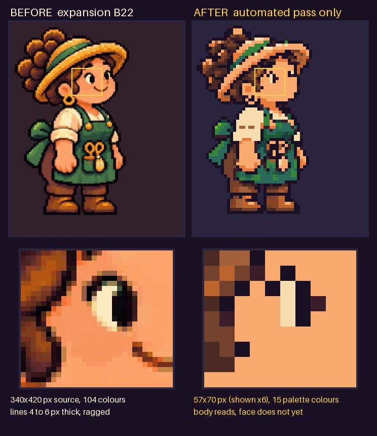
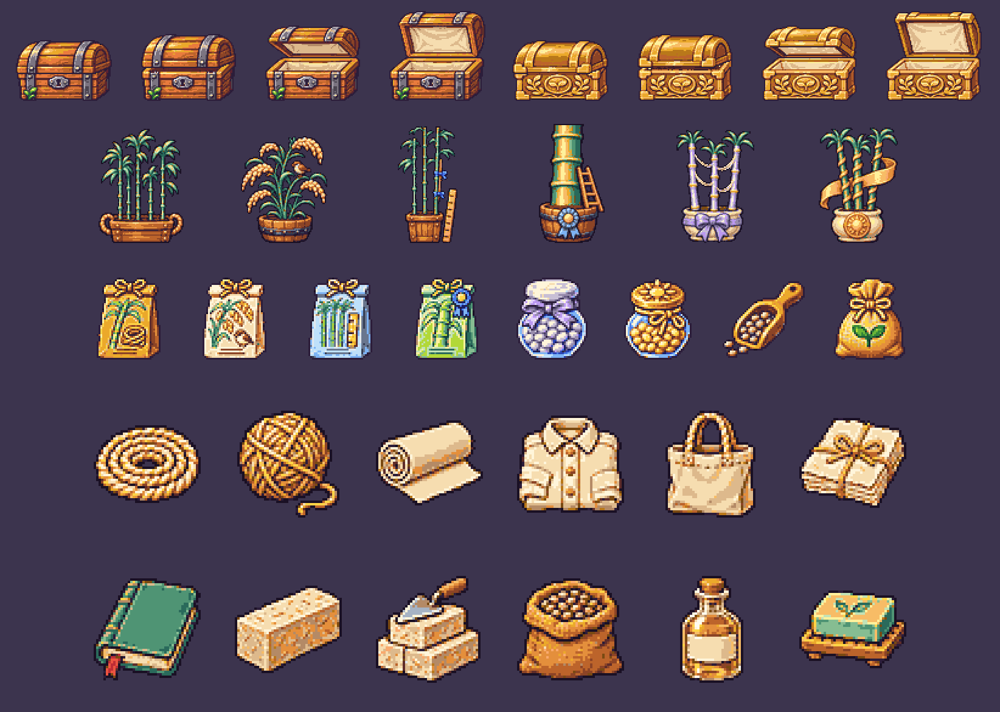
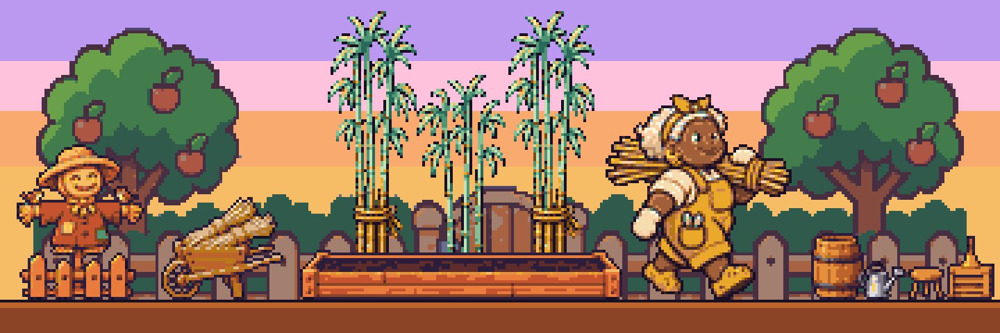

# Clean-up Route v1: from generated image to production sprite

Part of the [Style Bible](STYLE_BIBLE.md). Owner: Art Director.

Generated images look like pixel art but are not usable as game sprites. This page explains why, shows the route that fixes them, and proves it on real assets from the reference packs.

## Why the references cannot go into the game as they are

Measured on all 52 reference images:

| Problem | First pack | Expansion pack |
|---|---|---|
| No real pixel grid | No block size fits. "Pixels" are painted stair-steps 2 to 4 image pixels wide | Has a grid, but at 6 image pixels per art pixel and enlarged 2×, so it must be brought down to 1× |
| Too many colours | 217,000 to 1,050,000 per image | 104 to 192 per image, close to but not in our palette |
| Soft edges | Yes, everywhere | No |
| Dirty transparency | Yes (B8: only 0.02% fully opaque pixels) | Clean |
| Baked backgrounds and frames | Yes | No |

A sprite with soft edges and a private pixel size shimmers when it moves and never sits correctly next to another sprite. So everything goes through the same route.

## The route

1. **Cut out.** Remove the background. For a flat background, flood from the image border by colour similarity. For a transparent file, keep pixels that are at least half opaque.
2. **Find the sprite's own colours.** Group the image's colours into 12 to 40 families. This throws away paint noise while keeping the shading the artist intended.
3. **Put it on our grid.** Shrink to the size in the style bible's size table. Each art pixel takes the colour family that covers most of its cell. The tool tries nine grid positions and keeps the cleanest. Thin dark lines are protected so outlines and eyes do not vanish.
4. **Snap to the master palette.** Each family becomes its nearest master colour. A sprite can be limited to certain ramps (a mint plant may use `leaf`, `sage`, `clay`, `wood`, `gold`, `ink`, `white`) so that a yellow-green highlight cannot drift into `gold`.
5. **Finish.** Transparency becomes fully on or off. Stray single pixels are removed. A continuous 1 pixel `ink-1` outline is rebuilt.
6. **Hand polish.** An artist pass on the true-size sprite: fix jaggies, tidy clusters, check the light, set the pivot. Minutes for a prop, longer for a character.
7. **Review** against Gate B in the style bible.

Steps 1 to 5 are automatic. The working prototype is [`tools/cleanup_prototype.py`](tools/cleanup_prototype.py) (Python with numpy and Pillow only). It is a proof, not the final tool. The production version belongs to the content pipeline.

```text
python3 -I cleanup_prototype.py SRC.png OUT_PREFIX --box X0 Y0 X1 Y1 --factor 6
        [--k 16] [--ramps leaf,sage,clay,ink] [--bg auto|alpha|#RRGGBB] [--preview 4] [--no-outline]
```

Settings that worked: `--factor 6` for expansion-style images. For first-pack paintings, pick the factor from the target size (4.8 gave the 96 pixel card mint, 9.2 the 50 pixel in-world mint).

## Before and after

All three results below are the **automatic pass only**, with no hand polish, so you can see exactly what the tool does and does not do.

### 1. Mint plant from first-pack B9 (the hero example)


- Before: 460×485 pixels, **99,610 colours**, soft edges, baked blue-grey background.
- After: **96×101 pixels, 13 master colours**, hard edges, clean transparency, 1 pixel outline.
- True-size sprites: [`mint_card_96px.png`](cleanup/mint_card_96px.png) for cards and [`mint_world_50px.png`](cleanup/mint_world_50px.png) for the floor.
- Verdict: usable after a short hand polish (the water drops were dropped on purpose, the moss on the planter needs tidying).

### 2. A whole floor from the expansion pack (floor 01 v2)


- Before: 2160×720 pixels, 129 colours.
- After: **360×120 pixels, 28 master colours**: exactly one floor module.
- True-size sprite: [`floor01_360x120.png`](cleanup/floor01_360x120.png).
- Verdict: plants, planters, furniture and tools come out production-ready. **Faces do not.** At this size a face is about 10 pixels wide, and automatic clean-up loses the eyes and glasses.

### 3. A character from B22



- After: 57×70 pixels, 15 master colours.
- Verdict: the body, hat, apron and boots read well. The face does not yet.

Also proven: the B24 growth stages ([`growth_stages_400x120.png`](cleanup/growth_stages_400x120.png), 14 colours) and the floor shell (13 colours).

## First production images: Batch 1, round 4

The first images made from our own prompts (prompts 11 to 14: chests, hemp cards, seed packets, product icons) came back better than the reference packs.



- **They are already on a true grid.** Each sheet is an exact whole-number enlargement (4×, 6× or 8×) of true-size pixel art, with on-or-off transparency. The chest frames are 96×80, the card pictures sit in 108×100 windows and the icons in 48×48 windows, exactly as the prompts asked.
- **They arrived cut up.** The zip held the chest base and lids as separate parts, 32 and 16 pixel icon sheets, and a `slices.json` that names every region. All eight chest frames rebuild exactly from the parts.
- **So steps 1 to 3 of the route fall away for images like these.** What is left is step 4 (snap to the master palette, since none of their 32 to 47 colours per sheet is a master colour), step 5 (rebuild the ink outline) and the hand polish.
- **The palette snap needs two guards,** both now in the tool: each sprite is limited to the ramps it may use (hemp gets `sage` plus `leaf-5`), and greens, blues and purples stay in their own colour family. Without them an olive notebook cover turned tan and the silver-lilac canes turned grey.
- **Result:** 28 sprites, all inside their colour budgets (16 for icons, 24 for chests, 32 for cards). The tool is [`tools/clean_batch01_round4.py`](tools/clean_batch01_round4.py), the sprites are in the repo under `art/`, and before/after sheets are in [`cleanup/batch01_round4/`](cleanup/batch01_round4/).
- **Left for the hand polish:** thin the leaf tufts on the hemp cards toward the proportions in HEMP_ART.md, tidy speckle on the burlap and the building blocks, make the soap one colour family, and redraw the 16 pixel icons (the delivered ones are plain reductions).

If later rounds come back the same way, ask for the same package every time: the big sheet, the true-size parts and the slices file.

## The rest of Batch 1: rounds 1, 2, 3, 5 and 6

Thirteen more images (prompts 1 to 10 and 15 to 17) came back in the same package: an exact enlargement, true-size parts and a slices file. All thirteen passed Gate A and the hemp review with no redo. This time the parts were already cut at true size, so the pass is [`tools/clean_batch01_parts.py`](tools/clean_batch01_parts.py) on top of the shared steps in [`tools/cleanlib.py`](tools/cleanlib.py).



The picture is a mock-up, not a game screen: the Backyard Hemp Patch built only from cleaned sprites (veiled back wall, props, fibre hemp at two growth stages, the floor 3 worker).

What these rounds taught the route:

- **Thin strokes keep their colour.** The outline step used to ink every edge pixel, which swallowed hemp leaves, rosemary needles and twine. It now leaves strokes of one or two pixels alone. The hemp growth stages and Longstalk Hemp keep their generated outline altogether.
- **Hemp greens get a small lift.** The `sage` ramp is darker and stronger than the pale greens ChatGPT paints for hemp, so nearest-colour alone lands one step too dark. Green source colours are lifted a little in lightness before the snap. The canes stay as pale as the hemp chart.
- **Cut stalks are straw with a green cast:** `cream`, the quiet golds and the light end of `sage`. With the full `sage` and `wood` ramps the strands of a sheaf striped orange and teal.
- **Baked sparkles are removed.** The harvest-ready herbs came with four-point sparkles. The pass finds small bright warm shapes that sit in outline or empty space and deletes them, also when they touch a leaf. The game adds its own sparkle.
- **Planter and foliage are separate.** The herb frames are composed from one shared planter and a foliage layer per stage, so a planter can be swapped later.
- **Back walls need the wall veil.** The generated walls are dusty and quiet. Snapped to master colours they turn as loud as props, because the palette has no dusty mid-tones. The answer is in the style bible, section 13: walls are stored in plain master colours and shown a quarter of the way toward `stone-3`. Measured over the eight walls, that blend is close to the best fit between the snapped and the generated walls (the fit gives 18% of a colour next to `stone-4`; a quarter of `stone-3` is the same idea, one step darker, as the bible asks).
- **People stay on the skin ramp.** Warm lights on a face are nearer to the bright ends of `wood` and `clay` than to `skin`, so those ends are left out for people. A deep brown skin sits between `skin` and the dark golds and gets a rule of its own, or it turns khaki. Beige-grey hair goes to `ash` by hand-set colours.
- **Small accents are protected.** The budget step folds the least used colours away first, which are exactly the spectacles, the water drops and the rake tines. Each worker names the ramps that may not be folded away.
- **One colour map per character.** All nine frames of a worker, the shared head, the body layers and the props share one map, so no colour flickers between poses. Budget: 24 colours for the person, 32 with held props.

Result: 213 sprite files from these five rounds, 259 with round 4, every one in master colours and inside its budget. Before/after sheets are in `cleanup/batch01_round1/` to `batch01_round6/`.

Left for the hand polish: the list in [HANDOFF.md](HANDOFF.md).

## Batch 2, prompts 7 to 17

Eleven images came back in the same package and all passed Gate A and the hemp review with no redo. The pass is [`tools/clean_batch02.py`](tools/clean_batch02.py). It made 172 files: soap workshop props, the walls of floors 9 and 10, Pip, and 16 workers from eight two-worker sheets. Before/after sheets are in `cleanup/batch02/`.

What this batch taught the route:

- **Two workers on one sheet work.** The slices file names each frame's character, row and column, so the pass sorts the 18 frames into two people of nine. Sheets came back at three or four times true size; the characters stand 66 to 74 pixels tall, the same as Batch 1.
- **Muted purples need a rule.** Mauve and plum cloth (dungarees, a market dress, a twine cap) sits between `rose`, `lavender`, `stone` and the dark `clay` and `red` steps. Nearest-colour sent it to brown or wine red. A hue rule sends low-chroma red-purple to `rose-1`, `lavender-1`, `lavender-2` and the dark `stone` steps, and the brown ramps are taken off that worker.
- **Tin and steel grey get the same treatment.** Watering cans and buckets went teal or sage. A rule sends low-chroma blue-grey to `steel`.
- **Take ramps away, not only add them.** A worker's ramp list starts from the shared people set and can drop a ramp (written with a minus in front) when it pulls the wrong colour, for example `ash` on purple cloth or the light `clay` steps on a cap.
- **Feet on one line.** All nine frames of a worker move together so the idle feet rest on row 76, like Batch 1. If any pose would lose pixels at the frame edge, nothing moves and `frames.json` records the real feet line. 15 of the 16 workers are on 76; one is on 77.
- **Olive has no home.** The palette has no olive green, so olive clothes come out as brighter `leaf` green. Accepted for now; the colour is still clearly a green work jacket.

## Batch 2, round 7: the rarity reveal kit (prompts 18 to 23)

Lawson made the round twice and sent five zips. One zip held all six images; Lawson liked its chests and card frames best and left the rest to the Art Director. The emblems and bursts were taken from the same zip, because the emblems repeat the card frames' top ornaments and its bursts grow honestly in size from Common to Exotic (the other set drew every burst at about the same size). The same pass, `clean_batch02.py`, made 84 files. Before/after sheets, a mock-up of the frames with card pictures in them, and a line-up are in `cleanup/batch02/`.

- **Native sprites are exact now.** Every sheet in the chosen zip had a native copy that matches the big sheet pixel for pixel at a whole-number scale, with hard alpha. Nothing had to be resampled.
- **Per-step chest bases.** The new chests came with a base and a lid for each step, because the inside of the chest shades differently as the lid opens. `chests.json` now lets a step carry its own base; the Batch 1 chests keep one base each.
- **The new chests are a little smaller** than the Batch 1 chests (70 art pixels wide against 78). They were moved to stand on the same row and centre. One chest is shown at a time in the game, so this is accepted.
- **Dark teal pulls night blue.** The starlight chest's shaded side went green until only the two light `teal` steps were allowed.
- **Bursts lose their dark specks.** Specks of up to four pixels drawn only in outline colour read as dirt, so they are removed. Coloured motes stay.
- **The card picture fits the windows.** The windows are 118 to 130 pixels wide and 89 to 95 tall. Drawn at (36, 33), the 108×100 pictures sit centred and their pots tuck under the name ribbon. `frames.json` records each window.

## Batch 2, round 8: the World 1 managers (prompts 24 to 27)

Lawson sent all four manager sheets in one zip, with a native copy of each pose trimmed to its box and a `slices.json` that names the character and pose. `clean_batch02.py` (step `managers`) rebuilds each character on one canvas: each pose keeps its place across its column, and the row's lowest foot lands on the feet line, so jumps keep their height. Sheets 24 and 25 (floors 1 to 6) passed and made 24 frames; the redos of sheets 26 and 27 (floors 7 to 10) made 16 more. A line-up of all ten is `cleanup/batch02/batch02_p24_27_managers_lineup.png`. Before/after sheets are in `cleanup/batch02/`.

- **Managers need a bigger frame.** The characters came back 72 to 80 pixels tall and raise their items above their heads when they cheer, so they did not fit the workers' 80×80 frame. Managers use 96×96 with the feet on y 92.
- **The sheet shape sets the size.** Sheets 26 and 27 were asked for in 16:9 with two rows, and ChatGPT filled the taller rows with bigger people (101 to 114 pixels). The step refuses any character taller than the feet line, and the redo asks for the size of sheet 24 in words. Future manager sheets keep three rows on a 3:2 sheet, or say the pixel height.
- **Plum, olive and silver need rules.** The master palette has no plum and no olive. Plum knitwear went to the blue lavender ramp under the old `MAUVE` rule, so `PLUM` keeps strong dark red-purples on `rose-1`, `red-1`, `clay-1` and `wood-1`. Clementine Zest's plum coat had gone flat on `rose-1` alone under `MAUVE`; with `PLUM` it keeps three shades. Olive cloth went teal on `sage`, so `OLIVE` keeps it on the three dark `leaf` steps. Once the rose ramp was open, lilac-grey hair turned pink, so `SILVER` keeps pale, low-colour purples on `stone`, `ash` and the two lightest `lavender` steps, and `LILAC` keeps pink-purple flowers on `lavender`.
- **The redos fixed the size.** Asked for in words ("about 76 big square pixels tall", same sheet shape, more space around each character), ChatGPT drew all four characters at exactly 76 and said so in its README. Its `slices.json` came in a second layout (one sheet at the top level, the character only in the sprite name); `manager_sheets()` reads both, and a sheet's own package wins over the same sheet inside an earlier zip.
- **A khaki robe needs one ramp.** Old Moss's "sage-green" robe was painted khaki (hue about 100) and split three ways, to gold, cream and mint. `ROBE` keeps it on `leaf-1` to `leaf-3` and `sage-4`, `sage-5`, which share a hue near 145, so the robe reads as one jade green, a little cooler than the sheet.
- **Burlap is light wood.** Pale burlap went to bright `gold-4` until `wood-5` and `wood-6` were allowed.
- **Budget.** Every manager fits the 32-colour budget (22 to 31 colours).
- **Granny Evergreen's skin** was painted orange-tan; on the `skin` ramp (`skin-3`, `skin-4`) it reads as the warm brown the prompt asked for.

## Batch 3, images 1 to 12: the Loomington rooms, walls and back layers

Pass: `docs/art/tools/clean_batch03.py`. Review sheets, the floor mock-ups and the report are in `docs/art/cleanup/batch03/`.

- **The rooms came back on a finer pixel than the game grid.** The workers were 74 to 85 pixels tall where the bible asks for 64, and six of the seven sheets were 390 to 411 pixels wide for a 360 floor. Every room piece is brought to five sixths by dropping whole rows and columns (`cleanlib.fit_pixels`): one row in each stretch of six goes, the one that changes least, and two neighbouring rows never both go. Nothing is blended, so the result is still clean pixel art; shapes move by one pixel at most. Workers land at 62 to 71 pixels (the gift-box porter is the tallest because of his cap and boxes).
- **The pieces are laid out again on the floor:** feet on y 112, the first piece at x 20, the manager's seat ending at x 336, the tap target as near the middle as fits, the rest spread evenly. `floor.json` names the tap target and the manager's spot.
- **The walls came back 324×108.** They are brought to 336×104 the same way (twelve columns doubled, four rows dropped). The flat pale-blue sky of the rooftop and brickyard walls is cut out first by a flood fill from the top row.
- **The far skyline and the river came back 360×90 at one pixel per art pixel,** which is already the game grid, so they stay that size and repeat. The far layer keeps no outline (no ink in its ramps). The river's three empty columns at each end are filled from its own edge so that the water runs on.
- **Near-duplicate colours.** These exports carry runs like `#772b47`, `#782c48`, `#792d49`. Snapped one by one they fell on both sides of a palette boundary and showed as speckle (the emporium wallpaper). They are now folded into the most used of them before the snap.
- **New colour rules:** strong mustard yellow goes to `gold` (it sat nearer the pale `wood-6`); the dusty plum cloth of this batch goes to `lavender` (nearest colour put it on pink `rose-2` or grey); the brickyard mixer's orange vest is kept off the skin ramp (skin stops at chroma 0.14 for him); the tailor's khaki dress goes to `sage`, as the brief asked; the faded sprout on the kiosk wall goes to `sage` and `leaf`; the atelier's two stripe tones are kept apart (`stone-3` and `stone-4`); the periwinkle far city goes to `lavender` rather than the bright `sky-3`; the river keeps its lightest ripples on `sky-3`.
- **Budgets.** Props are held to 16 with the room's accent ramps kept (the emporium stand had lost its green sprouts and lavender tiers to the budget), workers to 24, and workers who hold a prop (sewing machine, wrapping counter, mint table, gift boxes) to 32. Walls use 13 to 21 colours, the back layers 17 and 18.
- **Gate B notes:** the tailor's hair picked up two sage pixels, faces were shrunk with the rest and get their fixed heads from the Face Kit, the kiosk wall's lit window reads pale gold, and the strips need a seam pass to loop perfectly.

## What this means for each asset class

| Class | Route | Hand work |
|---|---|---|
| Plants, planters, props, furniture | Generate, automatic clean-up | Light polish |
| Floor shell, shutter, back walls | Generate, automatic clean-up | Light polish, make edges tile |
| Chests, artifacts, product icons | Generate, automatic clean-up | Polish, redraw the 16 pixel versions |
| Character bodies | Generate, automatic clean-up | Medium polish per pose |
| **Character faces** | **Not from generation.** One head per character redrawn by hand, expressions from the shared Face Kit | Hand-built |
| Card frames | Generate for the design, rebuild on the grid as 9-slice pieces | Mostly hand-built |
| **UI kit, fonts, small icons** | **Not generated.** Built directly on the grid from the palette | Hand-built |
| Parallax backgrounds | Generate, automatic clean-up without outline, make tileable | Medium |
| Effects | Take the shapes from B29 and B19, rebuild as small particle sprites | Hand-built |

## Honest limits

- **Faces** fail the automatic pass. This is why the style bible uses one fixed head per character and a Face Kit.
- **Skin tones** can snap to `cream` instead of `skin` on very light faces. Character sprites get a ramp whitelist and a manual check.
- **Very small details** (glasses, jewellery, buttons) need hand placement.
- **First-pack images** lose more than expansion-style images because they start soft. New prompts therefore ask for the expansion style, which cleans up almost losslessly.
- The tool does not yet set pivots or make edges tile. Those are pipeline tasks. Splitting is no longer needed while images arrive with their parts cut.

## Acceptance numbers for the automatic pass

A cleaned sprite goes on to hand polish when:

- its size matches the size table exactly,
- every colour is a master palette colour,
- the colour count is within budget (16 for props and plants, 24 for actors, 32 for floors, cards and worker frames that hold a prop),
- transparency has only two values,
- the outline is closed.

If the count is over budget, lower the number of colour families or narrow the ramp whitelist and run again.

## Where files live

| Stage | Location |
|---|---|
| Raw generated images, exactly as downloaded | Project files, in a folder per batch (`art_raw/batch01/`). Not in git |
| Cleaned 1× sprites | Repo, under `art/<class>/` |
| Pivots and part lists | JSON next to the sprites |
| Atlases | Built by script at build time. Never committed |
| This proof | `docs/art/cleanup/` |
