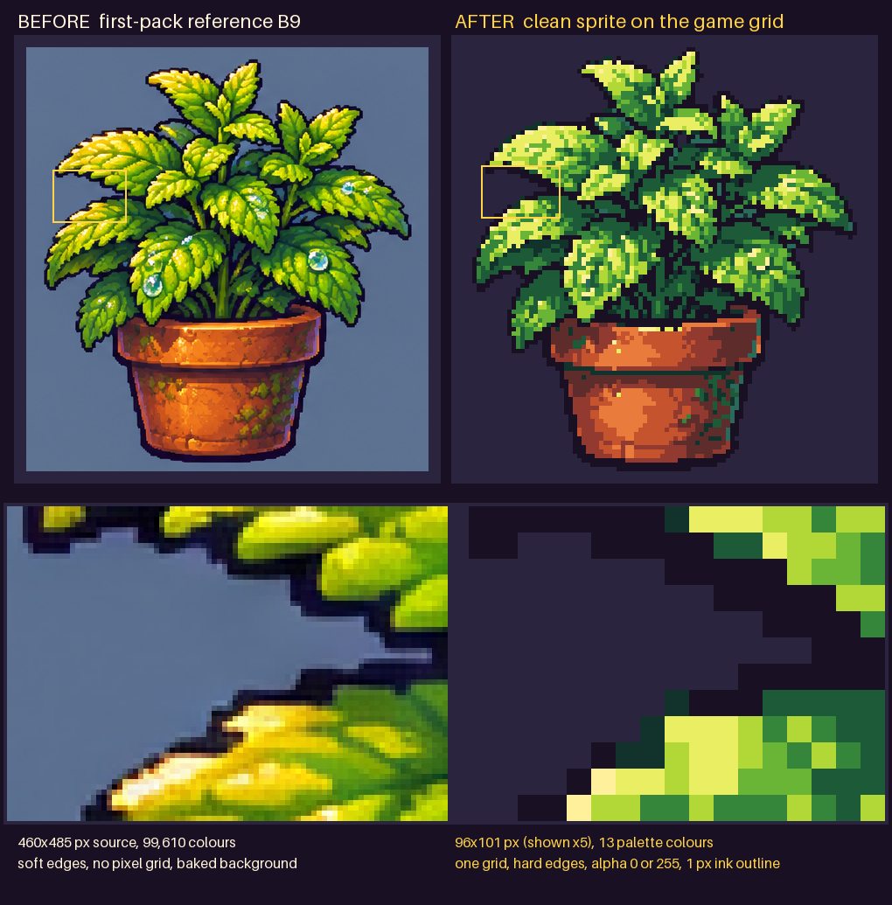
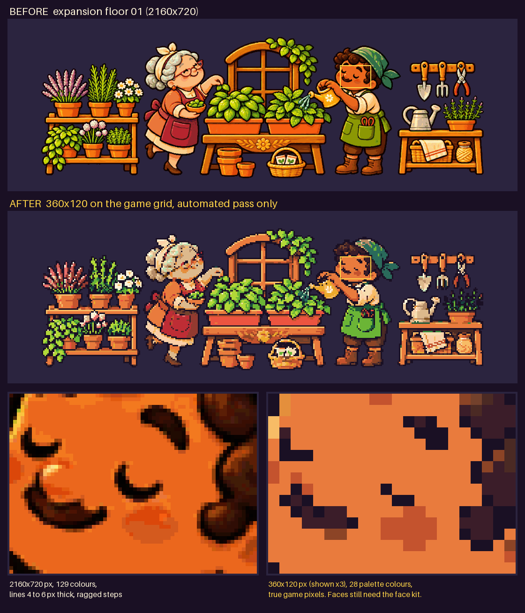

# Clean-up Route v1: from generated image to production sprite

Part of the [Style Bible](STYLE_BIBLE.md). Owner: Art Director.

Generated images look like pixel art but are not usable as game sprites. This page explains why, shows the route that fixes them, and proves it on real assets from the reference packs.

## Why the references cannot go into the game as they are

Measured on all 52 reference images:

| Problem | First pack | Expansion pack |
|---|---|---|
| No real pixel grid | No block size fits. "Pixels" are painted stair-steps 2 to 4 image pixels wide | Has a grid, but at 6 image pixels per art pixel and enlarged 2×, so it must be brought down to 1× |
| Too many colours | 217,000 to 1,050,000 per image | 104 to 192 per image, close to but not in our palette |
| Soft edges | Yes, everywhere | No |
| Dirty transparency | Yes (B8: only 0.02% fully opaque pixels) | Clean |
| Baked backgrounds and frames | Yes | No |

A sprite with soft edges and a private pixel size shimmers when it moves and never sits correctly next to another sprite. So everything goes through the same route.

## The route

1. **Cut out.** Remove the background. For a flat background, flood from the image border by colour similarity. For a transparent file, keep pixels that are at least half opaque.
2. **Find the sprite's own colours.** Group the image's colours into 12 to 40 families. This throws away paint noise while keeping the shading the artist intended.
3. **Put it on our grid.** Shrink to the size in the style bible's size table. Each art pixel takes the colour family that covers most of its cell. The tool tries nine grid positions and keeps the cleanest. Thin dark lines are protected so outlines and eyes do not vanish.
4. **Snap to the master palette.** Each family becomes its nearest master colour. A sprite can be limited to certain ramps (a mint plant may use `leaf`, `sage`, `clay`, `wood`, `gold`, `ink`, `white`) so that a yellow-green highlight cannot drift into `gold`.
5. **Finish.** Transparency becomes fully on or off. Stray single pixels are removed. A continuous 1 pixel `ink-1` outline is rebuilt.
6. **Hand polish.** An artist pass on the true-size sprite: fix jaggies, tidy clusters, check the light, set the pivot. Minutes for a prop, longer for a character.
7. **Review** against Gate B in the style bible.

Steps 1 to 5 are automatic. The working prototype is [`tools/cleanup_prototype.py`](tools/cleanup_prototype.py) (Python with numpy and Pillow only). It is a proof, not the final tool. The production version belongs to the content pipeline.

```text
python3 -I cleanup_prototype.py SRC.png OUT_PREFIX --box X0 Y0 X1 Y1 --factor 6
        [--k 16] [--ramps leaf,sage,clay,ink] [--bg auto|alpha|#RRGGBB] [--preview 4] [--no-outline]
```

Settings that worked: `--factor 6` for expansion-style images. For first-pack paintings, pick the factor from the target size (4.8 gave the 96 pixel card mint, 9.2 the 50 pixel in-world mint).

## Before and after

All three results below are the **automatic pass only**, with no hand polish, so you can see exactly what the tool does and does not do.

### 1. Mint plant from first-pack B9 (the hero example)



- Before: 460×485 pixels, **99,610 colours**, soft edges, baked blue-grey background.
- After: **96×101 pixels, 13 master colours**, hard edges, clean transparency, 1 pixel outline.
- True-size sprites: [`mint_card_96px.png`](cleanup/mint_card_96px.png) for cards and [`mint_world_50px.png`](cleanup/mint_world_50px.png) for the floor.
- Verdict: usable after a short hand polish (the water drops were dropped on purpose, the moss on the planter needs tidying).

### 2. A whole floor from the expansion pack (floor 01 v2)



- Before: 2160×720 pixels, 129 colours.
- After: **360×120 pixels, 28 master colours**: exactly one floor module.
- True-size sprite: [`floor01_360x120.png`](cleanup/floor01_360x120.png).
- Verdict: plants, planters, furniture and tools come out production-ready. **Faces do not.** At this size a face is about 10 pixels wide, and automatic clean-up loses the eyes and glasses.

### 3. A character from B22


- After: 57×70 pixels, 15 master colours.
- Verdict: the body, hat, apron and boots read well. The face does not yet.

Also proven: the B24 growth stages ([`growth_stages_400x120.png`](cleanup/growth_stages_400x120.png), 14 colours) and the floor shell (13 colours).

## What this means for each asset class

| Class | Route | Hand work |
|---|---|---|
| Plants, planters, props, furniture | Generate, automatic clean-up | Light polish |
| Floor shell, shutter, back walls | Generate, automatic clean-up | Light polish, make edges tile |
| Chests, artifacts, product icons | Generate, automatic clean-up | Polish, redraw the 16 pixel versions |
| Character bodies | Generate, automatic clean-up | Medium polish per pose |
| **Character faces** | **Not from generation.** One head per character redrawn by hand, expressions from the shared Face Kit | Hand-built |
| Card frames | Generate for the design, rebuild on the grid as 9-slice pieces | Mostly hand-built |
| **UI kit, fonts, small icons** | **Not generated.** Built directly on the grid from the palette | Hand-built |
| Parallax backgrounds | Generate, automatic clean-up without outline, make tileable | Medium |
| Effects | Take the shapes from B29 and B19, rebuild as small particle sprites | Hand-built |

## Honest limits

- **Faces** fail the automatic pass. This is why the style bible uses one fixed head per character and a Face Kit.
- **Skin tones** can snap to `cream` instead of `skin` on very light faces. Character sprites get a ramp whitelist and a manual check.
- **Very small details** (glasses, jewellery, buttons) need hand placement.
- **First-pack images** lose more than expansion-style images because they start soft. New prompts therefore ask for the expansion style, which cleans up almost losslessly.
- The tool does not yet split a sheet into separate sprites, set pivots or make edges tile. Those are pipeline tasks.

## Acceptance numbers for the automatic pass

A cleaned sprite goes on to hand polish when:

- its size matches the size table exactly,
- every colour is a master palette colour,
- the colour count is within budget (16 for props and plants, 24 for actors, 32 for floors and cards),
- transparency has only two values,
- the outline is closed.

If the count is over budget, lower the number of colour families or narrow the ramp whitelist and run again.

## Where files live

| Stage | Location |
|---|---|
| Raw generated images, exactly as downloaded | Project files, in a folder per batch (`art_raw/batch01/`). Not in git |
| Cleaned 1× sprites | Repo, under `art/<class>/` |
| Pivots and part lists | JSON next to the sprites |
| Atlases | Built by script at build time. Never committed |
| This proof | `docs/art/cleanup/` |
