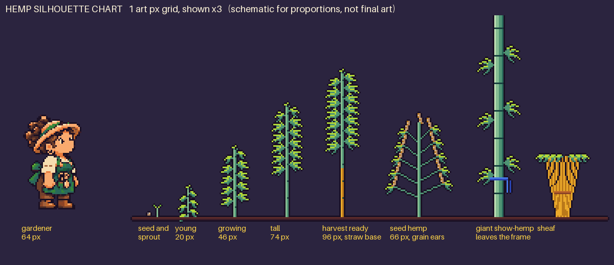

# Hemp Art Definition v1

Part of the [Style Bible](STYLE_BIBLE.md). Owner: Art Director.

Sprout Tower includes **legal industrial hemp** as a farm crop and as a material for products. This page fixes exactly how it is drawn, so that it always reads as a tall, leafy agricultural plant and never as drug imagery. It applies to sprites, cards, icons, backgrounds, UI, the logo and marketing art.

## The rule in one line

> **A tall field crop that becomes rope, cloth, paper and building blocks. Drawn like bamboo or tall corn: a cane first, leaves second.**

If a player who has never heard of hemp looks at it, they should think "some kind of tall farm crop, like bamboo or corn". That is the target.

## The chart



The chart is a proportion guide on the real art-pixel grid (shown at 3×), not final art. The gardener on the left is the 64 pixel adult.

## How the plant is built

| Part | Rule |
|---|---|
| **Silhouette** | Stalk-dominant. Fibre hemp is at least three times as tall as it is wide: 96 pixels tall next to a 64 pixel gardener, with a canopy no wider than 30 pixels |
| **Whole plants only** | Always the whole plant from the ground up, in clumps or rows of 3 to 7 canes. Never a cropped top, never a single leaf |
| **Cane** | Straight and slim, 2 pixels wide, with ringed joints every 10 to 12 pixels, like bamboo. Colour `sage-3` with a `sage-4` lit side |
| **Lower half** | Bare. The bottom 40 to 50% of the cane has no leaves. This is what makes it read as a cane crop |
| **Leaves** | Small drooping groups of 3 to 5 narrow leaflets, seen from the side or three-quarter view and overlapping each other. Each group is at most 10 pixels, no more than one ninth of the plant's height. Colour `sage-2` and `sage-3` with `leaf-5` tips |
| **Top** | A slim leafy tuft, the same leaf shapes getting smaller. Nothing dense, nothing chunky |
| **Ripening** | At harvest the cane turns straw-gold (`gold-3`, `gold-2`) from the base upward. Gold stalk means ready |
| **Ground** | A soil mound, a field row or a long wooden planter trough. Not a small round pot |
| **Colour** | `sage` and `gold` ramps, with a little `leaf-5` on tips. Never neon green, never purple or black foliage |

### Varieties

| Variety | Look | Read |
|---|---|---|
| **Fibre hemp** | The standard above. 32×96, clump of three canes | "Bamboo-like fibre crop" |
| **Seed hemp** | Shorter (about 66 tall) and branchier, with slim hanging grain ears: cream and tan husks with small round seeds, like oats or millet. Sparrows love it | "Grain crop" |
| **Giant show-hemp** | A comic super-cane as thick as bamboo (6 pixels) that pokes through the ceiling into the floor above. It grows in a half-barrel, wears a blue first-prize ribbon and has a ladder and a tape measure next to it | "County fair champion" |
| **Magical varieties** (three placeholders: golden-thread, moon-silver, star-loom) | The magic lives in the **stalk and the fibre**: golden thread spiralling round the cane, silver-blue canes with a crescent on the planter, star-shaped joints with fibre drifting up like ribbon. The tops stay plain | "Enchanted rope plant" |

Names of the magical varieties belong to the Game Designer and may change. The looks do not depend on the names.

### Growth stages

Five stages, sizes true to each other:

1. **Seed:** a soil mound with a few round seeds.
2. **Sprout:** tiny two-leaf seedlings, about as tall as the mound.
3. **Young:** thin canes about 20 pixels tall with a few small leaves.
4. **Tall:** about 74 pixels, leaf groups in the upper half.
5. **Harvest-ready:** 96 pixels, straw-gold base, a twist of rope tied round the clump.

The chart also shows a 46 pixel in-between step. It is there for proportion and can become a sixth stage if the design wants one.

## Harvest and products

This is where hemp gets its charm. The crop is plain on purpose. The products are the fun part.

| Stage | Art |
|---|---|
| Harvest | Tied sheaf, stook (sheaves leaning together), round bale with twine, loaded farm cart |
| Processing | Drying rack with pale golden bundles, hank of combed blond fibre (looks like a straw ponytail) |
| Rope | Rope coil, twine ball, rope-walk spinning wheel twisting three strands |
| Cloth | Loom with half-woven canvas, canvas bolt, sack, shirt, tote bag |
| Paper | Vat, mould frame, drying sheets on a line, paper ream, notebook |
| Building | Hempcrete block (pale, speckled), block stack, small wall with a trowel |
| Seed | Seed sack, toasted seed snack bowl, golden seed-oil bottle with a cork (a kitchen bottle) |
| Care | Soap bar with a pressed sprout mark, lotion jar with a wooden lid |

### Planned hemp floors

These are art plans by floor type. The Game Designer decides which exist, their order and their names.

| Floor type | Tap target | Cast | Key props |
|---|---|---|---|
| **Hemp Field** | The crop row itself | Hemp farmer, field hand | Rail fence, stook, cart, scarecrow with sparrows, water barrel |
| **Rope and Textile Mill** | Rope-walk wheel | Ropemaker, weaver | Loom, canvas bolts, rope coils, fibre baskets |
| **Paper Workshop** | Paper vat and mould | Papermaker, apprentice | Drying line, press, paper stacks, notebooks |
| **Hempcrete Builder** | Block mould and mixing trough | Mason, hod carrier | Block stacks, half-built wall, trowels, wheelbarrow |
| **Seed Press and Pantry** | Wooden screw press | Press-keeper, baker | Seed sacks, oil bottles, snack bowls, sparrows |
| **Soap and Lotion Kitchen** | Soap moulds on a bench | Soapmaker, packer | Kettle with white steam, soap racks, ribbon and boxes |

### Cards and packets

- **Plant cards** show a clump of whole canes in a wide planter. The cane is the hero.
- **Seed packets** show the whole cane plant plus a rope coil or a sheaf. Never a lone leaf.
- **Product icons** carry a rope knot or the two-leaf sprout as their mark.

### The hemp cast

Farmer, ropemaker, weaver, papermaker, mason, press-keeper. They are **brisk, proud and bright-eyed**: skilled trades people who love their craft. Humour comes from pride, competition and scale (the giant cane, the endless rope, the sparrows stealing seed).

Not on hemp floors: the B5 beach-shirt manager, the B21 sleepy night-shift manager, or any character whose joke is being drowsy, dazed or "chill".

## The never list

None of these appears anywhere in the game, its text or its art.

**Smoke and fire**

- No smoke, burning or embers near hemp. Steam is white, and only from a visible kettle or vat.
- Flames appear only on stoves and ember herbs, on non-hemp floors.

**Use**

- Nothing held to a mouth or nose on hemp floors. (The B28 customer and the floor 09 perfumer sniff herbs. That stays on herb floors.)
- No pipes, rolling papers, lighters, grinders, small bags, pill bottles, droppers, syringes, or lab glassware with green liquid.
- No scales weighing plant matter and no jars of dried green material on hemp floors.

**The leaf**

- No lone fan leaf as an icon, emblem, pattern, logo, badge or decoration. Ever.
- No flat, frontal fan with seven or more fingers, even on a whole plant. Leaf groups are small, side-on and overlapping.
- The only plant emblem in the game is the two-leaf sprout.

**Plant close-ups**

- No close-ups of plant tops.
- No frost, resin, crystals, sparkle dust or hairs on the tops. Magic goes in the stalk and fibre.

**Setting**

- No hemp in small pots under purple grow lamps, in tents or in foil-lined rooms. Hemp grows outdoors in rows or in big planters in daylight.
- No medical or green-cross symbols.

**Tone**

- No number jokes, slang or winks.
- No tie-dye, "chill" stereotypes or red, gold and green stripe sets.
- No neon or acid green, no purple-black foliage.

**Information**

- No real cultivation instructions. Growing is a cartoon: seed, water, sunshine, harvest.

## Five-question review

Every hemp asset is checked with these five questions. All five must be "yes".

1. **Squint test:** is the cane the first thing you see, before any leaf?
2. **Mistaken identity:** could someone take it for bamboo, corn or another tall field crop?
3. **Clean frame:** is there no lone leaf, no close-up of a top, no smoke, and nothing near a face?
4. **Context:** is there a farm or workshop prop in the frame (fence, rope, cart, loom, tool)?
5. **Colour:** is the plant drawn only in `sage`, `gold` and a little `leaf-5`?

## The fixed prompt guards

Every image prompt that shows a hemp **plant** includes this, word for word:

```text
HEMP LOOK: industrial fibre hemp drawn as a tall farm crop, like bamboo or tall corn: a straight slim green cane with ringed joints, bare in its lower half, with small drooping groups of 3 to 5 narrow leaflets seen from the side in the upper half and a slim leafy tuft on top. Whole plants only, in farm context. No flower buds, no close-up of plant tops, no single fan-shaped leaf shown alone or used as an emblem, no smoke, no jars of dried leaves, nothing held to a face.
```

Every image prompt that shows hemp **products or harvested stalks** but no living plant includes this one instead:

```text
HEMP PRODUCTS: everything here is made from industrial hemp fibre and seed, shown as plain farm and workshop goods. Harvested stalks are long, straight and pale, like thin bamboo canes or straw. Any mark on a product is a rope knot or a simple two-leaf sprout. No fan-shaped leaf anywhere as an emblem, pattern or decoration, no plant close-ups, no smoke, no jars of dried leaves, nothing held to a face.
```

## Already in the references, to fix

- **B11 compass lid:** many-fingered fan-leaf emblem. Replace with the two-leaf sprout.
- **B12 purple plus token:** reads as a medical cross. Redesign as a gem or seed.
- **B29:** flame row stays away from hemp. Baked "+$" is removed.
