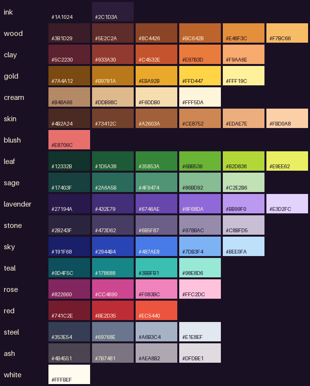
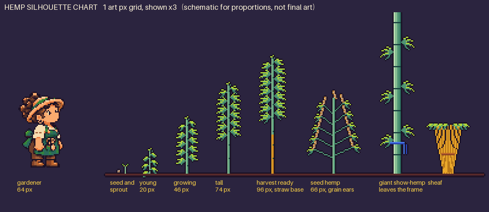

# Sprout Tower Style Bible v1

Status: v1.5, Phase 0. Owner: Art Director. Applies to every sprite, background, UI piece, icon, effect and marketing image in the game.

This is the single source of truth for how Sprout Tower looks. If an asset and this document disagree, the asset is wrong, or this document gets a new version. Nobody "interprets around" it.

Companion pages:

- [HEMP_ART.md](HEMP_ART.md): the exact look of hemp, the planned hemp art, and the never list.
- [CLEANUP_ROUTE.md](CLEANUP_ROUTE.md): how a generated image becomes a production sprite, with real before/after results.
- [ASSET_BATCH_01.md](ASSET_BATCH_01.md): the first numbered prompt batch.
- [BATCH_PLAN.md](BATCH_PLAN.md): what each later batch holds, up to a four-world launch.
- [palette/](palette/): the locked master palette in four file formats.

---

## 1. The direction in one minute

**HD pixel art, warm golden hour, cozy purples and greens, chunky cheerful characters.** A tall, friendly tower of little rooms where people grow herbs and industrial hemp and turn them into nice things. It should feel like a warm window at dusk: you want to step inside.

The style is settled. The B1 key art is the mood anchor. The expansion pack (B20 to B29 and the "v2" floors) is the rendering anchor.

### Five pillars

| # | Pillar | What it means in practice |
|---|---|---|
| 1 | **Golden hour, always warm** | One sun, low and golden, from the upper left. Shadows lean purple, highlights lean yellow. Even night and the Moon keep a warm lamp in frame. |
| 2 | **Chunky and readable** | Big heads, big hands, squat rounded props. Everything passes the silhouette test at 100% size. |
| 3 | **One grid, one palette, no exceptions** | Every sprite is drawn on the same 640×360 art-pixel grid and uses only the 76 master colours. No mixed pixel sizes, no stray colours, no soft edges. |
| 4 | **Alive** | Nothing is a still picture. Rooms are built from separate parts so plants sway, workers move, lamps flicker and coins bounce. |
| 5 | **A farm, not a pharmacy** | Hemp is a tall field crop that becomes rope, cloth, paper and building blocks. Herbs are kitchen and garden herbs. Nothing on screen could be mistaken for drug imagery. |

### Why these choices

- **Rendering follows the expansion pack** (flat cel shading, 3 to 4 tones per material, bold dark outline, transparent backgrounds, a different cast on every floor). It is cleaner, it animates, and it is what a small team can keep consistent across hundreds of assets.
- **Mood, light and colour follow the first pack** (B1 key art and the B2 lighting board). That is where the golden hour and the purple and green warmth live.
- Where the two packs overlap, **the expansion pack wins**. The first-pack floors, managers and workers are mood reference only.

---

## 2. What the reference packs taught us

Both packs were measured, not just looked at. The numbers below drive the rest of this document.

| Finding | First pack (B1 to B19, 29 images) | Expansion pack (B20 to B29 and v2 floors, 23 images) |
|---|---|---|
| Real pixel grid | **None.** No block size explains the image better than any other (best fit only 1 to 3% better). The "pixels" are painted stair-steps 2 to 4 image pixels wide. | **Yes.** Every image is an exact 2× enlargement, and the visible art pixel is about **6 image pixels**. |
| Colours per image | 217,000 to 1,050,000 | 104 to 192 |
| Edges | Soft, blended, anti-aliased | Hard |
| Transparency | B8 "transparent" file is dirty: only 0.02% of pixels are fully opaque, 13.5% are a faint haze | Clean on-or-off transparency |
| Floors | Full painted scenes with a baked frame, baked sky and the same three gardeners on every floor | Props and two unique workers on a transparent background, 2160×720, which is exactly **360×120 art pixels at 6×** |
| Sky | Inconsistent (floor 02 sunset, floors 03 and 05 blue midday) | Not baked in |
| Use in production | Mood, light, palette, card frames, chests, artifacts, currencies, world backgrounds after clean-up | Direct base for production sprites after clean-up |

Things found in the references that production must fix:

- **B11 compass lid** carries a many-fingered fan-leaf emblem. Replace with the two-leaf sprout. See the never list in HEMP_ART.md.
- **B12** has a purple "plus" token that can read as a medical cross. Redesign as a gem or a seed. Its blue flask (the research currency, now called Insight) becomes a lightbulb with a sprout inside, so nothing reads as extraction.
- **B5 botanist** carries test tubes in the coat pocket. In the redraw they become plant labels and a pencil.
- **B21 cook** grinds in a mortar and **B21 tea master** holds a steaming cup. No manager sprite shows a mortar or drawn steam (section 10), so the cook's sprite carries a ladle and a copper pan instead, and the tea master's cup has no drawn steam (steam is a game effect, off on hemp floors).
- **B11 pruners** carry a purple leaf with five pointed lobes. It becomes a rounded bramble leaf.
- **B11 mortar** is redrawn as the **Moonstone Birdbath**: a stone bowl of moonlit water on a short pedestal, with a moonstone set in the rim and no pestle. A mortar read badly beside hemp, so no heirloom shows one.
- **B29** bakes "+$" into the art and includes a flame row. Text and currency signs are drawn by the game. Flames are for stoves and ember herbs only.
- **B5 beach-shirt manager** (Sandy Tidewell) and **B21 sleepy night-shift manager** (Barnaby Moonwort) are fine characters. Each manages an herb floor (design 0.3), so they never appear in a hemp room.
- **B28 customer and the floor 09 perfumer** sniff herbs. Fine on herb floors, never on hemp floors.
- **v2 floor 03** becomes the Backyard Hemp Patch. Its two gardeners stay. Its side shelf (jars, hanging dried bunches) and work table (mortar and pestle) are replaced with hemp-patch props, because those items are on the hemp never list.
- **v2 floor 09** becomes the Soap and Scent Workshop. Its copper still with a flame and its lab flasks are replaced with a soap kettle, moulds and drying racks, so nothing reads as a laboratory.
- **v2 floor 08** (spice kitchen) moves to World 2. World 1 floor 8 is the new Ropewalk and Twine Shop.
- **B27** is named `world4_moon_greenhouse`. In the game design document the Moon is world 5.

---

## 3. Canvas and pixel scale

One rule: **every art pixel in the game is the same size on screen.** The game renders a 640×360 art-pixel canvas and scales it by a whole number (3× at 1080p, 4× at 1440p, 6× at 4K). Ultrawide screens show a wider view, never a stretched one.

- No sprite is ever scaled by a non-whole number, rotated more than a few degrees, or shown at a "zoomed" size next to normal sprites.
- No full-screen illustrations at another pixel scale. The title screen, chest opening and world map are composed from in-game sprites. B1 stays as marketing art.

### Size table (art pixels)

| Asset class | Size | Notes |
|---|---|---|
| Screen | 640×360 | Three floors fill the height |
| Floor module | 360×120 | Includes the shell. Shell, locked shutter, construction scene, contents and back wall all overlay 1:1 |
| Floor shell | beams 8 tall (top and bottom), posts about 12 wide | Interior about 336×104 |
| Floor content zone | x 20 to 340, floor line at y 112 | Feet and planter bases sit on y 112 |
| Room back wall | 336×104 | Opaque, quiet, sits behind everything |
| Adult actor | 64 tall on an 80×80 canvas | Feet baseline y 76. Children 44 to 52 tall |
| Manager | 72 to 80 tall on a 96×96 canvas | Feet baseline y 92. Placed so the feet sit on the floor line like a worker's |
| Manager portrait | 48×48 bust | Cut from the actor's head and shoulders, redrawn |
| Herb in a planter | up to 48×60 | Planter about 32 wide |
| Fibre hemp | 32×96 per clump | Taller than a person on purpose |
| Seed hemp | about 48×66 to 72 | |
| Giant show-hemp | cane 6 thick, spans floors | Base, tileable middle, top |
| Small prop | 16 to 32 | Tools, planters, jars, baskets |
| Furniture | 48 to 96 wide | Benches, shelves, stalls |
| Chest | 96×80 hero, 32×32 icon | Closed, ajar, open |
| Large card | 180×240 | Art window about 108×100 |
| Small grid card | 64×88 | 48×48 picture |
| Icons | 16, 24, 32, 48 | Drawn separately at each size, never scaled |
| Artifact icon | 48×48 | |
| UI panel 9-slice | corner 8 | |
| Buttons | 16, 20 or 24 tall | Smallest click target 16×16 |
| Parallax strip | 320 to 360 tall, 640 or wider | Tiles left to right |
| Particles | 3×3 to 9×9 | On the grid |

### What the engine needs from art

- Transparent PNGs, drawn at 1×, sampled nearest-neighbour. Transparency is fully on or fully off.
- Actors arrive as parts: body pose frames, one head, face pieces, held tools (section 10).
- Plants arrive as foliage and planter separately, with the pivot at the soil line, so the game can sway the foliage.
- Every sprite has a pivot (feet for actors, base centre for props). Pivots live in JSON next to the sprite.
- Cleaned sprites go in the repo under `art/` by class: `floors/`, `actors/`, `plants/`, `props/`, `cards/`, `icons/`, `ui/`, `vfx/`, `bg/`. File names are lowercase snake case: `class_subject_variant_state_frame.png`, for example `plant_mint_stage3.png`, `actor_gardener01_walk_2.png`.
- Raw generated images stay in project files, never in git. Atlases are built by script and never committed.

---

## 4. Shape language

- **Characters are 2.3 to 2.6 heads tall.** Head about 26 of the 64 pixels. Round bodies, short legs, big mitten hands, small feet.
- **Props are squat and rounded.** Corners are cut by 1 to 2 pixels. No straight edge runs longer than 24 pixels without a break such as a chip, knot, rivet or leaf.
- **Big, medium, small.** Each sprite has one big mass, two or three medium shapes and a few small accents. Even detail everywhere reads as noise.
- **Silhouette test.** Fill the sprite with one dark colour at 100% size. If you cannot name it, simplify it.
- **View.** Rooms and actors are seen straight from the side, like a dollhouse. Planters, baskets, chests and icons are seen from slightly above so the rim shows.
- **Smallest readable feature is 2 pixels.** Single pixels are for sparkles and eye glints only.
- **Curves step in even runs** (for example 3, 2, 1, 1, 2, 3). A lone single-pixel step in a long run is a jaggy and gets fixed.

---

## 5. Line

- **Outline:** 1 pixel, colour `ink-1` `#1A1024`, around every in-world sprite (actors, props, plants, shell).
- **Inner lines** use the darkest step of that material's own ramp (for example `wood-1` for board seams). Ink is used inside a sprite only where two different objects overlap.
- **Lit edges (optional, large sprites only):** on the upper-left edge the outline may lighten to `ink-2` or the ramp's darkest step.
- **Depth:** far background layers have no outline. Middle layers use `stone-1`. The play layer uses `ink-1`.
- **UI:** 1 pixel ink outline plus a 1 pixel inner bevel.
- **No anti-aliasing against transparency.** Inside a sprite, a single in-between pixel from the same ramp may smooth a large curve. Use it rarely.
- **Shadows are not drawn into sprites.** The game draws the contact shadow.

---

## 6. Rendering

- **Flat cel shading.** 3 tones for sprites under 32 pixels, 4 to 5 for large ones.
- **Ramps are hue-shifted.** Each ramp gets cooler and more purple as it darkens and warmer and yellower as it lightens. This is where the golden-hour feeling comes from.
- **No gradients, no dithering, no noise.** The sky is the one exception and it uses flat bands (section 14).
- **Colour budgets:** up to 16 colours for a prop or plant, 24 for an actor, 32 for a whole floor or card. A worker frame that holds a prop may reach 32: 24 for the person and the rest for the prop.
- **No pillow shading.** Shade follows the light direction, never the outline.
- **Highlights:** one specular tick of 1 to 3 pixels on glossy things only (glass, glazed planters, metal, eyes).
- **Texture:** at most 2 to 4 texture marks per 16×16 area (grain dashes, stone specks), in the neighbouring ramp step.

---

## 7. Lighting

- **Key light:** golden, from the upper left at about 10 o'clock, in every world. The direction never changes, so any sprite works in any room.
- **Fill:** purple, from the lower right.
- **Lamps:** the lamp sprite is hard-edged. The game adds a warm pool of light around it.
- **Waiting rooms dim.** A floor waiting for a tap is about 25% darker and cooler. It warms up the moment it runs.
- **Soft light is allowed in exactly three places**, all made by the game and never drawn into sprites: lamp pools, window light shafts, and the bloom behind a rare drop.

### Mood per world

World names are from the game design document. Worlds 1 to 4 ship at launch. Worlds 5 and 6 follow later.

| World | Time and mood | Dominant ramps | Accent | Art so far |
|---|---|---|---|---|
| 1 Thymeford, home town | Golden hour, always | wood, clay, gold, leaf, lavender | rose clouds | B3, B26, floors, cast |
| 2 Loomington, hemp-industry city | Blue night, lit windows | sky, stone, lavender | gold windows, a little teal | B17 background only |
| 3 Papaya Cay, island | Bright late afternoon | teal, sky, leaf, cream sand | rose and red flowers | B18 background only |
| 4 Mount Mitten, winter | Snowy dusk, cabin lamps | sky, steel, lavender, with `white` and `sky-5` snow | gold lamps, red scarves | none. A launch world, so its look is fixed below |
| 5 The Moon | Earthlight outside, warm lamps inside | stone, steel, sky | teal glass, gold lamps | B27 background only |
| 6 Nebula Nursery | Deep space, glowing nebula bands | ink, lavender, rose, teal | gold lamps, white stars | none |

Every world uses the same 76 colours. A world chooses which five or six ramps cover most of the screen. If a world truly needs a new colour, the palette gets a new version, with at most 8 added colours per world.

### Mount Mitten, the one launch world with no reference image

- **The mountain is a mitten.** One rounded peak with a smaller thumb-shaped peak beside it. That outline is the world's signature and its icon.
- **A cabin village at dusk.** Log cabins with thick snow caps, pine trees, lamp posts and a string of lanterns up the slope. Every cabin has a lit gold window, so pillar 1 holds: the cold is outside and the warmth is one window away.
- **Snow is clean and bright.** `white` and `sky-5` on top, `sky-4` and `lavender-5` in shadow. Never grey, never dirty. Snow lies on roofs, fences, the tower shell and the street. It never falls inside a room and never lies on a plant.
- **Sky bands,** horizon upward: a thin `gold-4` band, `rose-3`, `lavender-3`, `sky-2`, `sky-1`, `ink-2`, then stars. The Aurora Garden's lights are two or three flat ribbons in `teal` and `lavender`, drawn by the game like the sky bands. No glow, no gradient.
- **The cast wears knitwear.** Scarves, bobble hats, mittens and thick socks, with red as the accent. Faces stay bright and awake.
- **Hearth Heat is a gauge, not a bonfire.** The world's warmth rule is shown by a mitten-shaped meter in the HUD that fills with `gold`. As it fills, the game warms the window light and thins the snow caps on the shell in three steps.
- **Fire stays in its place.** A flame is drawn only in a hearth or a closed stove, and only in the herb rooms (Hearthside Herb Racks, Fireside Tea Lodge, Summit Lodge). The two hemp rooms (Hemp Knitworks, Sled Works) are warmed by lamps and a closed tiled stove with no visible flame. No chimney in the world has a smoke plume. See the never list in HEMP_ART.md.

---

## 8. Palette

**Sprout Tower Master v1: 76 colours in 18 ramps.** Files: [`sprout_master_palette_v1.png`](palette/sprout_master_palette_v1.png) (labelled sheet), `.hex`, `.gpl` (GIMP, Aseprite), `.json` (tools).



Steps are numbered from dark to light, so `leaf-1` is the darkest leaf green.

| Ramp | Colours, dark to light | Used for |
|---|---|---|
| ink | `#1A1024` `#2C1D3A` | Outlines, deepest shadow |
| wood | `#3B1D29` `#5E2C2A` `#8C4426` `#BC642B` `#E48F3C` `#F7BC66` | Beams, shelves, crates, frames |
| clay | `#5C2230` `#933A30` `#C4532E` `#E97B3D` `#F9AA6E` | Terracotta, brick, warm roof tile |
| gold | `#7A4A12` `#B9781A` `#EBA92B` `#FFD447` `#FFF19C` | Coins, trim, lamp light, UI accents, ripe hemp stalk |
| cream | `#B48A66` `#DDB98C` `#F6DDB0` `#FFF5DA` | Paper, plaster, parchment UI, cloth, fibre |
| skin | `#4B2A24` `#73412C` `#A2603A` `#CE8752` `#EDAE7E` `#FBD0A8` | All skin tones, deep to light |
| blush | `#E8706C` | Cheeks, noses, warm lips |
| leaf | `#12332B` `#1D5A38` `#35853A` `#6BB536` `#B2D838` `#E9EE62` | Herb foliage, the hero green |
| sage | `#17403F` `#2A6A5B` `#4F9474` `#86BD92` `#C2E2B6` | Hemp, rosemary, sage, cool foliage |
| lavender | `#27194A` `#432E79` `#6746AE` `#8F68DA` `#BB99F0` `#E3D2FC` | Brand purple, roofs, flowers, UI |
| stone | `#2B243F` `#473D62` `#6B5F87` `#978BAC` `#C8BFD5` | Cobbles, walls, cool shadow masses |
| sky | `#191F68` `#2944B4` `#487AE8` `#7DB3F4` `#BEE0FA` | Dusk sky, windows, night |
| teal | `#0D4F5C` `#178688` `#3BBFB1` `#98E8D6` | Glass, water |
| rose | `#822660` `#CC4690` `#F083BC` `#FFC2DC` | Sunset clouds, blossoms |
| red | `#741C2E` `#BE2D35` `#EC5440` | Awning stripes, alerts, hibiscus |
| steel | `#353E54` `#69768E` `#A6B3C4` `#E1E8EF` | Tin, tools, hinges, cool metal |
| ash | `#4B4551` `#7B7481` `#AEA8B2` `#DFDBE1` | Grey hair, pewter, disabled UI |
| white | `#FFFBEF` | Sparkles, speculars, text on dark |

Rules:

- Sprites use these colours and nothing else. The clean-up tool enforces it.
- Shade within a ramp. To go darker than a ramp allows, step to `ink-2`, never to pure black.
- Foliage is `leaf` for herbs and `sage` for hemp. That split is deliberate: hemp reads as a cooler, greyer field crop next to the juicy herb greens.

### Rarity colours

Rarity is always shown **twice**: by colour and by a second cue that works for colour-blind players.

| Rarity | Colour | Second cue | Pips on small cards |
|---|---|---|---|
| Common | wood and iron | Plain frame with rivets | 1 |
| Uncommon | leaf green | Leaf pair at the top | 2 |
| Rare | sapphire blue (`sky`) | Diamond gem | 3 |
| Epic | amethyst (`lavender`) | Tall crystal | 4 |
| Legendary | gold | Sun and laurel medallion | 5 |
| Exotic | prismatic (teal, rose, lavender) | Winged prism, moving shimmer | 6 |

The six second cues are also the six **rarity emblems**: one small badge per rarity that appears on the card frame, the small card, the inventory slot, the chest light and the reveal. Two more rows stay free above Exotic in case the design adds tiers (Lawson asked for Mythic and Godly on 2026-11-26; the Game Designer decides). How rarity moves on screen is in section 19.

---

## 9. Materials

Each material has one recipe. Steps are ramp steps, dark to light.

| Material | Recipe |
|---|---|
| Wood | `wood-3` body, `wood-2` shade, `wood-5` lit top edge, `wood-1` seams. Grain is 2 or 3 short dashes per plank. Never draw every board line |
| Cream stone and plaster | `cream-3` body, `cream-2` shade, `cream-4` light, corner chips in `cream-1` |
| Terracotta planters | `clay-3` body, `clay-2` shade, `clay-4` light, rim one step lighter, one `clay-5` tick |
| Tower roof | `clay` tiles in rows of rounded scallops |
| Town roofs (background) | `lavender-2` to `lavender-4`, so the tower's warm roof stands out |
| Glass | `teal-3` body, `teal-4` diagonal streak, `teal-1` frame shade, one white tick |
| Brass | `gold-2` body, `gold-1` shade, `gold-4` light, one `gold-5` tick |
| Tin and steel | `steel-2` body, `steel-1` shade, `steel-3` light, one `steel-4` tick |
| Iron (dark) | `stone-1` body, `ink-2` shade, `stone-3` edge light |
| Striped awnings | 6 to 8 pixel stripes, `cream-3` with `red-2`, `lavender-3` or `leaf-3`, scalloped edge |
| Herb foliage | `leaf-3` body, `leaf-2` shade, `leaf-4` light, `leaf-5` on the newest leaves, `leaf-1` deep gaps |
| Water | `teal-3` with `teal-4` ripples and white drops |
| Parchment | `cream-3` body, `cream-4` centre, `cream-2` edge, `cream-1` curl |
| Coin | `gold-3` face, `gold-4` rim light, `gold-1` edge, sprout mark in `leaf-3` |
| **Hemp stalk** | `sage-3` body, `sage-4` lit side, ring joints in `sage-2`. Ripening turns it `gold-3` and `gold-2` from the base upward |
| **Hemp leaf** | `sage-3` body, `sage-2` shade, `leaf-5` tips |
| **Hemp fibre** | `cream-3` body, `cream-2` strands, `gold-5` light. Looks like blond straw or a horse's tail |
| **Rope** | `cream-2` body, `cream-1` twist marks every 3 pixels on a slant, `cream-3` light |
| **Canvas and cloth** | `cream-3` body, `cream-2` folds, a visible weave tick here and there |
| **Hemp paper** | `cream-4` sheets, `cream-2` edges, deckled (slightly uneven) edge |
| **Hempcrete** | `cream-2` block, `cream-1` shade, speckles in `ash-2` and `gold-2`, slightly rough edge |
| **Hemp seed** | `cream-1` and `ash-2`, round, 2 to 3 pixels, a darker dot |
| **Seed oil** | `gold-4` in a `teal` glass bottle with a cork. A kitchen bottle, never a dropper |
| **Soap** | `cream-3` or `sage-5` bar with a pressed sprout mark |

---

## 10. Characters

- **Size:** 64 tall on an 80×80 canvas, feet on y 76. Children 44 to 52.
- **Build:** chunky, 2.3 to 2.6 heads tall. Bodies vary a lot: tall, short, round, lanky. Ages, skin tones, hair and abilities vary too. The expansion pack's cast is the benchmark, including the gardener who uses a wheelchair.
- **Read by silhouette:** each character has one signature hat, hairstyle or tool that nobody else has.
- **Clothes tell the job.** The apron or main garment carries the floor's accent colour.
- **Faces:** happy closed-eye smiles are the default, as in the references. Open eyes are 2×3 pixels with a 1 pixel glint. Cheeks get a `blush` patch.
- **Moods we use:** happy, proud, focused, surprised, comically grumpy, sleepy. Sleepy never appears on hemp floors.
- **A different pair of workers on every floor.** No worker is copied between floors. Managers are separate characters (see below).
- **Original characters only.** No real people, no celebrity likenesses, no existing cartoon characters.

### Managers

Every floor has its own manager, who never moves to another floor (Lawson's call on 2026-11-25; design version 0.3, GDD 7 and CONTENT 2). So:

- **A manager belongs to one room.** The sprite may work at that room's job and hold its tools. Their own signature item, hat or hairstyle still makes them read alone, because the same sprite is their card picture.
- **Four body poses** on a **96×96 canvas with the feet line on y 92**, 72 to 80 pixels tall, so a manager stands a head-top taller than the workers (64) and has room to raise an item when cheering: *stand* (facing the viewer, holding their item), *work* (facing right, at their job), *cheer* (hired or levelled up) and *big moment* (the ability for Rare and better, a signature gesture for the rest). Head and face are built like a worker's (below), and the blink comes from the Face Kit. No walk cycle.
- **Card and portrait** come from the stand pose: the full body on the large card over the rarity backdrop, and a 48×48 bust for lists.
- **Every floor has a manager spot** at its right end (section 13). Before the manager is hired the spot shows its empty stool, crate or desk.
- **Rarity follows the floor** (CONTENT 2.1). The top floor's manager is that world's Head, Exotic, and is drawn as the grandest person in the world: the biggest silhouette and the richest outfit.
- **Hemp floors get the hemp cast:** brisk, proud craftspeople (CONTENT 2.4). The beach-shirt gardener (Sandy Tidewell) and the sleepy night-shift keeper (Barnaby Moonwort) manage herb floors and never appear in a hemp room.
- **Every manager is still safe in any picture:** no manager sprite has drawn steam or smoke, a mortar, a pipe, or anything held to the mouth or nose. The cook carries a ladle and a copper pan, the tea master's cup has no steam, and the perfumer's bottle is never sprayed.
- **Three grandmothers share World 1:** the floor 1 worker (salmon cardigan, red apron, bow headband), Nana Sprig, who manages that same floor (plum cardigan, green apron, lavender in her bun) and Granny Evergreen, the Exotic Head of Thymeford (deep brown skin, a cloud of white curls, green suit and a green velvet cape, from the desk in v2 floor 10). Their colours, hair and silhouettes are kept far apart, and Granny Evergreen gets a grand, unmistakable outline.
- **World 1's ten managers** are drawn in Batch 2, round 8. Six come from the B5 and B21 lineups (Nana Sprig, Basil Brumble, Fern Petrie, Juniper Jones, Old Moss, Clementine Zest), four are new (Rowan Rake, Posy Seedwell, Captain Kelp, Granny Evergreen).

### How characters are built so they can move

Tested in the clean-up proof: bodies survive automated clean-up, faces do not (CLEANUP_ROUTE.md). So:

1. **Body pose frames**, swapped by the game: stand, blink, cheer, walk (3 drawn frames make a 4-step cycle), work (2 frames), carry. Nine frames per character, as on the B22 sheet.
2. **One head sprite per character**, attached at a neck pivot. The head never changes between frames, which stops face flicker.
3. **A shared Face Kit**: eyes, brows and mouths as tiny hand-built sprites, placed on the head for blinks and expressions.
4. **Held tools as separate sprites** (watering can, rake, rope coil).

The game adds the rest: breathing squash, head bob, a lean into the walk, a hop on cheer.

---

## 11. Plants

- **Planter view:** from slightly above, rim visible. Foliage straight on.
- **Each herb has its own silhouette:** mint is a round bush of broad toothed leaves. Basil is a glossy dome of big cupped ovals. Rosemary is upright needle spikes. Lavender is thin stems with purple flower heads. Chamomile is daisies on feathery green. Sage is long soft grey-green ovals. Chives are tubes with pink pom-poms.
- **Five growth stages** for every crop: seed mound, sprout, young, mature, harvest-ready. Each stage changes size and shape clearly (B24 mint is the model). The harvest sparkle is added by the game.
- **Magical variants** keep the base herb's silhouette and add one element: frost, ember, moon, crystal, star or storm. The element shows in the leaves, the planter motif and the particles (B23 is the model).
- **Planters are a shared kit:** small, medium and large terracotta, glazed cream, and one magic planter per element. Foliage and planter are separate sprites.
- **Hemp** never grows in a small round planter like a herb. See section 12.

---

## 12. Hemp

Full definition, chart, product list and never list: [HEMP_ART.md](HEMP_ART.md). The short form:

> **A tall field crop that becomes rope, cloth, paper and building blocks. Drawn like bamboo or tall corn: a cane first, leaves second.**



- Stalk-dominant, taller than a person, bare in the lower half, small drooping leaf groups seen from the side.
- Whole plants in farm context only. Never a lone leaf, never a close-up of the plant top.
- Coloured with `sage` and `gold`, never neon green, never purple-black.
- The fun of hemp is in the **products**: rope, canvas, paper, hempcrete, seed snacks, oil, soap.

---

## 13. Tower and floors

A floor is a 360×120 module built from layers, back to front:

1. **Back wall** (336×104, opaque, quiet)
2. **Light shafts** (game-made)
3. **Back props** (shelves, windows, wall racks)
4. **Plants** (foliage sways)
5. **Actors**
6. **Front props** (benches, baskets, carts)
7. **Shell** (beams, posts, ivy)
8. **Floor UI plate** (name, level, buttons)

Rules:

- **The tap target is the star.** The crop or machine the player taps is the biggest, brightest thing in the room and sits near the centre (about x 130 to 230).
- **Back walls are quiet.** Lower contrast, slightly darker and cooler than the props, few details. The room should read from the props and people, not the wallpaper.
- **The wall veil makes them quiet.** A back wall is drawn in plain master colours and shown a quarter of the way toward `stone-3` (25% of `#6B5F87` over the wall). The master palette has no dusty mid-tones, so a wall in plain master colours is as loud as a prop; the veil gives every master colour one quieter twin. It is applied to back walls only, never to props, people, plants or the UI.
- **Outdoor floors are open to the sky.** Balcony, backyard and field floors have a low back layer (wall, fence, hedge) and the world's sky shows above it.
- **Two workers per floor** as in the v2 floors, flanking the tap target.
- **One manager spot per floor,** always at the right end (about x 292 to 336). It holds a low stool, crate or small desk, no taller than 24 pixels, themed to the floor, and nothing tall in front of it. The assigned manager stands or sits there. In the v2 floors the right-hand furniture is moved or trimmed to make this room.
- **States:** locked (B4 shutter with the sprout sign), under construction (B4 scaffold scene), built and waiting (dimmed), built and running.
- **Tower extras** from B20: roof, entrance, side walls. Tower roof is warm terracotta so it stands out from the purple town roofs.

### World 1 floors and where their art comes from

Names are from the game design document, still in review.

| Floor | Name | Contents | Back wall |
|---|---|---|---|
| 1 | Windowsill Planter | v2 floor 01 | Batch 1, prompt 1 |
| 2 | Balcony Boxes | v2 floor 02 | Batch 1, prompt 1 |
| 3 | Backyard Hemp Patch | v2 floor 03 gardeners, hemp props from Batch 1 prompt 4, crop from prompt 5 | Batch 1, prompt 2 |
| 4 | Garden Shed Nursery | v2 floor 04 | Batch 1, prompt 2 |
| 5 | Glass Greenhouse | v2 floor 05 | Batch 1, prompt 3 |
| 6 | Farmers' Market Stall | v2 floor 06 | Batch 1, prompt 16 |
| 7 | Tea House | v2 floor 07 | Batch 1, prompt 16 |
| 8 | Ropewalk and Twine Shop | Batch 1, prompt 15 | Batch 1, prompt 3 |
| 9 | Soap and Scent Workshop | v2 floor 09 with the still and flasks replaced | Batch 2 |
| 10 | Sprout Tower HQ | v2 floor 10 | Batch 2 |

---

## 14. Backgrounds and parallax

From B26, cleaned to the grid. Layers, back to front, with suggested scroll speed relative to the tower:

| Layer | Content | Outline | Scroll |
|---|---|---|---|
| Sky | Flat colour bands drawn by the game, plus separate cloud sprites | none | 0 to 0.05 |
| Far | Hills, lake | none | 0.15 |
| Town | House rows, purple roofs, lit windows | `stone-1` | 0.5 |
| Street | Cobbles, lamp posts, fences | `ink-1` | 1.0 |
| Foreground | A few dark leaves and posts at the screen edge | `ink-1` | 1.15 |

**World 1 sky bands**, horizon upward: `gold-4`, `clay-5`, `rose-3`, `lavender-4`, `lavender-3`, `lavender-2`, `sky-1`, `lavender-1`, `ink-2`, then stars. Bands get taller as they go up (about 10, 14, 18, 24, 32, 48, 64 pixels, then as needed). Flat bands, no dithering. This lets the tower climb from the street to the stars without a seam.

**Worlds 2 to 4** use the same five layers and the same band method. B17 (Loomington) and B18 (Papaya Cay) are single paintings, so both are drawn again as separate layers, with those images as the guide for what is in them. Mount Mitten's layers are new (section 7).

---

## 15. Cards, chests, artifacts, currencies

- **Large card (180×240):** layout from B25 at one sixth size. Name banner on top, art window (about 108×100), level badge, progress bar, two stat rows. Frame shape and ornament from B8, one per rarity.
- **Small card (64×88):** 48×48 picture, rarity frame colour, pips 1 to 6, level number drawn by the game.
- **Card art:** the plant or person sits on a simple two-band backdrop in the rarity colour. No scenery.
- **Chests (B10):** the six chest tiers of the design (GDD 8.3), closed and open. Material tells the tier: Wooden Crate (planks and iron, **B1** common chest), Copper Chest (warm copper bands with a green verdigris trim), Silver Chest (silver plates with a blue sapphire lock), Golden Chest (gold with laurel, **B1** legendary chest), Crystal Chest (amethyst crystal panels in a silver frame), Starlight Chest (night-blue with gold stars and a prismatic crystal lock). A chest's tier is not the rarity of what is inside: the light that leaks out of it tells that (section 19).
- **Heirlooms (B11, called artifacts in the file names):** 48×48 icons, one clear object each, with the B11 compass emblem fixed and the mortar redrawn as the Moonstone Birdbath.
- **Currencies (B12, B29):** coin with the sprout mark is the main one. Which currencies exist is the Game Designer's list. Launch needs eleven icons: Coins, Notes, Shells, Snowmarks, Gems, Compost, Ribbons, Insight, Pollen, Skill Points and Fair Tickets. Moonpennies and Stardust come with their worlds. The research currency is called Insight and its icon is a lightbulb with a sprout inside. The purple plus token and the blue flask get redesigned.

---

## 16. UI kit

The UI is **built by hand on the grid** from the palette, not generated. B13 and B14 are layout and mood references only.

| Element | Look |
|---|---|
| HUD chips (money, premium currency) | Dark green enamel (`sage-1`, `leaf-1`) with brass trim (`gold-2`, `gold-4`), icon on the left, number in `white` |
| Panels and windows | Wood frame (`wood` ramp) with 8 pixel corners, parchment inside |
| Text areas | Parchment (`cream-3`, `cream-4`) with `ink-1` text |
| Primary button | Leaf green (`leaf-3` body, `leaf-4` top, `leaf-2` bottom), `white` label |
| Secondary button | Wood |
| Premium or prestige button | Gold |
| Danger (hard reset) | `red-2`, used nowhere else |
| Progress bar | Track `ink-2`, fill `leaf-4` with a `leaf-5` top line |
| Notification pip | `red-3` dot, 6 pixels, `white` number |
| Tooltip | Small parchment panel, 1 pixel `ink-1` outline |
| Ticket plate (above a world's top floor) | Brass plate on a wood board, the next world's icon on the left, three small waypoint marks along the price bar that turn from `ash` to `gold-4` when passed |
| "Coming soon" card | The same plate in the `ash` ramp, with the next world drawn as a flat `ink-2` silhouette. It has no button, so nothing looks buyable |

**Button states:** normal, hover (one step lighter and 1 pixel up), pressed (one step darker and 1 pixel down, bevel flipped), disabled (`ash` ramp, no bevel), keyboard focus (2 pixel `gold-4` ring).

**Sizes:** smallest click target 16×16 art pixels (48 real pixels at 1080p). Button heights 16, 20 or 24. Panels are 9-slice with 8 pixel corners.

**Colour meaning:** green means "go, you can afford it". Gold means special. Red means warning only. Grey means not yet.

---

## 17. Iconography

- **The brand mark is the two-leaf sprout.** It is the only plant emblem in the game. It appears on coins, signs, the shutter, the app icon and the logo.
- Icons show **one object, from slightly above**, with a 1 pixel ink outline, 3 tones and one accent colour.
- **No letters, numbers or currency signs in art.** The game draws all text.
- Sizes 16 (inline in text), 24 (buttons), 32 (tabs, list rows), 48 (artifacts, features). Each size is drawn on its own.
- Fixed meanings: sprout = yield, lightning bolt = speed, star = critical, moon = offline earnings, hourglass = time, chevrons = combo, padlock = locked, star in laurel = prestige, golden sprout = lucky pickup.

---

## 18. Typography

All text is a bitmap pixel font drawn by the game. Fonts must be under the SIL Open Font License or made by us.

| Role | Use | Size |
|---|---|---|
| **Display** | Money, big numbers, titles, floor names | Capital height 9 to 11 pixels, chunky slab, tabular (equal width) digits |
| **Body** | Descriptions, buttons, lists | Capital height 7 pixels |
| **Small** | Labels, units, pips | Capital height 5 pixels, capitals and digits only |

- **Display is custom.** Numbers are the star of an idle game, so we draw our own digits and capitals to match the wooden sign lettering in B16. It is a small job (about 50 glyphs to start).
- **Body and Small come from open pixel fonts.** Candidates to test at 3×: Pixelify Sans, Silkscreen, Jersey 10, Tiny5, Micro 5. Each licence file is checked when the font is added to the repo.
- Text on the world gets a 1 pixel `ink-1` outline and a 1 pixel drop shadow. Text on parchment is plain `ink-1`.
- Art may contain **squiggles that look like writing** on packets and signs, never real words.

---

## 19. Effects and motion look

- **Particles are pixel sprites on the grid** (B29 and B19 after clean-up): coin pop, four-point sparkle, leaf burst, dust puff, water drops, level-up ring.
- **Rarity beams** are hard-edged vertical bars in the rarity colour.
- **Snappy, bouncy timing.** A tap gets a squash and pop within about 120 milliseconds. Coins arc to the counter in about half a second.
- **Flame** appears only on stoves and ember herbs. **Never near hemp.**
- **Steam** is white puffs from a visible kettle or vat only.
- A **reduce motion** setting turns off screen shake and flashes.

### The rarity reveal ladder

Getting something rare is the best moment in the game, so it is staged. One rule drives it: **the rarer the thing, the longer the build-up and the bigger the payoff.** The same ladder is used for every reveal: chest cards, heirloom pieces, a finished cross-pollination or mutation, and a new manager card. The look is fixed here; the timing is a first pass for the playtest to tune.

**Five beats in every reveal.** *Arrive* (the chest or card lands with a squash), *Build* (it shakes and lifts), *Tell* (light leaks out and climbs the rarity colours), *Burst* (it opens), *Show* (the card is held up with its name).

**The climb is the tell.** Light leaks from the lid seam in the Common colour first, then steps up one rarity at a time: wood, green, blue, purple, gold, prismatic. Each step is a jolt, a brighter seam and a chime one note higher. The light stops at the best rarity inside. A step never goes back down, so the player knows the moment it turns gold that a Legendary is coming. No fake-outs: the climb is always honest.

| Best rarity inside | Build | Climb stops on | Burst | Show |
|---|---|---|---|---|
| Common | none, the lid pops | wood | dust puff | quick flip, 0.4 s |
| Uncommon | one hop | green | leaf burst | flip, the leaf pair on the frame wiggles |
| Rare | two hops | blue | lid flies off, a short blue beam, gem glints | flip, the diamond gem flashes once |
| Epic | three hops, each higher; the room dims a third | purple | crystal shards and a pixel shockwave ring | the card shakes, then flips; the tall crystal grows onto the frame |
| Legendary | the chest lifts off the floor and the rest of the screen freezes and dims by half | gold | sun rays turn behind the chest, a coin shower, the screen shakes 2 pixels | a slow flip that shows the gold edge first; the laurel medallion stamps onto the frame; fanfare; held 1.5 s |
| Exotic | everything Legendary does, then all light goes out except one prismatic crack, and a beat of silence | prismatic | the chest bursts into prism shards and the screen floods teal, rose and lavender | the card floats down shimmering; the winged prism opens its wings on the frame; Pip and the floor's workers cheer at the screen edges; held 2.5 s |
| *(free slot)* | *one more stage of build* | *a new colour beyond prismatic* | *bigger than Exotic* | *for Mythic, if the design adds it* |
| *(free slot)* | *one more stage again* | *one more colour* | *the biggest moment in the game* | *for Godly, if the design adds it* |

**A chest with many cards** opens with the climb for its best card. The cards then fly out face down into a fan, lowest rarity first. Common to Rare cards flip on their own in a quick ripple. Each Epic or better card waits face down with its edge glowing in its colour and plays its own short build and show when tapped, best card last.

**Rarity keeps moving after the reveal.** In the collection, Epic frames shimmer once every 6 seconds, Legendary frames glint every 4 seconds, and the Exotic shimmer never stops. The same emblem, colour and chime family appear on the chest light, the card frame, the small card, the inventory slot, the bench when a job finishes and the name text, so every rare thing in the game looks related.

**Respect the player's time.** A tap skips to the Show after the first second. After the player's 20th chest a "quick open" setting keeps only the climb and the Show. The first Legendary and the first Exotic a player ever gets always play in full. Reduce motion swaps shake, flash and the colour flood for a steady glow and the rarity emblem; flashes are never faster than three a second.

**Who makes what.** The engine plays it with its planned shaders (pixel dissolve, rarity colour flood, shockwave ring, glow; tech plan, rendering section). Art supplies the chests, the rarity emblems, the card frames, the burst particles (dust, leaves, gem glints, crystal shards, coins, laurel leaves, prism shards) and the ray and beam shapes. Audio supplies one rising chime per step and one closing sting per rarity.

---

## 20. Do and don't


**Do**

- Draw on the grid, in the palette, with a 1 pixel ink outline.
- Keep golden light from the upper left in every asset.
- Make each plant and person recognisable as a flat silhouette.
- Deliver everything on a transparent background, in parts.
- Show rarity by colour and by shape.
- Draw hemp as a tall cane crop in a farm or workshop setting.

**Don't**

- Don't blend, blur, glow, dither or anti-alias.
- Don't mix pixel sizes in one image, or scale a sprite to fit.
- Don't bake text, numbers or currency signs into art.
- Don't bake sky, frames or characters into a floor.
- Don't reuse a worker on another floor. Each manager belongs to one floor too.
- Don't use any leaf as an emblem except the two-leaf sprout.
- Don't show smoke, anything held to a face on hemp floors, or any item on the never list in HEMP_ART.md.
- Don't copy anything from Cash, Inc. or any other game: no names, characters, art or layouts.

---

## 21. The fixed prompt suffix

Every image prompt ends with this block, word for word. It is what makes two images from different days match.

```text
STYLE (Sprout Tower house style v1): cozy 2D pixel art that looks like low-resolution game sprites enlarged, with big, clearly visible square pixels on one even grid, the same pixel size everywhere in the image. Flat cel shading with only 3 to 4 tones per material. Bold dark plum-black outline around every object. Crisp hard edges only: no anti-aliasing, no blur, no soft gradients, no glow, no noise, no dithering. Chunky, rounded, friendly shapes with simple readable silhouettes. Warm golden-hour light from the upper left; shadows lean purple, highlights lean golden yellow. Limited cozy palette: wood browns, terracotta orange, golden yellow, cream, fresh herb greens, lavender purple, dusk blue. Match the pixel size, outline and shading of the attached reference images exactly. Family-friendly, original designs only. No text, letters, numbers, logos, watermark or signature.
```

Background line, one of:

```text
BACKGROUND: transparent (PNG with alpha). No ground shadow, no floor, no scenery, no frame.
```

```text
BACKGROUND: transparent (PNG with alpha) around and between the panels. Each panel itself is fully painted edge to edge.
```

Any prompt that shows a hemp **plant** also carries this guard, word for word:

```text
HEMP LOOK: industrial fibre hemp drawn as a tall farm crop, like bamboo or tall corn: a straight slim green cane with ringed joints, bare in its lower half, with small drooping groups of 3 to 5 narrow leaflets seen from the side in the upper half and a slim leafy tuft on top. Whole plants only, in farm context. No flower buds, no close-up of plant tops, no single fan-shaped leaf shown alone or used as an emblem, no smoke, no jars of dried leaves, nothing held to a face.
```

Any prompt that shows hemp **products or harvested stalks** but no living plant carries this one instead:

```text
HEMP PRODUCTS: everything here is made from industrial hemp fibre and seed, shown as plain farm and workshop goods. Harvested stalks are long, straight and pale, like thin bamboo canes or straw. Any mark on a product is a rope knot or a simple two-leaf sprout. No fan-shaped leaf anywhere as an emblem, pattern or decoration, no plant close-ups, no smoke, no jars of dried leaves, nothing held to a face.
```

### Prompt grammar

Every prompt is built in the same order:

1. **What it is** in one sentence.
2. **Layout:** grid, count, spacing, baseline.
3. **Content:** a numbered list, one line per item or pose.
4. **Hemp guard** (plant or products), if hemp appears.
5. **Style suffix.**
6. **Background line.**
7. **Shape of the image** (for example "Wide 3:1 image").

Reference images are attached to the chat, not described. Three fixed sets are used (see ASSET_BATCH_01.md).

When this suffix changes, it gets a new version number, and the batch file says which version it used.

---

## 22. Acceptance checklist

### Gate A: the raw image from ChatGPT

Reject and ask again if any of these is true. The exact sentence to send back is in ASSET_BATCH_01.md.

1. Soft, blurry or painted look instead of hard pixels.
2. Pixel size differs between parts of the image.
3. Background is baked in where transparent was asked.
4. Items touch, overlap or are cut off by the edge.
5. Text, numbers or logos appear.
6. A character is missing from a pose, or changes outfit, colours or proportions between poses.
7. Light comes from the wrong side.
8. Anything on the hemp never list appears.
9. A character resembles a real person or a known cartoon character.
10. Wrong count (five stages asked, four delivered).

### Gate B: the cleaned sprite

A sprite is production-ready when all of these are true. A reviewer can check each with a tool or at a glance.

1. Size matches the size table.
2. 100% of its colours are master palette colours.
3. Colour count is within budget (16, 24 or 32).
4. Transparency is fully on or off. No haze.
5. Outline is 1 pixel, continuous, `ink-1`.
6. No orphan pixels, no jaggies on main curves.
7. Light from the upper left.
8. Passes the silhouette test at 100%.
9. Pivot is set and the sprite sits correctly on the floor line.
10. Hemp assets pass the five-question hemp review in HEMP_ART.md.

---

## 23. What is missing

After both packs, this is still to be made. Batch 1 covers the items marked **B1**. Counts follow the game design document, version 0.2, which plans **four worlds at launch** (34 rooms). That version is still in re-check, so names are near-final. Which batch makes what is in [BATCH_PLAN.md](BATCH_PLAN.md).

| Missing | Notes |
|---|---|
| All hemp art | Crop, growth stages, floors, products, cast, cards, packets. **B1** |
| Rooms | 50 in the design document, 34 at launch. Ten are pictured (the v2 set; the spice kitchen moves to World 2). 24 are new for launch: the Ropewalk in **B1**, then 7 in Loomington, 8 in Papaya Cay and 8 on Mount Mitten |
| Room back walls for every floor | The shell interiors are transparent. World 1 floors 1 to 8 in **B1**. 26 more for launch |
| Growth stages for every plant except mint | Basil, rosemary, lavender in **B1** |
| Animation sheets for every worker except the B22 gardener | Lead workers of floors 1, 2 and 3 in **B1**. 31 more lead workers for launch, and a short sheet (stand, blink, two work frames) for each room's second worker |
| Manager sprites, four poses each | 50 managers in the design document (version 0.3), one per floor, 34 at launch. Twelve are pictured in B5 and B21 and are redrawn in the crisp style with their poses. 22 are new for launch. World 1's ten (six redrawn, four new) are Batch 2, round 8: all ten are back and cleaned into `art/actors/w1_floorNN_manager/`. Worlds 2 to 4 follow in later batches |
| Plants | 38 in the design document, 36 at launch. Nine herbs are pictured (B9, B23), seven of them launch cards. **B1** adds the six hemp cards. 23 more herb cards are needed for launch. Growth stages are drawn once per family: mint exists (B24), hemp, basil, rosemary and lavender are in **B1**, and thyme, sage and chamomile are still to make |
| Heirlooms | Six new icons: clover locket, bramble gloves, whetstone, spindle, guild banner, golden rope coil. One redraw: the B11 mortar becomes the Moonstone Birdbath |
| Visitors | Six new animated sprites: three Golden Sprouts with badges, Dewdrop, Mystery Crate, Busy Bee |
| Currency icons | Six new for launch: Insight, Pollen, Skill Points, Shells, Snowmarks, Fair Tickets. Later: Moonpennies, Stardust |
| Story characters | Pip the seedling guide and Baron Fauxliage, the plastic-plant salesman |
| Manager spot props | Stool and crate for floor 3 and counter stool for floor 8 in **B1**. The rest by hand |
| Floor 9 rework | Soap kettle, moulds and racks to replace the still and flasks |
| Chest opening in-between frames | Lid ajar, half open, open and empty. **B1** |
| Face Kit | Hand-built |
| UI kit | Hand-built |
| Icon set at 16, 24, 32 | Designs in **B1**, small sizes redrawn by hand |
| Fonts | Custom Display font, plus tested open fonts |
| Card back, frames in B25 layout for six rarities, small card | B25 shows Epic only. Generated as a base, finished by hand |
| Rarity reveal kit | Six rarity emblems, four more chests (Copper, Silver, Crystal, Starlight), burst particles per rarity, rays and beams (section 19) |
| Shared planter kit, lamp sprite, tower side walls and floor plates | |
| Upper sky, stars, separate clouds | Sky bands are specified here |
| Worlds 2 (Loomington) and 3 (Papaya Cay) | Loomington: seven rooms with two workers each, all eight back walls, all four background layers, Mayor Thyme, seven card pictures and seven heirloom icons are cleaned (Batch 3, 2026-11-27). Papaya Cay: one background painting (B18), no rooms or cast yet, and it needs four weather signs (sunshine, rain, breeze, rainbow) |
| World 4 (Mount Mitten), a launch world | No art at all. Needs background layers, eight rooms with back walls and cast, the Snowmarks icon, the Heat gauge, snow caps for the tower shell, and Grandpa Mitten. Look in section 7 |
| World 5 (The Moon), later | Background only (B27) |
| World 6 (Nebula Nursery), later | No art at all |
| Weekend events | Four event emblems (Herb Fair, Night Market, Hemp Harvest Home, Blossom Parade) and fair-stall dressing for World 1 rooms 1 to 5 |
| Ticket plate and "Coming soon" card | Hand-built (section 16). World icons and their flat silhouettes for all six worlds |
| Final logo | Pick: the B16 top-left wooden arch sign with lanterns, redrawn on the grid, with a rope border so hemp is in the brand |
| Golden sprout pickup, combo and critical hit styles | |
| B11 compass emblem, B11 mortar and B12 plus token | Redesign |
| Windows app icon | The two-leaf sprout in a terracotta planter, 16 to 256 pixels |

---

## 24. Interfaces and names that may change

- **Game Designer** owns the names and lists of floors, plants, managers, currencies and worlds, in `docs/design/`. This bible describes looks by type ("the windowsill room", "the ropewalk") and quotes design names where they are known. Agreed so far: World 1 floor names (section 13), six worlds with four at launch (section 7), six hemp cards (HEMP_ART.md), managers as cards for any floor, the manager, plant, heirloom and currency rows in `CONTENT.md`. Design version 0.2 is still in re-check, so a name can still move. A renamed row changes a label here, not a look.
- **Words.** Asset names, file names and anything a player can see follow the word list in the design document (section 2.3): planter, not the three-letter word; variety; sun lamp; kettle and soap mould. These pages follow it too, except where a rule has to name the thing it forbids.
- **Engine** owns the tech. Agreed contract: 640×360 canvas, whole-number scaling, nearest-neighbour transparent PNGs, cutout actors from parts with pivots in JSON, bitmap fonts, soft light made by the engine only.
- **A fresh-eyes art review** checks later assets against section 22.

---

## 25. Change log

- **v1:** first version, built from both reference packs, with the measured grid, the 76-colour palette, the hemp definition and the clean-up proof.
- **v1.1:** aligned with the game design document. World 1 floor table, six worlds, six named hemp cards, managers as floor-neutral cards with a manager spot on every floor, fixes owed on v2 floors 03 and 09, on the B12 flask, the B5 botanist, the B21 cook and tea master and the B11 pruners, and the design document's word list. The look, grid, palette and prompt suffix are unchanged.
- **v1.2:** follows design version 0.2, which plans four worlds at launch. Mount Mitten's look is fixed (section 7), the missing list has launch counts (section 23), the B11 mortar becomes the Moonstone Birdbath, the ticket plate and "Coming soon" card join the UI kit, and the later batches are laid out in BATCH_PLAN.md. The look, grid, palette and prompt suffix are unchanged.
- **v1.3:** after the first full batch of our own images. Adds the wall veil (section 13) and the 32-colour budget for a worker frame that holds a prop (section 6). Managers still read as in v1.1 and wait for design version 0.3.
- **v1.4:** the rarity reveal ladder (section 19), the six rarity emblems with two free slots above Exotic (section 8), and chests named by the design's six chest tiers instead of by rarity (section 15). Lawson asked for reveals that build up more the rarer the item is.
- **v1.5:** managers follow design version 0.3 (merged 2026-11-26): one fixed manager per floor, drawn at work in their own room with four poses, rarity by floor, the Head as the grandest person in each world, and hemp floors cast with the hemp cast (section 10). The floor-neutral pose is gone. Managers use a 96×96 frame with the feet on y 92 (the first manager sheets came back 72 to 80 pixels tall, too tall for the 80×80 worker frame).
