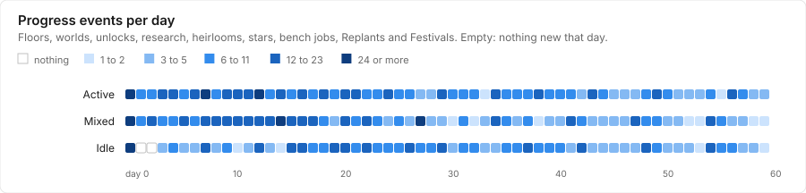
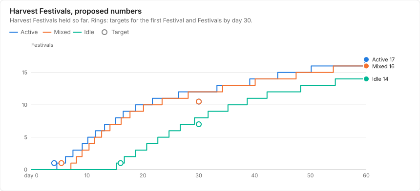

# Balance report: Sprout Tower economy on design 0.3

Written by `pnpm sim` from the simulator's runs (2026-11-26). Do not edit it by hand: change `apps/sim/src/report.ts` or the runs, then run `pnpm sim report`.

Inputs: the GDD and CONTENT of design 0.3 (one fixed manager per floor), as tables in `packages/content/tables`. Three play styles from GDD 17.6 (active, mixed, idle), 60 days each, all six planned worlds, plus the four-world launch build. Proposed changes are overlays in `apps/sim/proposals/`.

**How to run.** From the repository root: `pnpm install`, then `pnpm sim` (every run and this report, about 4 minutes on 4 processors). One player as a printed timeline: `pnpm sim run --profile idle --days 14`. Fit the gate prices again after a design change: `pnpm sim calibrate --base p1-levels,p2-taps --out p4-gates`.

## The verdict in plain words

**Pacing targets (GDD 17.6).** With the GDD's numbers 4 of 27 checks are on target. The targets are the GDD 17.6 table with the Game Designer's rulings of 2026-11-26 (first Replant inside day 1 for everyone, active first Replant 30 to 55 minutes, new idle targets, Festival counts as ranges). A point target counts as met from a third early to half late. With the proposed numbers 22 of 27 are.

- Active, GDD numbers: Top floor of Thymeford 19 min against 32 min (1.1 times early); First Replant 27 min against 30 to 55 min (1.1 times early); World 2 3.6 h against 12.0 h (2.2 times early); World 3 6.2 h against day 2.6 (6.7 times early); First Harvest Festival 14.1 h against day 4.1 (4.7 times early); World 4 day 1.5 against day 6.7 (3.1 times early); World 5 day 3.5 against day 12.2 (2.4 times early); World 6 day 8.1 against day 19.5 (1.6 times early); Festivals by day 30 15 against 9 to 11 (4 too many).
- Mixed, GDD numbers: First Replant 28 min against inside day 1 (6.3 times early); World 3 day 1.4 against day 4.1 (1.9 times early); First Harvest Festival day 2.1 against day 5.4 (1.7 times early); World 4 day 3.3 against day 10.1 (2.1 times early); World 5 day 6.1 against day 18.1 (2.0 times early); World 6 day 10.4 against day 30.5 (2.0 times early); Festivals by day 30 14 against 9 to 11 (3 too many).
- Idle, GDD numbers: World 2 day 4.7 against by day 8.0 (1.1 times early); World 3 day 5.2 against by day 13.0 (1.7 times early); First Harvest Festival day 6.5 against by day 16.0 (1.7 times early); World 4 day 9.5 against by day 20.0 (1.4 times early); World 5 day 13.2 against by day 26.0 (1.3 times early); World 6 day 20.2 against day 30 or later (1.5 times early); Festivals by day 30 12 against 6 to 8 (4 too many).
- Active, proposed numbers: Top floor of Thymeford 20 min against 32 min (1.1 times early); Festivals by day 30 12 against 9 to 11 (1 too many).
- Mixed, proposed numbers: World 2 day 2.3 against day 1.4 (1.1 times late); Festivals by day 30 12 against 9 to 11 (1 too many).
- Idle, proposed numbers: World 5 day 26.2 against by day 26.0 (1.0 times late).

**Dead zones.** A dead zone here is more than 30 minutes of open game in which the player buys nothing (time spent saving for a world ticket does not count, and the Auto-Gardener's own purchases do not end a stretch), or two Festivals more than 10 days apart after day 14 (the Game Designer's limit). GDD 0.3 numbers: the active player has 59:50 of open game with nothing to buy (day 24.6); active, mixed, idle have Festival gaps above 10 days after day 14. Proposed numbers: the active player has 52:06 of open game with nothing to buy (day 51.3). The Festival rhythm against the designer's shape (gaps of 1 to 3 days to day 10, 3 to 6 to day 30, 5 to 9 after, no jump above about twice the gap before) is under "Dead zones".

- Active, gdd 0.3 numbers: longest open-game stretch with nothing to buy 59:50 (day 24.6); 0 of the first 30 days with no progress event; longest gap between Festivals 2.5 days before day 14, 12.2 days after day 14.
- Mixed, gdd 0.3 numbers: longest open-game stretch with nothing to buy 11:54 (day 27.4); 0 of the first 30 days with no progress event; longest gap between Festivals 2.5 days before day 14, 20.3 days after day 14.
- Idle, gdd 0.3 numbers: longest open-game stretch with nothing to buy 3:57 (day 53.5); 1 of the first 30 days with no progress event; longest gap between Festivals 2.0 days before day 14, 13.8 days after day 14.
- Active, proposed numbers: longest open-game stretch with nothing to buy 52:06 (day 51.3); 0 of the first 30 days with no progress event; longest gap between Festivals 2.0 days before day 14, 9.6 days after day 14.
- Mixed, proposed numbers: longest open-game stretch with nothing to buy 11:54 (day 57.4); 0 of the first 30 days with no progress event; longest gap between Festivals 1.5 days before day 14, 7.3 days after day 14.
- Idle, proposed numbers: longest open-game stretch with nothing to buy 3:55 (day 53.7); 2 of the first 30 days with no progress event; longest gap between Festivals none before day 14, 6.2 days after day 14.

**Runaway growth.** None. No play style ever grows faster than in its first week, as it should with exponents below 1 (GDD 17.6 note 1). Growth rises again after a slow stretch in one run (Idle, proposed numbers: 2.2 orders of magnitude a week in weeks 3 and 4 against 1.7 in week 2, then 1.1 in weeks 5 to 8.) That is a catch-up as new worlds open, never faster than the run's own week 1. The burst the first audit found (every timed ability held and fired together at 12 taps a second) put the tower at ×1,350 its steady income under the 0.1 stacking rule, and at most ×42.0 under the 0.2 rule (one Boost capped at 15, Spurt the only multiplier on it). The exploit is gone.

- Active, gdd 0.3 numbers: all-time Compost grows 12.5 orders of magnitude a week in week 1, 2.1 orders of magnitude a week in week 2, 0.6 orders of magnitude a week in weeks 3 and 4, 0.5 orders of magnitude a week in weeks 5 to 8.
- Mixed, gdd 0.3 numbers: all-time Compost grows 11.3 orders of magnitude a week in week 1, 3.0 orders of magnitude a week in week 2, 0.7 orders of magnitude a week in weeks 3 and 4, 0.3 orders of magnitude a week in weeks 5 to 8.
- Idle, gdd 0.3 numbers: all-time Compost grows 6.6 orders of magnitude a week in week 1, 4.7 orders of magnitude a week in week 2, 1.6 orders of magnitude a week in weeks 3 and 4, 0.5 orders of magnitude a week in weeks 5 to 8.
- Active, proposed numbers: all-time Compost grows 8.7 orders of magnitude a week in week 1, 3.3 orders of magnitude a week in week 2, 1.5 orders of magnitude a week in weeks 3 and 4, 0.7 orders of magnitude a week in weeks 5 to 8.
- Mixed, proposed numbers: all-time Compost grows 7.7 orders of magnitude a week in week 1, 3.8 orders of magnitude a week in week 2, 1.6 orders of magnitude a week in weeks 3 and 4, 0.7 orders of magnitude a week in weeks 5 to 8.
- Idle, proposed numbers: all-time Compost grows 5.8 orders of magnitude a week in week 1, 1.7 orders of magnitude a week in week 2, 2.2 orders of magnitude a week in weeks 3 and 4, 1.1 orders of magnitude a week in weeks 5 to 8.

**Longevity.** Days to weeks, yes: the gates are spread over the first three to five weeks for every play style and new things still arrive in week 8. The risk is the other way round: in weeks 5 to 8 all-time Compost grows 0.7 (active), 0.7 (mixed) and 1.1 (idle) orders of magnitude a week, and each Festival needs about 0.6 (four times the Compost, because Ribbons grow with its square root), so after day 30 Festivals come 3.4 to 9.6 days apart (see "Festival rhythm").

- Active, gdd 0.3 numbers, launch build (4 worlds): level 95 on day 60, 18 Festivals, 3 of them after day 30; progress events in weeks 5 to 8: 44, 17, 38, 32.
- Active, proposed numbers, launch build (4 worlds): level 93 on day 60, 17 Festivals, 5 of them after day 30; progress events in weeks 5 to 8: 44, 49, 58, 31.
- Idle, gdd 0.3 numbers, six worlds: level 79 on day 60, 15 Festivals, World 6 day 20.2.
- Idle, proposed numbers, six worlds: level 73 on day 60, 14 Festivals, World 6 day 37.7.

## Recommended number changes

4 overlays in `apps/sim/proposals/`, applied in this order: `p1-levels`, `p2-taps`, `p4-gates`, `p5-late-research`. Each is a plain list of table values. None is in the GDD tables yet. On 2026-11-26 the Game Designer accepted the level and tap changes and the refit gate prices as the base for design 0.4, and sent the late research rows and the per-world Mastery lists (`p5-late-research`) to be run and fitted here. The gate overlay was fitted by `pnpm sim calibrate` on top of the level and tap overlays, so its prices are only right together with them. A manager change (lower level-1 values, larger steps) was tried and not accepted: managers multiply every play style alike, so they do not cause the spread between active and idle, and it halved manager power on days 30 and 60.

| Overlay | Number | GDD 0.3 | Proposed |
| --- | --- | --- | --- |
| `p1-levels` | `XP_DAILY` | 1500 | 1000 |
| `p1-levels` | `XP_DAILY_ALL` | 1500 | 1000 |
| `p1-levels` | `XP_ACHIEVEMENT` | [200,400,800,1500,3000] | [100,200,400,750,1500] |
| `p2-taps` | `skill.gt.firm_grip` effect.value | 0.2 | 0.1 |
| `p2-taps` | `skill.gt.keep_the_rhythm` effect.value | 4 | 2 |
| `p2-taps` | `skill.gt.bumper_crop` effect.value | 0.01 | 0.005 |
| `p2-taps` | `skill.gt.big_bumpers` effect.value | 1 | 0.5 |
| `p4-gates` | `FIRST_REPLANT_MIN` | 60 | 440 |
| `p4-gates` | `RIBBON_C0` | 50000 | 9.0e5 |
| `p4-gates` | `world.w1` ticket | 5e19 | 3e23 |
| `p4-gates` | `world.w2` ticket | 2e19 | 4.5e23 |
| `p4-gates` | `world.w3` ticket | 1e24 | 1e25 |
| `p4-gates` | `world.w4` ticket | 2e29 | 3e30 |
| `p4-gates` | `world.w5` ticket | 1e34 | 3e35 |
| `p4-gates` | `shop.ribbon.deed_nebula` costs | 600 | 250 |
| `p5-late-research` | `AUTO_GARDENER_RESTARTS` | false | true |
| `p5-late-research` | `world.w1` mastery | 25, 50, 100, 250, 350, 400, 450, 500, 550, 600 | 25, 325, 350, 400, 475, 525, 625, 675, 725, 800 |
| `p5-late-research` | `world.w2` mastery | 25, 50, 100, 250, 350, 400, 450, 500, 550, 600 | 150, 225, 250, 275, 350, 400, 500, 550, 600, 675 |
| `p5-late-research` | `world.w3` mastery | 25, 50, 100, 250, 350, 400, 450, 500, 550, 600 | 25, 150, 225, 275, 350, 400, 450, 525, 575, 625 |
| `p5-late-research` | `world.w4` mastery | 25, 50, 100, 250, 350, 400, 450, 500, 550, 600 | 175, 200, 250, 300, 350, 375, 425, 475, 525, 575 |
| `p5-late-research` | `world.w5` mastery | 25, 50, 100, 250, 350, 400, 450, 500, 550, 600 | 125, 150, 200, 250, 300, 325, 350, 375, 425, 475 |
| `p5-late-research` | `world.w6` mastery | 25, 50, 100, 250, 350, 400, 450, 500, 550, 600 | 100, 150, 175, 200, 225, 250, 300, 325, 375, 400 |
| `p5-late-research` | `research.soil.crop_rotation_4` (new research row) | - | 12,000 Insight, 96 h, floor.speed ×1.4, after `research.soil.crop_rotation_3` |
| `p5-late-research` | `research.people.training_day_4` (new research row) | - | 15,000 Insight, 96 h, manager.power +25%, after `research.people.training_day_3` |
| `p5-late-research` | `research.soil.living_soil_1` (new research row) | - | 18,000 Insight, 120 h, floor.profit ×1.3, after `research.soil.soil_science_3` |
| `p5-late-research` | `research.soil.living_soil_2` (new research row) | - | 21,000 Insight, 120 h, floor.profit ×1.3, after `research.soil.living_soil_1` |
| `p5-late-research` | `research.soil.living_soil_3` (new research row) | - | 24,000 Insight, 120 h, floor.profit ×1.3, after `research.soil.living_soil_2` |
| `p5-late-research` | `research.soil.living_soil_4` (new research row) | - | 27,000 Insight, 120 h, floor.profit ×1.3, after `research.soil.living_soil_3` |
| `p5-late-research` | `research.soil.living_soil_5` (new research row) | - | 30,000 Insight, 120 h, floor.profit ×1.3, after `research.soil.living_soil_4` |
| `p5-late-research` | `research.soil.living_soil_6` (new research row) | - | 36,000 Insight, 120 h, floor.profit ×1.3, after `research.soil.living_soil_5` |

**`p1-levels`: Fewer one-off XP gifts in the first hour.** On design 0.3 a new active player has 27,430 XP after one hour (level 13) against the 8,750 that level 8 needs, and the skill tree opens at minute 13 instead of minute 26. Most of it comes in lumps: the first Compost records (8,250 XP), the first daily quests (6,000 XP) and the achievements that are already earned when the achievement book opens (4,600 XP). Halving the achievement rewards and cutting the daily quests to 1,000 XP leaves 19,450 XP at one hour (level 11) and the skill tree at minute 16. A stronger cut (XP_BASE 1000 as well) reaches level 9 at one hour, but it pushes the mixed player's top floor past the end of the first session (from 28 minutes to 2.4 hours), so it is not proposed. The rest of the gap is Compost-record XP at the first Replant, which REPLANT_XP_STEP controls.

**`p2-taps`: Tap skills at half strength.** Tap income is several times the budget of GDD 17.6 in the first week, because four Green Thumb skills are full on day 1. Half the value per rank keeps the branch worth taking and spreads the growth over the first weeks.

**`p4-gates`: Gate prices fitted to the pacing targets (active profile).** Fitted by "pnpm sim calibrate" on top of p1-levels, p2-taps. First Replant: 60 -> 440, set by rule rather than fitted: every play style's first Replant must land inside its first 24 hours, and 448 is the largest minimum that keeps the idle player's inside day 1 (16.2 h; the active player's lands at 38 min, the mixed player's at 6.5 h). World 6 deed: 600 -> 250 Ribbons, so the deed does not hold World 6 back once Ribbons come more slowly. World 2: 5e19 -> 3.0e+23 (target 12.0 h, lands 11.7 h) World 3: 2e19 -> 4.5e+23 (target day 2.60, lands day 2.60) First Harvest Festival: 50000 -> 6.5e+5, set by hand after the fit (8.6e+5 put the active player's first Festival on day 4.35) to smooth the Festival rhythm: first Festival on day 3.5 active, 5.6 mixed, 14.2 idle, and 18 gaps that break the designer's rhythm across the three play styles instead of 24. Eight Golden Hour price lists were tried as well; none beat the GDD's own. Raised to 9.0e+5 for the Auto-Gardener rule (see below). World 4: 1e24 -> 1.0e+26 (target day 6.70, lands day 6.70), lowered by hand to 1e+25 once the Auto-Gardener kept every world going (see below). World 5: 2e29 -> 7.3e+31 (target day 12.20, lands day 12.47), lowered by hand to 3e+30 (see below). World 6: 1e34 -> 3e+35, set by hand: the fitted 1.4e+34 put the mixed player in World 6 on day 19.4 once the late research (p5-late-research) was in, and with the Auto-Gardener rule 6e+34 put it there on day 17.4, both before its window. Refit for the Auto-Gardener rule (Game Designer, 2026-11-26): with older worlds earning again, Festivals came faster (12 and 13 by day 30 for active and mixed) and the idle player reached World 5 after day 26. RIBBON_C0 650,000 -> 900,000 (the first Festival needs more Compost, so fewer Festivals by day 30) and the World 4 and World 5 tickets above (so the idle player still reaches them by days 20 and 26). Sixteen combinations of RIBBON_C0 (650,000 to 2.6 million), the World 4 to 6 tickets and Living Soil were run; this one keeps every gate in its window.

**`p5-late-research`: Late research tiers and one Mastery list per world (Game Designer's p5).** The Game Designer's eight late research rows (proposal p5, 2026-11-26), run on top of p1-levels, p2-taps and p4-gates. Costs: the designer's first-pass costs times 0.06 (Crop Rotation IV 12,000 up to Living Soil VI 36,000). The Insight rate is about 11,000 to 13,000 a day for the active player from day 20 to day 65, and the 40 existing projects (626,000 Insight in all) use nearly all of it up to day 64. Living Soil I hangs on Soil Science III instead of Soil Science V: Soil Science V costs 150,000 and lands on day 64 for the active player, so with it as the requirement no factor can start the chain before then. Living Soil profit x1.3 each instead of x2: at x2 the active player had Festival gaps of 3.0 to 3.7 days after day 30 and at x1.7 gaps of 3.6 and 3.9, below the designer's floor of 4, so the first run used x1.6. With the Auto-Gardener rule older worlds earn again and x1.6 gave gaps of 3.2 to 4.0 days after day 30; x1.3 gives 4.4 to 8.8 for active and mixed. The designer's rule was to lower the multiplier before touching the costs. Crop Rotation IV is floor speed x1.4, like Crop Rotation I to III. Auto-Gardener (Game Designer's ruling, 2026-11-26, last change before design 0.4): AUTO_GARDENER_RESTARTS turns on two more jobs while the Auto-Gardener is owned and switched on and the game is open. A world opens its next floor when that costs at most AUTO_BUY_SHARE of the coins in hand, and floor 1's manager in every unlocked world stays hired through every Replant and Festival with no fee. No world goes dead after a Replant any more. Mastery: each world gets its own ten levels (multiples of 25), picked from the mean crossing days of four 90-day active runs with the Auto-Gardener rule in place (each run with the previous pick in place), so the active player's stars land near the designer's days after arrival (under 1, 1-2, 3-4, 5-6, 8-10, 12-14, 18-22, 28-34, 40-46, 55-65), with one star on arrival day and star 5 not before day 8 (picked at day 9 or later on the mean, because star days move by about a day between runs: a world's best level rises once per Festival cycle). World 5's star 5 is level 300 on about day 13, because 275 lands on day 7.4 to 9.1. Every star of every world is measured now, Thymeford's 7 to 10 included.

### Before and after, every gate

**Active**

| Gate | Target | GDD 0.3 numbers | Proposed numbers |
| --- | --- | --- | --- |
| Top floor of Thymeford | 32 min | 19 min (1.1 times early) | 20 min (1.1 times early) |
| First Replant | 30 to 55 min | 27 min (1.1 times early) | 38 min (on target) |
| World 2 | 12.0 h | 3.6 h (2.2 times early) | 11.7 h (on target) |
| World 3 | day 2.6 | 6.2 h (6.7 times early) | day 3.1 (on target) |
| First Harvest Festival | day 4.1 | 14.1 h (4.7 times early) | day 4.6 (on target) |
| World 4 | day 6.7 | day 1.5 (3.1 times early) | day 7.6 (on target) |
| World 5 | day 12.2 | day 3.5 (2.4 times early) | day 12.1 (on target) |
| World 6 | day 19.5 | day 8.1 (1.6 times early) | day 20.1 (on target) |
| Festivals by day 30 | 9 to 11 | 15 (4 too many) | 12 (1 too many) |

**Mixed**

| Gate | Target | GDD 0.3 numbers | Proposed numbers |
| --- | --- | --- | --- |
| Top floor of Thymeford | 30 min | 25 min (on target) | 26 min (on target) |
| First Replant | inside day 1 | 28 min (6.3 times early) | 6.5 h (on target) |
| World 2 | day 1.4 | day 1.1 (on target) | day 2.3 (1.1 times late) |
| World 3 | day 4.1 | day 1.4 (1.9 times early) | day 5.5 (on target) |
| First Harvest Festival | day 5.4 | day 2.1 (1.7 times early) | day 7.1 (on target) |
| World 4 | day 10.1 | day 3.3 (2.1 times early) | day 9.3 (on target) |
| World 5 | day 18.1 | day 6.1 (2.0 times early) | day 13.6 (on target) |
| World 6 | day 30.5 | day 10.4 (2.0 times early) | day 23.1 (on target) |
| Festivals by day 30 | 9 to 11 | 14 (3 too many) | 12 (1 too many) |

**Idle**

| Gate | Target | GDD 0.3 numbers | Proposed numbers |
| --- | --- | --- | --- |
| Top floor of Thymeford | 11.0 h | 10.9 h (on target) | 10.9 h (on target) |
| First Replant | inside day 1 | 16.2 h (on target) | 16.2 h (on target) |
| World 2 | by day 8.0 | day 4.7 (1.1 times early) | day 7.2 (on target) |
| World 3 | by day 13.0 | day 5.2 (1.7 times early) | day 12.5 (on target) |
| First Harvest Festival | by day 16.0 | day 6.5 (1.7 times early) | day 15.2 (on target) |
| World 4 | by day 20.0 | day 9.5 (1.4 times early) | day 19.7 (on target) |
| World 5 | by day 26.0 | day 13.2 (1.3 times early) | day 26.2 (1.0 times late) |
| World 6 | day 30 or later | day 20.2 (1.5 times early) | day 37.7 (on target) |
| Festivals by day 30 | 6 to 8 | 12 (4 too many) | 8 (on target) |

## Pacing targets: first 10 minutes, first hour, day 1, week 1, month

The GDD gives a minute-by-minute table for a new player's first hour (section 16) and milestones for day 1, week 1 and month 1 (section 17). The simulated new player is the active profile with the beginner model described under "How the simulated players decide".

| Active player | Target | GDD numbers | Proposed numbers |
| --- | --- | --- | --- |
| Level at 10 minutes | about 3 to 4 | 4 | 4 |
| Floors open at 10 minutes | 7 | 7 | 7 |
| Level at 1 hour | 10 to 11 (ruling; GDD 8) | 13 | 11 |
| Top floor (floor 10) | 32 min | 19 min | 20 min |
| First Replant | 30 to 55 min (ruling; GDD 50 to 60) | 27 min | 38 min |
| Replants by day 1 | 6 to 10 | 19 | 11 |
| Level at day 1 | about 23 (ruling; GDD 18) | 29 | 22 |
| Level at day 7 | about 40 | 52 | 39 |
| Research projects by day 7 | 12 to 15 | 22 | 19 |
| Festivals by day 7 | 3 to 4 | 9 | 2 |
| Level at day 30 | about 70 | 78 | 73 |
| Level at day 60 | cap 112 about month 3 | 98 | 95 |

"Ruling": a target the Game Designer moved on 2026-11-26 when accepting the level overlay and the first-Replant rule. The skill tree is now expected at about minute 16.

### The reveal order (GDD section 16, 31 rows)

Measured in game time. Rows 1 to 19 have a target in minutes of the first session, rows 20 to 31 a target day for the active player.

| # | Feature | Target | Active, GDD | Mixed, GDD | Idle, GDD | Active, proposed | Mixed, proposed | Idle, proposed |
| --- | --- | --- | --- | --- | --- | --- | --- | --- |
| 1 | `tap_to_harvest` | 0.1 min | 0.0 min | 0.0 min | 0.0 min | 0.0 min | 0.0 min | 0.0 min |
| 2 | `floor_levels` | 0.2 min | 0.0 min | 0.0 min | 0.0 min | 0.0 min | 0.0 min | 0.0 min |
| 3 | `milestones` | 0.6 min | 0.7 min | 0.8 min | 0.7 min | 0.7 min | 0.8 min | 0.7 min |
| 4 | `more_floors` | 0.7 min | 0.4 min | 0.4 min | 0.4 min | 0.4 min | 0.4 min | 0.4 min |
| 5 | `managers` | 1.5 min | 2.1 min | 2.1 min | 2.7 min | 2.1 min | 2.1 min | 2.7 min |
| 6 | `tap_bonus` | 1.7 min | 2.1 min | 2.1 min | 2.7 min | 2.1 min | 2.1 min | 2.7 min |
| 7 | `quests` | 2.3 min | 3.0 min | 3.2 min | 4.1 min | 3.0 min | 3.2 min | 4.1 min |
| 8 | `plants` | 3.5 min | 4.0 min | 4.4 min | 6.1 min | 4.0 min | 4.4 min | 6.1 min |
| 9 | `bumpers` | 4.0 min | 3.5 min | 3.3 min | 4.6 min | 3.5 min | 3.3 min | 4.6 min |
| 10 | `visitors` | 5.5 min | 5.3 min | 5.7 min | 8.5 min | 5.3 min | 5.7 min | 8.5 min |
| 11 | `abilities` | 11 min | 8.8 min | 9.3 min | 13 min | 8.9 min | 9.4 min | 13 min |
| 12 | `spurt` | 13 min | 11 min | 12 min | 5.5 h | 11 min | 12 min | 5.5 h |
| 13 | `basket` | 15 min | 15 min | 15 min | 15 min | 15 min | 15 min | 15 min |
| 14 | `achievements` | 21 min | 13 min | 18 min | 5.6 h | 14 min | 18 min | 5.6 h |
| 15 | `skills` | 26 min | 13 min | 18 min | 10.9 h | 16 min | 18 min | 10.9 h |
| 16 | `offline` | - | 3.2 h | 2.4 h | 5.5 h | 3.2 h | 2.4 h | 5.5 h |
| 17 | `replant` | 50 min | 19 min | 28 min | 10.9 h | 38 min | 4.4 h | 16.2 h |
| 18 | `research` | 55 min | 27 min | 28 min | 16.2 h | 38 min | 6.5 h | 16.2 h |
| 19 | `heirlooms` | 90 min | 3.3 h | 14.4 h | day 4.2 | 3.3 h | 14.5 h | day 4.2 |
| 20 | `world2` | day 1.0 | 3.6 h | day 1.1 | day 4.7 | 11.7 h | day 2.3 | day 7.2 |
| 21 | `bees` | day 1.5 | 11.2 h | day 1.2 | day 4.5 | 13.8 h | day 1.2 | day 4.5 |
| 22 | `events` | day 1.5 | 40 min | 12.4 h | day 2.2 | 3.2 h | 6.5 h | day 3.5 |
| 23 | `bench` | day 2.0 | day 1.3 | day 2.0 | day 5.5 | day 1.5 | day 2.7 | day 7.5 |
| 24 | `world3` | day 3.0 | 6.2 h | day 1.4 | day 5.2 | day 3.1 | day 5.5 | day 12.5 |
| 25 | `mutation` | day 6.0 | day 7.7 | day 9.0 | day 15.0 | day 10.1 | day 11.7 | day 17.2 |
| 26 | `festival` | day 4.5 | 14.0 h | day 2.1 | day 6.2 | day 4.6 | day 7.1 | day 15.2 |
| 27 | `auto_buy` | day 5.0 | 14.2 h | day 2.1 | day 6.7 | day 4.6 | day 7.2 | day 15.2 |
| 28 | `world4` | day 10.0 | day 1.5 | day 3.3 | day 9.5 | day 7.6 | day 9.3 | day 19.7 |
| 29 | `head_copies` | day 11.0 | day 1.0 | day 2.4 | day 7.7 | day 10.0 | day 11.3 | day 22.2 |
| 30 | `world5` | day 17.0 | day 3.5 | day 6.1 | day 13.2 | day 12.1 | day 13.6 | day 26.2 |
| 31 | `world6` | day 24.0 | day 8.1 | day 10.4 | day 20.2 | day 20.1 | day 23.1 | day 37.7 |

## When each gate arrives

Every unlock, Replant, Festival and world arrival of each run is in `data/timeline-<run>.csv` (one row per event: game time, day, play time, kind, id, world, count).

**GDD 0.3 numbers**

| Gate | Active (target) | Mixed (target) | Idle (target) |
| --- | --- | --- | --- |
| Top floor of Thymeford | 19 min (32 min) | 25 min (30 min) | 10.9 h (11.0 h) |
| First Replant | 27 min (30 to 55 min) | 28 min (inside day 1) | 16.2 h (inside day 1) |
| World 2 | 3.6 h (12.0 h) | day 1.1 (day 1.4) | day 4.7 (by day 8.0) |
| World 3 | 6.2 h (day 2.6) | day 1.4 (day 4.1) | day 5.2 (by day 13.0) |
| First Harvest Festival | 14.1 h (day 4.1) | day 2.1 (day 5.4) | day 6.5 (by day 16.0) |
| World 4 | day 1.5 (day 6.7) | day 3.3 (day 10.1) | day 9.5 (by day 20.0) |
| World 5 | day 3.5 (day 12.2) | day 6.1 (day 18.1) | day 13.2 (by day 26.0) |
| World 6 | day 8.1 (day 19.5) | day 10.4 (day 30.5) | day 20.2 (day 30 or later) |

**Proposed numbers**

| Gate | Active (target) | Mixed (target) | Idle (target) |
| --- | --- | --- | --- |
| Top floor of Thymeford | 20 min (32 min) | 26 min (30 min) | 10.9 h (11.0 h) |
| First Replant | 38 min (30 to 55 min) | 6.5 h (inside day 1) | 16.2 h (inside day 1) |
| World 2 | 11.7 h (12.0 h) | day 2.3 (day 1.4) | day 7.2 (by day 8.0) |
| World 3 | day 3.1 (day 2.6) | day 5.5 (day 4.1) | day 12.5 (by day 13.0) |
| First Harvest Festival | day 4.6 (day 4.1) | day 7.1 (day 5.4) | day 15.2 (by day 16.0) |
| World 4 | day 7.6 (day 6.7) | day 9.3 (day 10.1) | day 19.7 (by day 20.0) |
| World 5 | day 12.1 (day 12.2) | day 13.6 (day 18.1) | day 26.2 (by day 26.0) |
| World 6 | day 20.1 (day 19.5) | day 23.1 (day 30.5) | day 37.7 (day 30 or later) |

## Dead zones

A progress event is a new floor, world, unlock, research project, heirloom, Mastery star, bench job, Replant or Festival. An empty cell is a day on which none of these happened.

| Run | Longest open-game stretch with nothing to buy | The same, counting time spent saving for a world ticket | Longest play time between two reward beats | Days with no progress event (day numbers from 1) | Replants by the six-hour rule |
| --- | --- | --- | --- | --- | --- |
| Active, GDD | 59:50 (day 24.6) | 59:50 (day 24.6) | 59:55 (day 44.7) | none | 171 |
| Mixed, GDD | 11:54 (day 27.4) | 11:54 (day 27.4) | 12:04 (day 50.3) | 6: 37, 39, 45, 47, 51, 52 | 164 |
| Idle, GDD | 3:57 (day 53.5) | 3:57 (day 53.5) | 4:00 (day 1.5) | 2: 2, 53 | 145 |
| Active, proposed | 52:06 (day 51.3) | 52:06 (day 51.3) | 46:30 (day 56.3) | none | 171 |
| Mixed, proposed | 11:54 (day 57.4) | 11:54 (day 57.4) | 12:04 (day 56.6) | none | 194 |
| Idle, proposed | 3:55 (day 53.7) | 3:55 (day 53.7) | 4:02 (day 31.7) | 2: 2, 3 | 115 |

### Festival gaps

| Run | Days between Festivals, in order |
| --- | --- |
| Active, GDD | 0.5, 0.2, 0.8, 0.6, 0.7, 0.8, 1.0, 1.0, 1.3, 2.0, 2.1, 2.5, 5.1, 9.2, 6.7, 11.1, 12.2, 1.5 (open) |
| Mixed, GDD | 0.3, 0.7, 0.4, 1.1, 0.8, 0.9, 0.8, 1.0, 1.3, 1.8, 1.8, 2.5, 6.6, 8.2, 9.0, 20.3, 0.4 (open) |
| Idle, GDD | 1.2, 1.0, 1.0, 1.0, 1.6, 1.4, 2.0, 2.0, 2.8, 2.8, 5.0, 6.0, 7.2, 13.8, 4.8 (open) |
| Active, proposed | 1.5, 1.3, 1.7, 1.0, 1.3, 1.7, 2.0, 1.3, 2.2, 3.0, 4.7, 6.9, 5.9, 5.0, 6.0, 9.6, 0.3 (open) |
| Mixed, proposed | 1.0, 1.0, 1.2, 1.0, 1.2, 1.5, 2.0, 1.6, 2.4, 3.3, 4.7, 6.2, 5.8, 7.3, 6.7, 5.9 (open) |
| Idle, proposed | 1.4, 2.0, 2.0, 2.0, 2.0, 2.0, 2.6, 2.4, 3.6, 3.4, 3.6, 6.0, 6.2, 5.5 (open) |

### Festival rhythm

The Game Designer's shape (2026-11-26): first Festival about day 4 for the active player, then gaps of 1 to 3 days up to day 10, 3 to 6 days up to day 30 and 5 to 9 days after, never more than 10, and no gap more than about twice the one before. Listed: every gap that breaks it (a fifth of slack on the ranges).

| Run | Gaps that break the rhythm |
| --- | --- |
| Active, GDD | 0.5 days from day 0.6 (wanted 1 to 3); 0.2 days from day 1.1 (wanted 1 to 3); 0.8 days from day 1.4 (wanted 1 to 3); 0.6 days from day 2.1 (wanted 1 to 3); 0.7 days from day 2.7 (wanted 1 to 3); 0.8 days from day 3.4 (wanted 1 to 3); 9.2 days from day 19.2 (wanted 3 to 6); 11.1 days from day 35.1, above the 10-day limit; 12.2 days from day 46.2, above the 10-day limit |
| Mixed, GDD | 0.3 days from day 2.1 (wanted 1 to 3); 0.7 days from day 2.4 (wanted 1 to 3); 0.4 days from day 3.1 (wanted 1 to 3); 0.8 days from day 6.4 (wanted 1 to 3); 1.8 days from day 11.3 (wanted 3 to 6); a jump from 2.5 to 6.6 days at day 15.6; 8.2 days from day 22.2 (wanted 3 to 6); 20.3 days from day 39.4, above the 10-day limit; a jump from 9.0 to 20.3 days at day 39.4 |
| Idle, GDD | 1.6 days from day 10.7 (wanted 3 to 6); 1.4 days from day 12.2 (wanted 3 to 6); 2.0 days from day 13.7 (wanted 3 to 6); 2.0 days from day 15.7 (wanted 3 to 6); 13.8 days from day 41.5, above the 10-day limit |
| Active, proposed | 1.3 days from day 10.1 (wanted 3 to 6); 1.7 days from day 11.5 (wanted 3 to 6); 2.0 days from day 13.1 (wanted 3 to 6); 1.3 days from day 15.1 (wanted 3 to 6); 2.2 days from day 16.5 (wanted 3 to 6) |
| Mixed, proposed | 1.0 days from day 10.4 (wanted 3 to 6); 1.2 days from day 11.4 (wanted 3 to 6); 1.5 days from day 12.6 (wanted 3 to 6); 2.0 days from day 14.1 (wanted 3 to 6); 1.6 days from day 16.1 (wanted 3 to 6) |
| Idle, proposed | 1.4 days from day 15.2 (wanted 3 to 6); 2.0 days from day 16.7 (wanted 3 to 6); 2.0 days from day 18.7 (wanted 3 to 6); 2.0 days from day 20.7 (wanted 3 to 6); 2.0 days from day 22.7 (wanted 3 to 6); 2.0 days from day 24.7 (wanted 3 to 6); 3.6 days from day 31.7 (wanted 5 to 9); 3.4 days from day 35.2 (wanted 5 to 9); 3.6 days from day 38.7 (wanted 5 to 9) |

## Runaway growth

Orders of magnitude of all-time Compost gained per week. Falling numbers mean growth slows down, which is what an idle game needs to last.

| Run | Week 1 | Week 2 | Weeks 3 and 4 | Weeks 5 to 8 |
| --- | --- | --- | --- | --- |
| Active, GDD | 12.5 | 2.1 | 0.6 | 0.5 |
| Mixed, GDD | 11.3 | 3.0 | 0.7 | 0.3 |
| Idle, GDD | 6.6 | 4.7 | 1.6 | 0.5 |
| Active, proposed | 8.7 | 3.3 | 1.5 | 0.7 |
| Mixed, proposed | 7.7 | 3.8 | 1.6 | 0.7 |
| Idle, proposed | 5.8 | 1.7 | 2.2 | 1.1 |

### Burst stacking and the tap limit

| Run | Highest tower income over steady income | World 5 | World 6 | Festivals in 10 days | Tap income over steady, day 7, at 6 taps/s | at 12 taps/s |
| --- | --- | --- | --- | --- | --- | --- |
| Every timed ability held and fired together, 12 taps a second, 0.1 stacking rule | ×1,350 | day 2.5 | day 4.5 | 12 | 12.0 | 23.9 |
| The same player under the 0.2 rule | ×42.0 | day 2.5 | day 6.1 | 11 | 13.3 | 26.5 |
| Active player, 6 taps a second | ×42.0 | day 3.5 | day 8.1 | 11 | 15.2 | 30.4 |
| Active player at the tap limit, 12 taps a second | ×42.6 | day 3.4 | day 7.1 | 11 | 13.1 | 26.3 |

Reviewer note 1 asks for both tap rates with every ability in. On day 60 of the active run, taps pay 15.5 times steady income at 6 taps a second and 31.0 times at 12, before Boost and Growth Spurt. A fully stacked moment multiplies that by at most 60 (Boost cap 15 times a Spurt of 4) for the 20 seconds a Spurt lasts, as GDD 13.5 rule 3 intends. That 20-second peak is not the same measure as the reviewer's 450 to 650, which is average active income over a session; the session averages are in the Boost table under the Game Designer's questions.

## Longevity

| Run | Day 30 | Day 60 | Progress events, days 30 to 60 |
| --- | --- | --- | --- |
| Active, GDD, six worlds | level 78, 15 F, 292 R, 36 research, 17 heirlooms | level 98, 18 F, 390 R, 40 research, 18 heirlooms | 152 |
| Mixed, GDD, six worlds | level 75, 14 F, 277 R, 35 research, 16 heirlooms | level 91, 17 F, 352 R, 39 research, 18 heirlooms | 115 |
| Idle, GDD, six worlds | level 63, 12 F, 180 R, 34 research, 15 heirlooms | level 79, 15 F, 278 R, 40 research, 16 heirlooms | 144 |
| Active, GDD, launch build (4 worlds) | level 78, 15 F, 267 R, 35 research, 18 heirlooms | level 95, 18 F, 350 R, 39 research, 18 heirlooms | 133 |
| Idle, GDD, launch build (4 worlds) | level 60, 11 F, 155 R, 33 research, 15 heirlooms | level 73, 14 F, 229 R, 39 research, 16 heirlooms | 108 |
| Active, proposed, six worlds | level 73, 12 F, 248 R, 35 research, 16 heirlooms | level 95, 17 F, 389 R, 46 research, 18 heirlooms | 219 |
| Mixed, proposed, six worlds | level 69, 12 F, 237 R, 34 research, 18 heirlooms | level 89, 16 F, 358 R, 46 research, 18 heirlooms | 187 |
| Idle, proposed, six worlds | level 51, 8 F, 118 R, 29 research, 14 heirlooms | level 73, 14 F, 247 R, 44 research, 15 heirlooms | 207 |
| Active, proposed, launch build | level 72, 12 F, 247 R, 34 research, 18 heirlooms | level 93, 17 F, 389 R, 45 research, 18 heirlooms | 208 |

F: Harvest Festivals held. R: Replants. The launch build stops at World 4, so its late game is Festivals, research, heirlooms and card levels only.

## What each system is worth

The designer's rough pacing script (GDD 17.6) ran on a budget: what managers, taps and "everything else" (skills, plants, card levels, research, heirlooms, achievements, codex, Mastery) multiply income by on each day. **The Game Designer retired this budget as a target on 2026-11-26**: the targets are the gate table and the Festival rhythm. It stays here as a reading aid. The simulator measures the same three numbers on the active player's newest world: the income-weighted manager multiplier, the permanent multiplier on the best floor without Rich Soil and Golden Hour (those are modelled by the script itself), and tap income at 6 taps a second as a multiple of steady income.

| When | Budget: managers / everything else / taps | Active, GDD | Active, proposed |
| --- | --- | --- | --- |
| hour 1 | ×2.0 / ×1.1 / ×1.9 | ×3.4 / ×1.5 / ×4.0 | ×5.6 / ×1.3 / ×2.9 |
| day 1 | ×2.5 / ×4.0 / ×2.5 | ×5.0 / ×22.8 / ×8.1 | ×5.0 / ×11.1 / ×4.6 |
| day 3 | ×3.1 / ×16.0 / ×3.1 | ×5.1 / ×75.8 / ×9.5 | ×5.0 / ×7.8 / ×4.4 |
| day 7 | ×5.0 / ×120 / ×5.0 | ×5.5 / ×132 / ×15.2 | ×6.0 / ×46.8 / ×4.5 |
| day 14 | ×6.0 / ×700 / ×6.2 | ×5.3 / ×303 / ×12.1 | ×5.4 / ×334 / ×8.3 |
| day 30 | ×9.0 / ×7,000 / ×10.0 | ×7.0 / ×668 / ×13.0 | ×6.0 / ×499 / ×7.0 |
| day 60 | ×13.0 / ×20,000 / ×14.0 | ×11.1 / ×6,014 / ×15.5 | ×11.2 / ×9,189 / ×9.4 |

### Each system switched off (active player, first 3 days)

On design 0.3 no single content system moves World 2 by more than a few percent of play time: the early rush comes from what every run has, the fixed managers of the top floors and tapping (see the table above).

Game time moves in steps of whole sessions (World 2 either arrives in a session or at the start of the next one), so the first column, minutes of play, is the fair comparison.

| Run | World 2, minutes of play | World 2 | World 3 | First Festival | Replants by day 3 | Level on day 3 |
| --- | --- | --- | --- | --- | --- | --- |
| Everything on | 87 min | 3.6 h | 6.2 h | 14.1 h | 71 | 41 |
| Without: Skill tree | 90 min | 5.8 h | 11.2 h | day 1.1 | 61 | 39 |
| Without: Card levels | 90 min | 5.8 h | 8.6 h | 16.5 h | 62 | 38 |
| Without: Plants | 90 min | 5.8 h | 11.2 h | day 1.5 | 50 | 35 |
| Without: Heirlooms | 90 min | 3.7 h | 8.8 h | day 1.1 | 49 | 37 |
| Without: Manager and heirloom abilities | 85 min | 3.6 h | 8.5 h | 14.3 h | 72 | 40 |
| Without: Garden Visitors | 90 min | 5.8 h | 8.6 h | 16.6 h | 59 | 36 |
| Without: Research | 90 min | 3.7 h | 11.5 h | day 1.5 | 36 | 33 |
| Without: Compost Shop items other than Rich Soil | 86 min | 3.6 h | 8.9 h | not reached | 13 | 28 |
| Without: Growth Spurts | 90 min | 5.8 h | 11.2 h | day 1.1 | 61 | 39 |

## The Game Designer's questions for design 0.3

### Manager profit on the top floors, days 0 to 2 (CHANGES A.7, item 2)

With one fixed manager per floor the rarest managers sit on the floors that earn most. Measured on the active player's newest world: the median hired manager, the mean of the three highest hired floors, and the income-weighted mean (what managers multiply that world's income by). The Game Designer kept the 0.3 manager numbers and retired the budget column as a target; the gate prices absorb the managers' early strength.

| When | Budget | Active, GDD: median / top 3 / weighted | Active, proposed: median / top 3 / weighted |
| --- | --- | --- | --- |
| 10 min | ×2.0 | ×3.0 / ×3.2 / ×3.5 | ×3.0 / ×3.2 / ×3.3 |
| 60 min | ×2.0 | ×3.5 / ×3.2 / ×3.1 | ×4.3 / ×5.6 / ×5.3 |
| 6.0 h | ×2.1 | ×3.0 / ×4.2 / ×4.9 | ×4.3 / ×6.0 / ×5.3 |
| day 1.0 | ×2.5 | ×3.6 / ×4.8 / ×5.0 | ×3.0 / ×4.5 / ×5.0 |
| day 2.0 | ×2.8 | ×3.5 / ×4.2 / ×4.8 | ×3.6 / ×4.5 / ×5.0 |

### Average Boost in each world (CHANGES A.7, item 4)

Time-weighted over every session spent in that world, days 0 to 60. Boost is the sum of timed bonuses on the world on screen (cap 15); the tap column is the Boost the taps see.

| World | Active, GDD | Mixed, GDD | Active, proposed | Mixed, proposed |
| --- | --- | --- | --- | --- |
| Thymeford | ×1.3 (taps ×1.6, Spurt 10%) | ×1.5 (taps ×1.7, Spurt 7%) | ×1.4 (taps ×1.6, Spurt 21%) | ×1.7 (taps ×1.8, Spurt 11%) |
| World 2 | ×1.5 (taps ×1.7, Spurt 30%) | ×2.2 (taps ×2.2, Spurt 18%) | ×1.6 (taps ×1.8, Spurt 41%) | ×2.0 (taps ×2.1, Spurt 20%) |
| World 3 | ×1.5 (taps ×1.8, Spurt 40%) | ×1.9 (taps ×2.1, Spurt 17%) | ×1.7 (taps ×2.1, Spurt 45%) | ×1.7 (taps ×2.0, Spurt 17%) |
| Mount Mitten (World 4) | ×1.7 (taps ×2.0, Spurt 56%) | ×1.9 (taps ×2.1, Spurt 25%) | ×1.7 (taps ×2.2, Spurt 54%) | ×1.9 (taps ×2.0, Spurt 26%) |
| World 5 | ×1.9 (taps ×2.3, Spurt 62%) | ×2.2 (taps ×2.3, Spurt 23%) | ×2.0 (taps ×2.3, Spurt 60%) | ×2.4 (taps ×2.6, Spurt 26%) |
| World 6 | ×1.8 (taps ×2.3, Spurt 64%) | ×2.4 (taps ×2.7, Spurt 32%) | ×1.8 (taps ×2.3, Spurt 64%) | ×2.4 (taps ×2.8, Spurt 35%) |

The script assumes Growth Spurts cover 29 percent of an active session. The measured share is in brackets.

### Where the manager copies go (CHANGES A.7, item 3)

Chest manager slots pick among the managers already met, so early copies pile onto Thymeford. Mean card level of the met managers in each world:

| Run | Thymeford | World 2 | World 3 | Mount Mitten (World 4) | World 5 | World 6 |
| --- | --- | --- | --- | --- | --- | --- |
| Active, GDD, day 3 | 4.2 | 3.1 | 3.4 | 2.1 | - | - |
| Active, GDD, day 7 | 5.2 | 4.1 | 4.1 | 3.3 | 2.6 | - |
| Active, GDD, day 14 | 5.6 | 4.7 | 4.7 | 4.1 | 3.6 | 2.6 |
| Active, GDD, day 30 | 6.0 | 5.4 | 5.4 | 5.0 | 4.6 | 4.1 |
| Active, GDD, day 60 | 6.7 | 6.0 | 6.1 | 5.9 | 5.4 | 5.4 |
| Active, proposed, day 3 | 4.3 | 2.3 | - | - | - | - |
| Active, proposed, day 7 | 4.9 | 3.4 | 3.1 | - | - | - |
| Active, proposed, day 14 | 5.7 | 4.4 | 4.6 | 2.9 | 2.0 | - |
| Active, proposed, day 30 | 6.3 | 5.3 | 5.3 | 4.4 | 4.1 | 3.1 |
| Active, proposed, day 60 | 7.0 | 6.0 | 6.3 | 5.4 | 5.4 | 4.9 |

### Event track and the top chests (reviewer note 4, CHANGES A.7, item 5)

The simulated players play the Garden Fair every weekend, and its chests are in every card and heirloom number of this report.

| Run | Weekends with the track finished | Golden Chests a week (all sources) | Crystal Chests a week | Starlight Chests a week |
| --- | --- | --- | --- | --- |
| Active, GDD | 8 of 9 | 5.8 | 2.0 | 0.47 |
| Mixed, GDD | 8 of 9 | 5.3 | 1.9 | 0.47 |
| Active, proposed | 8 of 9 | 5.6 | 2.1 | 0.47 |
| Mixed, proposed | 7 of 9 | 4.9 | 2.0 | 0.47 |
| Idle, GDD | 0 of 9 | 3.5 | 0.7 | 0.47 |

### Mastery stars (reviewer note 5, designer proposal p5)

Each world now has its own ten levels (multiples of 25), picked from the crossing data of 90-day runs so the active player's stars land as near as possible to the designer's days after arrival, with one star on the day of arrival and star 5 (the first Head copy) not before day 8. The picker finds the list with the least squared distance from the windows. The best level of a world rises in steps, once per Festival cycle, so some stars cannot land inside their window and land at the nearest step instead. The same list moves star days by about a day from one run to the next (the Festival days move), so the lists come from the mean of four 90-day active runs, and star 5 was picked at day 9 or later on that mean to keep the first Head copy after day 8.

| World | GDD 0.3 (one list for all) | Proposed |
| --- | --- | --- |
| Thymeford | 25, 50, 100, 250, 350, 400, 450, 500, 550, 600 | 25, 325, 350, 400, 475, 525, 625, 675, 725, 800 |
| World 2 | 25, 50, 100, 250, 350, 400, 450, 500, 550, 600 | 150, 225, 250, 275, 350, 400, 500, 550, 600, 675 |
| World 3 | 25, 50, 100, 250, 350, 400, 450, 500, 550, 600 | 25, 150, 225, 275, 350, 400, 450, 525, 575, 625 |
| Mount Mitten (World 4) | 25, 50, 100, 250, 350, 400, 450, 500, 550, 600 | 175, 200, 250, 300, 350, 375, 425, 475, 525, 575 |
| World 5 | 25, 50, 100, 250, 350, 400, 450, 500, 550, 600 | 125, 150, 200, 250, 300, 325, 350, 375, 425, 475 |
| World 6 | 25, 50, 100, 250, 350, 400, 450, 500, 550, 600 | 100, 150, 175, 200, 225, 250, 300, 325, 375, 400 |

Days after first arriving in the world when each star landed (Thymeford: stars start once World 2 is reached). A dash: not reached in the run.

| Run | Star 1 | Star 2 | Star 3 | Star 4 | Star 5 | Star 6 | Star 7 | Star 8 | Star 9 | Star 10 | In window |
| --- | --- | --- | --- | --- | --- | --- | --- | --- | --- | --- | --- |
| Target | under 1 | 1 to 2 | 3 to 4 | 5 to 6 | 8 to 10 | 12 to 14 | 18 to 22 | 28 to 34 | 40 to 46 | 55 to 65 |  |
| Thymeford, active, gdd | 0.2 | 0.2 | 0.2 | 0.4 | 1.0 | 1.6 | - | - | - | - | 1 of 10 |
| Thymeford, active, proposed | 0.5 | 4.7 | 5.0 | 5.7 | 10.0 | 12.5 | 20.1 | 30.0 | 41.1 | 58.1 | 8 of 10 |
| Thymeford, mixed, proposed | 2.3 | 7.1 | 7.1 | 7.1 | 11.3 | 13.5 | 22.0 | 32.1 | 44.0 | 68.1 | 4 of 10 |
| World 2, active, gdd | 0.0 | 0.0 | 0.1 | 1.4 | 3.4 | 5.0 | 8.2 | 11.0 | 17.4 | 33.3 | 1 of 10 |
| World 2, active, proposed | 0.8 | 4.6 | 4.9 | 6.2 | 10.2 | 12.2 | 20.6 | 31.0 | 41.8 | 65.6 | 5 of 10 |
| World 2, mixed, proposed | 1.0 | 5.1 | 5.2 | 5.8 | 9.8 | 11.4 | 20.1 | 31.2 | 43.1 | 70.8 | 6 of 10 |
| World 3, active, gdd | 0.0 | 0.0 | 0.1 | 2.2 | 4.8 | 6.9 | 10.4 | 15.9 | 31.4 | 51.3 | 1 of 10 |
| World 3, active, proposed | 0.0 | 2.1 | 3.3 | 5.5 | 9.9 | 12.5 | 17.0 | 32.3 | 43.3 | 60.1 | 8 of 10 |
| World 3, mixed, proposed | 0.0 | 2.0 | 2.9 | 4.5 | 8.1 | 11.6 | 16.5 | 32.7 | 45.6 | 63.5 | 6 of 10 |
| Mount Mitten (World 4), active, gdd | 0.0 | 0.0 | 0.1 | 2.6 | 7.2 | 11.0 | 21.9 | 36.7 | - | - | 2 of 10 |
| Mount Mitten (World 4), active, proposed | 0.9 | 1.8 | 3.1 | 6.6 | 10.5 | 12.6 | 22.0 | 33.0 | 45.0 | 58.8 | 8 of 10 |
| Mount Mitten (World 4), mixed, proposed | 1.1 | 1.8 | 3.1 | 5.9 | 9.8 | 12.1 | 21.8 | 34.4 | 49.2 | 64.1 | 7 of 10 |
| World 5, active, gdd | 0.0 | 0.0 | 0.9 | 6.8 | 22.7 | 35.9 | - | - | - | - | 1 of 10 |
| World 5, active, proposed | 0.4 | 1.3 | 3.4 | 6.0 | 12.1 | 17.9 | 24.3 | 29.1 | 41.2 | 60.1 | 7 of 10 |
| World 5, mixed, proposed | 1.0 | 1.5 | 3.8 | 7.6 | 12.7 | 18.7 | 25.4 | 30.8 | 45.9 | 70.0 | 5 of 10 |
| World 6, active, gdd | 0.0 | 0.0 | 0.4 | 14.4 | 48.2 | - | - | - | - | - | 1 of 10 |
| World 6, active, proposed | 0.0 | 1.3 | 4.1 | 8.1 | 10.1 | 15.2 | 21.4 | 27.4 | 44.2 | 52.1 | 4 of 10 |
| World 6, mixed, proposed | 0.1 | 2.2 | 4.6 | 8.2 | 13.4 | 15.2 | 24.0 | 34.0 | 58.1 | - | 2 of 10 |

**For checking the lists.** Days after each world's first arrival when its lowest floor first reached each level (best ever; floors restart at every Festival), from the 90-day runs. Measured at the end of each session, so a value is accurate to a session. A dash: not reached.

| Run (proposed numbers) | 100 | 150 | 200 | 250 | 300 | 350 | 400 | 450 | 500 | 550 | 600 | 650 | 700 | 750 |
| --- | --- | --- | --- | --- | --- | --- | --- | --- | --- | --- | --- | --- | --- | --- |
| Active, Thymeford | 0.0 | 0.2 | 0.2 | 0.3 | 0.3 | 5.2 | 5.7 | 8.5 | 11.2 | 14.2 | 17.4 | 24.2 | 35.5 | 46.6 |
| Active, World 2 | 0.1 | 0.8 | 0.8 | 4.9 | 7.0 | 10.2 | 12.2 | 15.8 | 20.7 | 31.0 | 41.8 | 55.8 | 75.0 | - |
| Active, World 3 | 0.0 | 2.1 | 2.6 | 4.2 | 7.0 | 10.0 | 12.5 | 17.0 | 25.2 | 38.3 | 47.0 | 70.3 | - | - |
| Active, Mount Mitten (World 4) | 0.0 | 0.1 | 1.8 | 3.1 | 6.6 | 10.6 | 15.7 | 27.8 | 34.8 | 50.6 | 69.1 | - | - | - |
| Active, World 5 | 0.1 | 1.3 | 3.4 | 6.0 | 12.1 | 24.3 | 34.1 | 51.0 | 66.3 | - | - | - | - | - |
| Active, World 6 | 0.0 | 1.4 | 8.1 | 15.2 | 21.5 | 34.6 | 52.1 | - | - | - | - | - | - | - |
| Mixed, Thymeford | 0.1 | 0.6 | 0.6 | 1.5 | 1.5 | 7.1 | 7.1 | 10.1 | 12.1 | 15.1 | 19.1 | 26.1 | 38.1 | 51.1 |
| Mixed, World 2 | 0.1 | 1.0 | 1.0 | 5.3 | 6.8 | 9.8 | 11.4 | 15.2 | 20.1 | 31.2 | 43.1 | 64.2 | 87.0 | - |
| Mixed, World 3 | 0.0 | 2.0 | 2.6 | 3.6 | 5.7 | 8.1 | 11.6 | 16.6 | 24.6 | 38.7 | 52.8 | 78.6 | - | - |
| Mixed, Mount Mitten (World 4) | 0.0 | 0.3 | 1.8 | 3.1 | 5.9 | 9.8 | 14.1 | 29.1 | 40.4 | 57.8 | 79.3 | - | - | - |
| Mixed, World 5 | 0.5 | 1.5 | 3.8 | 7.6 | 12.8 | 25.5 | 36.8 | 55.1 | - | - | - | - | - | - |
| Mixed, World 6 | 0.1 | 2.3 | 8.2 | 15.3 | 24.0 | 39.6 | - | - | - | - | - | - | - | - |

**Do the players keep levelling older worlds?** Yes, all six. Every Festival locks Worlds 2 to 6 again, the player climbs through them to the next ticket, and their best levels keep rising to the end of the run. Thymeford climbs too, since the Game Designer's Auto-Gardener rule (`AUTO_GARDENER_RESTARTS` in `p5-late-research`): while the Auto-Gardener is switched on, floor 1's manager stays hired through every Replant and Festival with no fee, and each world opens its next floor when that costs at most `AUTO_BUY_SHARE` (0.10) of its coins. Thymeford's lowest floor reaches level 862 by day 90 for the active player and 834 for the mixed player (before the rule it stopped at about 565 in week 2). A side effect: with its floors managed and opening on their own, Thymeford earns all the time, and after day 30 it gives 57% of the active player's Compost (Replants weighed by the Compost they paid). Older worlds now feed the Festival rhythm about as much as the newest one, which is why the gates and `RIBBON_C0` were refit (see "Open items").

### Where the XP comes from

| Run | Level | XP | quests | achievements | milestones | replants | story | chests | visitors | mastery |
| --- | --- | --- | --- | --- | --- | --- | --- | --- | --- | --- |
| Active, GDD, 60 min | 13 | 27,430 | 6,000 | 4,600 | 3,450 | 8,250 | 3,850 | 1,140 | 140 | 0 |
| Active, GDD, day 1.0 | 29 | 116,850 | 24,000 | 15,200 | 16,300 | 37,950 | 8,900 | 3,480 | 1,020 | 10,000 |
| Active, GDD, day 7.0 | 52 | 363,180 | 80,000 | 42,900 | 46,600 | 129,150 | 20,900 | 11,620 | 8,010 | 24,000 |
| Active, proposed, 60 min | 11 | 19,450 | 4,000 | 2,300 | 3,200 | 5,400 | 3,550 | 860 | 140 | 0 |
| Active, proposed, day 1.0 | 22 | 71,240 | 6,000 | 6,200 | 11,300 | 34,650 | 8,900 | 2,440 | 750 | 1,000 |
| Active, proposed, day 7.0 | 39 | 210,765 | 65,000 | 12,850 | 23,450 | 65,250 | 18,400 | 7,300 | 7,515 | 11,000 |

## Check against the designer's pacing script

The script in GDD 17.6 plays a perfect player on floors, levels, milestones, hires, taps, Replant, Compost and Rich Soil, with everything else as a budget. With every other system switched off, the simulator's perfect player is the closest match.

| Player | Top floor | First Replant | World 2 |
| --- | --- | --- | --- |
| Script (GDD 17.6), active | 17 min | 36 min | day 0.5 |
| Simulator, perfect player, every other system off | 15 min (15 min of play) | 19 min (19 min of play) | 3.4 h (71 min of play) |
| Simulator, perfect player, everything on | 7.4 min (7 min of play) | 8.0 min (8 min of play) | 23 min (23 min of play) |
| Simulator, new player (active), everything on | 19 min (19 min of play) | 27 min (27 min of play) | 3.6 h (87 min of play) |

On design 0.2 the bare perfect player landed on the script (16:30 to the top floor, 26:25 to the first Replant). On 0.3 it is a little faster, because the fixed managers of the top floors start at ×3 to ×5 instead of ×2.

## Reviewer's five notes (re-check of PR #3)

1. **Ceiling sentence in GDD 6.7.** Measured above under "Burst stacking and the tap limit", at both tap rates, with every ability in.
2. **Combo for a mouse-only player.** Not a number the simulator can settle. The simulated player taps without pauses while tapping, and its purchases do not interrupt the Combo (assumption below). A playtest should decide.
3. **Autopilot taps and counted taps.** The simulator follows the ruling: Autopilot taps fill neither Spurt, Combo, Hearth Heat, tap quests nor the `taps` achievement.
4. **Event track every weekend.** Played every weekend; its chests are in all card and heirloom rates (table above).
5. **Mastery spacing.** Measured above, with the level crossings the designer asked for to set the ten levels.

## Open items

- **Late research (the Game Designer's p5).** Festival gaps above 10 days after day 14: the active player none, the mixed player none, the idle player none. The shortest gap after day 30 is 5.0 (active), 5.8 (mixed), 3.4 (idle) days. Without the late research the active and mixed players had gaps of 10 to 13 days, which Golden Hour prices and `RIBBON_C0` only moved around. Three changes to the designer's first pass, all in `p5-late-research`: the costs are the designer's times 0.06 (the Insight rate is about 11,000 to 13,000 a day from day 20 to day 65, and the 40 existing projects use nearly all of it); Living Soil I follows Soil Science III instead of Soil Science V, because Soil Science V costs 150,000 and lands on day 64 for the active player, so no factor could start the chain sooner; and Living Soil is ×1.3 each instead of ×2: ×2 gave the active player gaps of 3.0 to 3.7 days after day 30 and ×1.7 gaps of 3.6 and 3.9, under the designer's floor of 4, so the first run used ×1.6; with the Auto-Gardener rule ×1.6 gave gaps of 3.2 to 4.0 days, and ×1.3 is the refit (the designer's rule: lower the multiplier before touching the costs). When they finish, active player (90-day run): living soil 1 day 25.6, living soil 2 day 30.7, living soil 3 day 36.4, living soil 4 day 41.4, crop rotation 4 day 45.7, living soil 5 day 47.5, living soil 6 day 54.1, training day 4 day 60.1. Mixed player: living soil 1 day 27.4, living soil 2 day 32.6, living soil 3 day 38.3, living soil 4 day 43.3, crop rotation 4 day 47.6, living soil 5 day 49.6, living soil 6 day 56.3, training day 4 day 62.3.
- **The Auto-Gardener rule (the Game Designer's ruling of 2026-11-26).** In the core behind `AUTO_GARDENER_RESTARTS` (off in the 0.3 tables, on in `p5-late-research`). No world goes dead after a Replant any more: Thymeford keeps climbing and all six Mastery lists were picked again from measured days, Thymeford's stars 7 to 10 included. Older worlds bring in more Compost (Thymeford alone 57% of the active player's after day 30), so on the first run with the rule Festivals came faster: 12 and 13 by day 30 for the active and mixed players, the mixed player in World 6 on day 17.4, the idle player in World 5 on day 27.2, and gaps of 3.0 to 4.0 days after day 30. The refit: `RIBBON_C0` 650,000 to 900,000, the World 4 ticket 1e26 to 1e25, World 5 7.3e31 to 3e30 and World 6 6e34 to 3e35 (all in `p4-gates`), and Living Soil ×1.6 to ×1.3 each (in `p5-late-research`, the designer's rule for gaps under 4 days). Sixteen combinations of these were run. `RIBBON_C0` pulls two ways: a higher value means fewer Festivals by day 30 for the active and mixed players but a later first Festival and later World 4 and 5 for the idle player.
- **Pacing checks still off target.** The active player's Festivals by day 30 12 against 9 to 11 (1 too many); the mixed player's Festivals by day 30 12 against 9 to 11 (1 too many); the idle player's World 5 day 26.2 against by day 26.0 (1.0 times late). They are the only misses that the designer has not accepted.
- **Accepted by the Game Designer (2026-11-26).** The active player's top floor of Thymeford at 20 min (window from 21 minutes; floor prices were not part of the refit), the mixed player's World 2 on day 2.3 (window to day 2.1; it does not follow the ticket, the mixed player's short sessions set it), the step in the Festival rhythm near day 13, and buying Golden Hour first as the player model. A real player can buy the cheaper Ribbon items first, so the Ribbon Shop could show Golden Hour first or mark it as the best buy (a note for the UI).
- **Design 0.4.** The designer folds `p1-levels`, `p2-taps`, `p4-gates` and `p5-late-research` into the GDD and CONTENT once PR #5 has merged. Then the tables change, the overlays go, and `pnpm sim` reruns on the new tables. `RIBBON_C0` and the World 4 to 6 tickets were set by hand after the fit (for the late research and the Auto-Gardener rule), so a later `pnpm sim calibrate` that includes the Festival or World 4 to 6 steps moves them back; refit with `--only` for the gates that move.

## Tests

`pnpm test` runs 59 tests (Vitest and fast-check) in about 10 seconds:

- **Big numbers.** Save text round-trips bit for bit at any size; multiply then divide keeps 15 significant digits; integers are exact to 15 digits and within one part in 1e15 past that; comparisons agree with logarithms; a 10,000-level cost curve and 1e(2e12) stay finite; NaN, infinity and junk text are refused.
- **One formatter.** A golden table (1,234, 1.23M, 12.3M, 123M, 1.00Dc, 1.00Ce, 1.00e306, long names, scientific, engineering, durations, multipliers), and properties over a million random sizes: always three significant digits once abbreviated, holdings round down and prices round up, never more than one step in the third digit.
- **Formulas.** Bulk buy equals buying one level at a time; max affordable buys the most the cash covers and no more; Compost and its inverse; Compost and Ribbons never fall as lifetime rises; Compost-record XP; shop prices.
- **Chests on design 0.3.** One fixed manager per floor with the Head on top; manager cards only from managers already met and never a Head; the Starlight Head copy only for a Head with five stars; card counts and guarantees; same seed, same chest.
- **Content.** Tables validate; floor tables equal what the template generates; every proposal overlay applies and validates; an overlay can add rows and give a world its own Mastery levels; a typo, a duplicate row or falling Mastery levels are errors.
- **Under play.** A save reads back to the same state and carries on identically; ten one-second ticks equal one ten-second tick; offline pay is proportional to time away up to the cap and stops at the cap; a two-day active soak stays finite and inside the Boost cap; with the Auto-Gardener rule floor 1 stays hired through a Replant with no fee and the world opens floors on its own, and under the 0.3 rule a Replanted world with no hired manager stands still.

One thing the tests found: the big-number library turns a NaN or infinite part into 0 without a word, so the core's NaN guard (`assertFinite`) could never fire for a broken formula. `Num.fromParts` now refuses non-finite parts. Division by zero still gives 0 in the library, so code that divides must check its divisor; a test pins that behaviour down so a library change cannot slip by.

## Assumptions the simulator makes

- **New player.** For the first two minutes 0.3 purchases a second and 30 percent of taps landed, then 0.35 and 35 percent to minute 10, 0.4 and 35 percent to the end of the first hour, then 2 a second and every tap. Fitted to the GDD's first-hour table on the bare game (floor 10 at 29.5 minutes, first Replant at 51 minutes).
- **Abilities.** A manager's ability can be pressed only while its world is on screen and the manager is hired. Leaving a world ends what an ability gave the taps (Combo lock, Liftoff).
- **Tea Party** adds 120 seconds of the world's steady income to the bubbles. **Wake-Up Call** makes the next missed sunrise pay as caught.
- **Auto-Gardener** is one switch. **Head Start** money is paid on first entry to a new world. Purchases do not interrupt tapping. Autopilot taps are not counted taps.
- **Garden Fair** every weekend, played in the sessions of that weekend.
- **Replant** when pending Compost is at least the era's Compost, or when the run is six hours old and a fifth of the era's Compost is pending (the designer's script; counted as "Replants by the six-hour rule"). **Festival** when pending Ribbons are at least the Ribbons claimed, as in the designer's script.

## How the simulated players decide

- **Schedule (GDD 17.6).** Active: six sessions of 30 minutes a day, the first one 60 minutes. Mixed: eight of 6 minutes, the first 30. Idle: three of 4 minutes, the first 15. Sessions are spread over 16 waking hours; the game is closed in between and offline earnings are paid by the core's own offline code. Game time 0 is 08:00 on a Monday.
- **Buying.** Greedy: the purchase with the lowest wait plus payback time, across floor levels, new floors, hires, Compost Shop, Ribbon Shop, research and the bench. While a world ticket is close the player saves for it.
- **Tapping.** 6 taps a second while a session is open (12 for the tap-limit runs), on the world on screen. Timed abilities are pressed when ready; the burst runs hold them and fire them together.
- **Rules.** The simulator calls the game's own economy code in `packages/core` and reads the tables in `packages/content/tables`, so a number changed in a table changes the simulation. It does not reimplement any formula.
