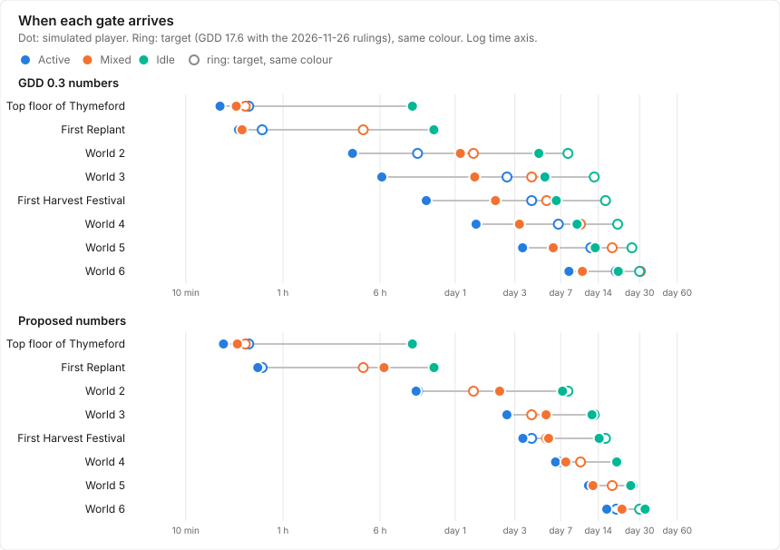
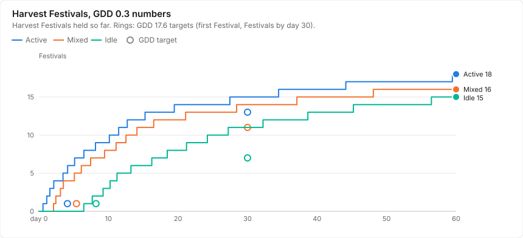
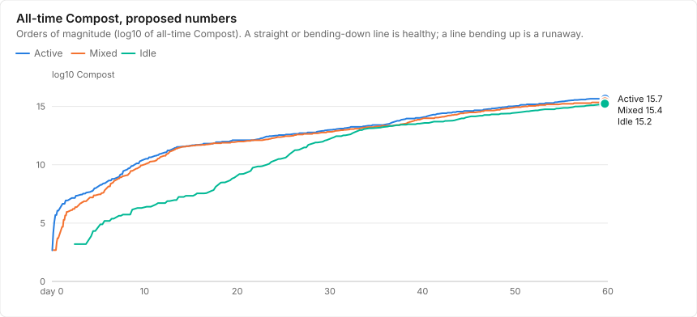

# Balance report: Sprout Tower economy on design 0.3

Written by `pnpm sim` from the simulator's runs (2026-11-26). Do not edit it by hand: change `apps/sim/src/report.ts` or the runs, then run `pnpm sim report`.

Inputs: the GDD and CONTENT of design 0.3 (one fixed manager per floor), as tables in `packages/content/tables`. Three play styles from GDD 17.6 (active, mixed, idle), 60 days each, all six planned worlds, plus the four-world launch build. Proposed changes are overlays in `apps/sim/proposals/`.

**How to run.** From the repository root: `pnpm install`, then `pnpm sim` (every run and this report, about 4 minutes on 4 processors). One player as a printed timeline: `pnpm sim run --profile idle --days 14`. Fit the gate prices again after a design change: `pnpm sim calibrate --base p1-levels,p2-taps,p3-managers --out p4-gates`.

## The verdict in plain words

**Pacing targets (GDD 17.6).** With the GDD's numbers 8 of 27 checks are on target (within a third early or half late). With the proposed numbers 20 of 27 are.

- Active, GDD numbers: Top floor of Thymeford 19 min against 32 min (1.7 times early); First Replant 27 min against 55 min (2.1 times early); World 2 3.6 h against 12.0 h (3.3 times early); World 3 6.2 h against day 2.6 (10.1 times early); First Harvest Festival 14.1 h against day 4.1 (7.0 times early); World 4 day 1.7 against day 6.7 (4.0 times early); World 5 day 4.5 against day 12.2 (2.7 times early); World 6 day 10.5 against day 19.5 (1.9 times early).
- Mixed, GDD numbers: First Replant 28 min against 4.4 h (9.3 times early); World 3 day 1.4 against day 4.1 (2.9 times early); First Harvest Festival day 2.1 against day 5.4 (2.6 times early); World 4 day 3.3 against day 10.1 (3.1 times early); World 5 day 6.4 against day 18.1 (2.8 times early); World 6 day 13.1 against day 30.5 (2.3 times early); Festivals by day 30 14 against 11 (3 too many).
- Idle, GDD numbers: World 4 day 9.2 against day 16.2 (1.8 times early); World 5 day 13.2 against day 27.2 (2.1 times early); World 6 day 23.2 against day 52.2 (2.2 times early); Festivals by day 30 11 against 7 (4 too many).
- Active, proposed numbers: Top floor of Thymeford 21 min against 32 min (1.5 times early); Festivals by day 30 9 against 13 (4 short).
- Mixed, proposed numbers: every gate on target.
- Idle, proposed numbers: First Replant day 2.5 against 16.0 h (3.7 times late); World 2 day 8.7 against day 3.2 (2.7 times late); World 3 day 13.2 against day 5.2 (2.5 times late); First Harvest Festival day 15.7 against day 8.2 (1.9 times late); World 6 day 30.5 against day 52.2 (1.7 times early).

**Dead zones.** No dead zone inside a session in the first two weeks, but the game goes quiet later: either a session has more than 30 minutes with nothing to buy, or Festivals are more than 8 days apart after day 14 (GDD 17.6 expects three to eight days).

- Active, gdd 0.3 numbers: longest open-game stretch with nothing to buy 43:09 (day 24.6); 0 of the first 30 days with no progress event; longest gap between Festivals 2.6 days before day 14, 15.3 days after day 14.
- Mixed, gdd 0.3 numbers: longest open-game stretch with nothing to buy 11:55 (day 32.5); 0 of the first 30 days with no progress event; longest gap between Festivals 2.0 days before day 14, 11.9 days after day 14 (still open when the run ended).
- Idle, gdd 0.3 numbers: longest open-game stretch with nothing to buy 3:57 (day 50.7); 1 of the first 30 days with no progress event; longest gap between Festivals 3.0 days before day 14, 11.2 days after day 14.
- Active, proposed numbers: longest open-game stretch with nothing to buy 59:54 (day 59.3); 0 of the first 30 days with no progress event; longest gap between Festivals 8.7 days before day 14, 7.7 days after day 14.
- Mixed, proposed numbers: longest open-game stretch with nothing to buy 11:54 (day 45.4); 0 of the first 30 days with no progress event; longest gap between Festivals 1.7 days before day 14, 10.8 days after day 14.
- Idle, proposed numbers: longest open-game stretch with nothing to buy 3:58 (day 46.5); 1 of the first 30 days with no progress event; longest gap between Festivals none before day 14, 8.2 days after day 14.

**Runaway growth.** None. Growth slows from week to week for every play style, as it should with exponents below 1 (GDD 17.6 note 1). The burst the first audit found (every timed ability held and fired together at 12 taps a second) put the tower at ×1,350 its steady income under the 0.1 stacking rule, and at most ×42.0 under the 0.2 rule (one Boost capped at 15, Spurt the only multiplier on it). The exploit is gone.

- Active, gdd 0.3 numbers: all-time Compost grows 11.5 orders of magnitude a week in week 1, 2.8 orders of magnitude a week in week 2, 0.8 orders of magnitude a week in weeks 3 and 4, 0.4 orders of magnitude a week in weeks 5 to 8.
- Mixed, gdd 0.3 numbers: all-time Compost grows 10.8 orders of magnitude a week in week 1, 2.7 orders of magnitude a week in week 2, 0.9 orders of magnitude a week in weeks 3 and 4, 0.4 orders of magnitude a week in weeks 5 to 8.
- Idle, gdd 0.3 numbers: all-time Compost grows 6.6 orders of magnitude a week in week 1, 4.3 orders of magnitude a week in week 2, 1.6 orders of magnitude a week in weeks 3 and 4, 0.6 orders of magnitude a week in weeks 5 to 8.
- Active, proposed numbers: all-time Compost grows 8.8 orders of magnitude a week in week 1, 2.7 orders of magnitude a week in week 2, 0.6 orders of magnitude a week in weeks 3 and 4, 0.7 orders of magnitude a week in weeks 5 to 8.
- Mixed, proposed numbers: all-time Compost grows 8.6 orders of magnitude a week in week 1, 2.9 orders of magnitude a week in week 2, 0.6 orders of magnitude a week in weeks 3 and 4, 0.6 orders of magnitude a week in weeks 5 to 8.
- Idle, proposed numbers: all-time Compost grows 5.4 orders of magnitude a week in week 1, 1.9 orders of magnitude a week in week 2, 2.2 orders of magnitude a week in weeks 3 and 4, 0.8 orders of magnitude a week in weeks 5 to 8.

**Longevity.** Days to weeks, yes: the gates are spread over the first three to eight weeks for every play style and new things still arrive in week 8. The risk is the other way round: after week 2 the content runs out of power before the budget does, so the late game stretches (see "What each system is worth").

- Active, gdd 0.3 numbers, launch build (4 worlds): level 95 on day 60, 18 Festivals, 3 of them after day 30; progress events in weeks 5 to 8: 47, 36, 37, 21.
- Active, proposed numbers, launch build (4 worlds): level 87 on day 60, 14 Festivals, 3 of them after day 30; progress events in weeks 5 to 8: 39, 47, 35, 17.
- Idle, gdd 0.3 numbers, six worlds: level 79 on day 60, 15 Festivals, World 6 day 23.2.
- Idle, proposed numbers, six worlds: level 68 on day 60, 12 Festivals, World 6 day 30.5.

## Recommended number changes

Four overlays in `apps/sim/proposals/`, applied in this order: `p1-levels`, `p2-taps`, `p3-managers`, `p4-gates`. Each is a plain list of table values. None is in the GDD tables yet: they are proposals for the Game Designer, who owns the numbers. The last one was fitted by `pnpm sim calibrate` on top of the first three, so the gate prices are only right together with them.

| Overlay | Number | GDD 0.3 | Proposed |
| --- | --- | --- | --- |
| `p1-levels` | `XP_DAILY` | 1500 | 1000 |
| `p1-levels` | `XP_DAILY_ALL` | 1500 | 1000 |
| `p1-levels` | `XP_ACHIEVEMENT` | [200,400,800,1500,3000] | [100,200,400,750,1500] |
| `p2-taps` | `skill.gt.firm_grip` effect.value | 0.2 | 0.1 |
| `p2-taps` | `skill.gt.keep_the_rhythm` effect.value | 4 | 2 |
| `p2-taps` | `skill.gt.bumper_crop` effect.value | 0.01 | 0.005 |
| `p2-taps` | `skill.gt.big_bumpers` effect.value | 1 | 0.5 |
| `p3-managers` | `MGR_BASE` | {"common":2,"uncommon":2.5,"rare":3,"epic":3.5,"legendary":4,"exotic":5} | {"common":2,"uncommon":2.2,"rare":2.4,"epic":2.6,"legendary":2.8,"exotic":3} |
| `p3-managers` | `MGR_STEP` | {"common":1.2,"uncommon":1.2,"rare":1.2,"epic":1.22,"legendary":1.28,"exotic":1.43} | {"common":1.2,"uncommon":1.213,"rare":1.227,"epic":1.266,"legendary":1.358,"exotic":1.625} |
| `p4-gates` | `FIRST_REPLANT_MIN` | 60 | 460 |
| `p4-gates` | `RIBBON_C0` | 50000 | 5.5e5 |
| `p4-gates` | `world.w1` ticket | 5e19 | 3.7e22 |
| `p4-gates` | `world.w2` ticket | 2e19 | 9.2e22 |
| `p4-gates` | `world.w3` ticket | 1e24 | 2.6e25 |
| `p4-gates` | `world.w4` ticket | 2e29 | 2.6e29 |
| `p4-gates` | `world.w5` ticket | 1e34 | 6.1e30 |
| `p4-gates` | `shop.ribbon.deed_nebula` costs | [600] | [250] |

**`p1-levels`: Fewer one-off XP gifts in the first hour.** On design 0.3 a new active player has 27,430 XP after one hour (level 13) against the 8,750 that level 8 needs, and the skill tree opens at minute 13 instead of minute 26. Most of it comes in lumps: the first Compost records (8,250 XP), the first daily quests (6,000 XP) and the achievements that are already earned when the achievement book opens (4,600 XP). Halving the achievement rewards and cutting the daily quests to 1,000 XP leaves 19,450 XP at one hour (level 11) and the skill tree at minute 16. A stronger cut (XP_BASE 1000 as well) reaches level 9 at one hour, but it pushes the mixed player's top floor past the end of the first session (from 28 minutes to 2.4 hours), so it is not proposed. The rest of the gap is Compost-record XP at the first Replant, which REPLANT_XP_STEP controls.

**`p2-taps`: Tap skills at half strength.** Tap income is several times the budget of GDD 17.6 in the first week, because four Green Thumb skills are full on day 1. Half the value per rank keeps the branch worth taking and spreads the growth over the first weeks.

**`p3-managers`: Managers start closer together.** With one fixed manager per floor the rarest managers sit on the floors that earn the most, so the income-weighted manager multiplier is about 5 on days 0 to 3 against a budget of 2 to 2.5. Lower level 1 values with larger steps keep every rarity's profit at max level where design 0.3 has it.

**`p4-gates`: Gate prices fitted to the GDD 17.6 pacing table (active profile).** Fitted by "pnpm sim calibrate" on top of p1-levels, p2-taps, p3-managers. First Replant: 60.0 -> 4.6e+2 (target 55 min, lands 55 min; was 25 min) World 2: 5.00e+19 -> 3.7e+22 (target 12.0 h, lands 11.7 h; was 6.1 h) World 3: 2.00e+19 -> 9.2e+22 (target day 2.60, lands day 2.48; was 14.0 h) First Harvest Festival: 5.00e+4 -> 5.5e+5 (target day 4.10, lands day 4.24; was day 2.48) World 4: 1.00e+24 -> 2.6e+25 (target day 6.70, lands day 6.70; was day 6.13) World 5: 2.00e+29 -> 2.6e+29 (target day 12.20, lands day 12.15; was day 12.14) World 6: 1.00e+34 -> 6.1e+30 (target day 19.50, lands day 19.49; was day 33.26) The World 6 deed comes down from 600 to 250 Ribbons first: at 600 even a free ticket lands World 6 on day 23.4, because the slower Ribbons of RIBBON_C0 = 550000 reach 600 too late.

### Before and after, every gate

**Active**

| Gate | Target | GDD 0.3 numbers | Proposed numbers |
| --- | --- | --- | --- |
| Top floor of Thymeford | 32 min | 19 min (1.7 times early) | 21 min (1.5 times early) |
| First Replant | 55 min | 27 min (2.1 times early) | 48 min (on target) |
| World 2 | 12.0 h | 3.6 h (3.3 times early) | 11.4 h (on target) |
| World 3 | day 2.6 | 6.2 h (10.1 times early) | day 2.3 (on target) |
| First Harvest Festival | day 4.1 | 14.1 h (7.0 times early) | day 3.7 (on target) |
| World 4 | day 6.7 | day 1.7 (4.0 times early) | day 6.7 (on target) |
| World 5 | day 12.2 | day 4.5 (2.7 times early) | day 12.2 (on target) |
| World 6 | day 19.5 | day 10.5 (1.9 times early) | day 17.4 (on target) |
| Festivals by day 30 | 13 | 15 (on target) | 9 (4 short) |

**Mixed**

| Gate | Target | GDD 0.3 numbers | Proposed numbers |
| --- | --- | --- | --- |
| Top floor of Thymeford | 30 min | 25 min (on target) | 28 min (on target) |
| First Replant | 4.4 h | 28 min (9.3 times early) | 4.5 h (on target) |
| World 2 | day 1.4 | day 1.1 (on target) | day 1.6 (on target) |
| World 3 | day 4.1 | day 1.4 (2.9 times early) | day 4.3 (on target) |
| First Harvest Festival | day 5.4 | day 2.1 (2.6 times early) | day 5.4 (on target) |
| World 4 | day 10.1 | day 3.3 (3.1 times early) | day 7.4 (on target) |
| World 5 | day 18.1 | day 6.4 (2.8 times early) | day 12.7 (on target) |
| World 6 | day 30.5 | day 13.1 (2.3 times early) | day 20.7 (on target) |
| Festivals by day 30 | 11 | 14 (3 too many) | 9 (on target) |

**Idle**

| Gate | Target | GDD 0.3 numbers | Proposed numbers |
| --- | --- | --- | --- |
| Top floor of Thymeford | 11.0 h | 10.9 h (on target) | 10.9 h (on target) |
| First Replant | 16.0 h | 16.2 h (on target) | day 2.5 (3.7 times late) |
| World 2 | day 3.2 | day 4.7 (on target) | day 8.7 (2.7 times late) |
| World 3 | day 5.2 | day 5.2 (on target) | day 13.2 (2.5 times late) |
| First Harvest Festival | day 8.2 | day 6.5 (on target) | day 15.7 (1.9 times late) |
| World 4 | day 16.2 | day 9.2 (1.8 times early) | day 19.7 (on target) |
| World 5 | day 27.2 | day 13.2 (2.1 times early) | day 26.2 (on target) |
| World 6 | day 52.2 | day 23.2 (2.2 times early) | day 30.5 (1.7 times early) |
| Festivals by day 30 | 7 | 11 (4 too many) | 7 (on target) |

## Pacing targets: first 10 minutes, first hour, day 1, week 1, month

The GDD gives a minute-by-minute table for a new player's first hour (section 16) and milestones for day 1, week 1 and month 1 (section 17). The simulated new player is the active profile with the beginner model described under "How the simulated players decide".

| Active player | GDD target | GDD numbers | Proposed numbers |
| --- | --- | --- | --- |
| Level at 10 minutes | about 3 to 4 | 4 | 4 |
| Floors open at 10 minutes | 7 | 7 | 7 |
| Level at 1 hour | 8 | 13 | 11 |
| Top floor (floor 10) | 32 min | 19 min | 21 min |
| First Replant | 50 to 60 min | 27 min | 48 min |
| Replants by day 1 | 6 to 10 | 19 | 11 |
| Level at day 1 | about 18 | 29 | 23 |
| Level at day 7 | about 40 | 49 | 41 |
| Research projects by day 7 | 12 to 15 | 21 | 19 |
| Festivals by day 7 | 3 to 4 | 8 | 2 |
| Level at day 30 | about 70 | 78 | 68 |
| Level at day 60 | cap 112 about month 3 | 97 | 88 |

### The reveal order (GDD section 16, 31 rows)

Measured in game time. Rows 1 to 19 have a target in minutes of the first session, rows 20 to 31 a target day for the active player.

| # | Feature | Target | Active, GDD | Mixed, GDD | Idle, GDD | Active, proposed | Mixed, proposed | Idle, proposed |
| --- | --- | --- | --- | --- | --- | --- | --- | --- |
| 1 | `tap_to_harvest` | 0.1 min | 0.0 min | 0.0 min | 0.0 min | 0.0 min | 0.0 min | 0.0 min |
| 2 | `floor_levels` | 0.2 min | 0.0 min | 0.0 min | 0.0 min | 0.0 min | 0.0 min | 0.0 min |
| 3 | `milestones` | 0.6 min | 0.7 min | 0.8 min | 0.7 min | 0.7 min | 0.8 min | 0.7 min |
| 4 | `more_floors` | 0.7 min | 0.4 min | 0.4 min | 0.4 min | 0.4 min | 0.4 min | 0.4 min |
| 5 | `managers` | 1.5 min | 2.1 min | 2.1 min | 2.7 min | 2.1 min | 2.1 min | 2.7 min |
| 6 | `tap_bonus` | 1.7 min | 2.1 min | 2.1 min | 2.7 min | 2.1 min | 2.1 min | 2.7 min |
| 7 | `quests` | 2.3 min | 3.0 min | 3.2 min | 4.1 min | 3.0 min | 3.2 min | 4.1 min |
| 8 | `plants` | 3.5 min | 4.0 min | 4.4 min | 6.1 min | 4.0 min | 4.4 min | 5.2 min |
| 9 | `bumpers` | 4.0 min | 3.5 min | 3.3 min | 4.6 min | 3.5 min | 3.3 min | 4.6 min |
| 10 | `visitors` | 5.5 min | 5.3 min | 5.7 min | 8.5 min | 5.3 min | 6.6 min | 8.4 min |
| 11 | `abilities` | 11 min | 8.8 min | 9.3 min | 13 min | 9.0 min | 9.9 min | 12 min |
| 12 | `spurt` | 13 min | 11 min | 12 min | 5.5 h | 11 min | 12 min | 5.5 h |
| 13 | `basket` | 15 min | 15 min | 15 min | 15 min | 15 min | 15 min | 15 min |
| 14 | `achievements` | 21 min | 13 min | 18 min | 5.6 h | 14 min | 15 min | 5.6 h |
| 15 | `skills` | 26 min | 13 min | 18 min | 10.9 h | 16 min | 21 min | 10.9 h |
| 16 | `offline` | - | 3.2 h | 2.4 h | 5.5 h | 3.2 h | 2.4 h | 5.5 h |
| 17 | `replant` | 50 min | 19 min | 28 min | 10.9 h | 48 min | 4.4 h | day 1.2 |
| 18 | `research` | 55 min | 27 min | 28 min | 16.2 h | 48 min | 4.5 h | day 2.5 |
| 19 | `heirlooms` | 90 min | 3.3 h | 14.4 h | day 4.2 | 3.3 h | 14.5 h | day 4.5 |
| 20 | `world2` | day 1.0 | 3.6 h | day 1.1 | day 4.7 | 11.4 h | day 1.6 | day 8.7 |
| 21 | `bees` | day 1.5 | 11.2 h | day 1.2 | day 4.5 | 14.3 h | day 1.2 | day 4.7 |
| 22 | `events` | day 1.5 | 40 min | 12.4 h | day 2.2 | 3.2 h | 12.5 h | day 2.7 |
| 23 | `bench` | day 2.0 | day 1.3 | day 2.0 | day 5.5 | day 1.5 | day 2.3 | day 9.0 |
| 24 | `world3` | day 3.0 | 6.2 h | day 1.4 | day 5.2 | day 2.3 | day 4.3 | day 13.2 |
| 25 | `mutation` | day 6.0 | day 8.0 | day 9.0 | day 14.2 | day 10.0 | day 11.0 | day 20.0 |
| 26 | `festival` | day 4.5 | 14.0 h | day 2.1 | day 6.2 | day 3.7 | day 5.4 | day 15.7 |
| 27 | `auto_buy` | day 5.0 | 14.2 h | day 2.1 | day 6.7 | day 3.7 | day 5.4 | day 16.5 |
| 28 | `world4` | day 10.0 | day 1.7 | day 3.3 | day 9.2 | day 6.7 | day 7.4 | day 19.7 |
| 29 | `head_copies` | day 11.0 | day 1.0 | day 2.4 | day 7.7 | day 4.2 | day 5.6 | day 17.0 |
| 30 | `world5` | day 17.0 | day 4.5 | day 6.4 | day 13.2 | day 12.2 | day 12.7 | day 26.2 |
| 31 | `world6` | day 24.0 | day 10.5 | day 13.1 | day 23.2 | day 17.4 | day 20.7 | day 30.5 |

## When each gate arrives

Every unlock, Replant, Festival and world arrival of each run is in `data/timeline-<run>.csv` (one row per event: game time, day, play time, kind, id, world, count).

**GDD 0.3 numbers**

| Gate | Active (target) | Mixed (target) | Idle (target) |
| --- | --- | --- | --- |
| Top floor of Thymeford | 19 min (32 min) | 25 min (30 min) | 10.9 h (11.0 h) |
| First Replant | 27 min (55 min) | 28 min (4.4 h) | 16.2 h (16.0 h) |
| World 2 | 3.6 h (12.0 h) | day 1.1 (day 1.4) | day 4.7 (day 3.2) |
| World 3 | 6.2 h (day 2.6) | day 1.4 (day 4.1) | day 5.2 (day 5.2) |
| First Harvest Festival | 14.1 h (day 4.1) | day 2.1 (day 5.4) | day 6.5 (day 8.2) |
| World 4 | day 1.7 (day 6.7) | day 3.3 (day 10.1) | day 9.2 (day 16.2) |
| World 5 | day 4.5 (day 12.2) | day 6.4 (day 18.1) | day 13.2 (day 27.2) |
| World 6 | day 10.5 (day 19.5) | day 13.1 (day 30.5) | day 23.2 (day 52.2) |

**Proposed numbers**

| Gate | Active (target) | Mixed (target) | Idle (target) |
| --- | --- | --- | --- |
| Top floor of Thymeford | 21 min (32 min) | 28 min (30 min) | 10.9 h (11.0 h) |
| First Replant | 48 min (55 min) | 4.5 h (4.4 h) | day 2.5 (16.0 h) |
| World 2 | 11.4 h (12.0 h) | day 1.6 (day 1.4) | day 8.7 (day 3.2) |
| World 3 | day 2.3 (day 2.6) | day 4.3 (day 4.1) | day 13.2 (day 5.2) |
| First Harvest Festival | day 3.7 (day 4.1) | day 5.4 (day 5.4) | day 15.7 (day 8.2) |
| World 4 | day 6.7 (day 6.7) | day 7.4 (day 10.1) | day 19.7 (day 16.2) |
| World 5 | day 12.2 (day 12.2) | day 12.7 (day 18.1) | day 26.2 (day 27.2) |
| World 6 | day 17.4 (day 19.5) | day 20.7 (day 30.5) | day 30.5 (day 52.2) |

## Dead zones

A progress event is a new floor, world, unlock, research project, heirloom, Mastery star, bench job, Replant or Festival. An empty cell is a day on which none of these happened.

| Run | Longest open-game stretch with nothing to buy | Longest play time between two reward beats | Days with no progress event (day numbers from 1) | Replants taken only because nothing else was left |
| --- | --- | --- | --- | --- |
| Active, GDD | 43:09 (day 24.6) | 60:00 (day 22.4) | 1: 51 | 167 |
| Mixed, GDD | 11:55 (day 32.5) | 12:08 (day 23.6) | 3: 35, 56, 60 | 187 |
| Idle, GDD | 3:57 (day 50.7) | 4:01 (day 37.2) | 1: 2 | 151 |
| Active, proposed | 59:54 (day 59.3) | 59:60 (day 31.4) | none | 160 |
| Mixed, proposed | 11:54 (day 45.4) | 12:08 (day 22.3) | 1: 37 | 171 |
| Idle, proposed | 3:58 (day 46.5) | 4:02 (day 54.5) | 1: 4 | 115 |

### Festival gaps

| Run | Days between Festivals, in order |
| --- | --- |
| Active, GDD | 0.5, 0.4, 0.6, 1.3, 0.7, 1.0, 1.3, 1.7, 2.0, 1.3, 1.2, 2.6, 4.2, 8.0, 7.0, 9.7, 15.3, 0.5 (open) |
| Mixed, GDD | 0.3, 0.7, 0.4, 1.6, 1.0, 1.3, 2.0, 1.7, 1.4, 1.6, 2.4, 4.6, 7.3, 8.7, 11.0, 11.9 (open) |
| Idle, GDD | 1.2, 1.6, 1.0, 1.0, 2.0, 3.0, 2.2, 2.8, 3.0, 3.0, 5.0, 6.4, 6.6, 11.2, 3.5 (open) |
| Active, proposed | 1.4, 2.0, 1.0, 1.3, 2.1, 1.9, 8.7, 6.5, 7.5, 4.0, 6.4, 7.7, 5.8 (open) |
| Mixed, proposed | 1.0, 1.3, 1.5, 1.5, 1.7, 1.7, 9.0, 6.6, 7.9, 4.5, 6.3, 10.8, 0.8 (open) |
| Idle, proposed | 2.6, 2.0, 2.0, 2.2, 1.8, 2.2, 3.0, 2.8, 8.2, 6.0, 8.0, 3.5 (open) |

## Runaway growth

Orders of magnitude of all-time Compost gained per week. Falling numbers mean growth slows down, which is what an idle game needs to last.

| Run | Week 1 | Week 2 | Weeks 3 and 4 | Weeks 5 to 8 |
| --- | --- | --- | --- | --- |
| Active, GDD | 11.5 | 2.8 | 0.8 | 0.4 |
| Mixed, GDD | 10.8 | 2.7 | 0.9 | 0.4 |
| Idle, GDD | 6.6 | 4.3 | 1.6 | 0.6 |
| Active, proposed | 8.8 | 2.7 | 0.6 | 0.7 |
| Mixed, proposed | 8.6 | 2.9 | 0.6 | 0.6 |
| Idle, proposed | 5.4 | 1.9 | 2.2 | 0.8 |

### Burst stacking and the tap limit

| Run | Highest tower income over steady income | World 5 | World 6 | Festivals in 10 days | Tap income over steady, day 7, at 6 taps/s | at 12 taps/s |
| --- | --- | --- | --- | --- | --- | --- |
| Every timed ability held and fired together, 12 taps a second, 0.1 stacking rule | ×1,350 | day 3.3 | day 5.6 | 11 | 11.3 | 22.6 |
| The same player under the 0.2 rule | ×42.0 | day 2.6 | day 7.7 | 11 | 13.0 | 26.0 |
| Active player, 6 taps a second | ×45.0 | day 4.5 | day 10.5 | 9 | 15.2 | 30.4 |
| Active player at the tap limit, 12 taps a second | ×45.0 | day 3.5 | day 8.5 | 10 | 13.6 | 27.3 |

Reviewer note 1 asks for both tap rates with every ability in. On day 60 of the active run, taps pay 15.3 times steady income at 6 taps a second and 30.7 times at 12, before Boost and Growth Spurt. With the Boost at its cap of 15 and a Spurt (×4 at most) the ceiling is about 1841 times steady income at the tap limit for the length of a Spurt. That is inside the reviewer's 450 to 650 range for a finished account and is only reached for 20 seconds at a time.

## Longevity

| Run | Day 30 | Day 60 | Progress events, days 30 to 60 |
| --- | --- | --- | --- |
| Active, GDD, six worlds | level 78, 15 F, 300 R, 36 research, 18 heirlooms | level 97, 18 F, 389 R, 40 research, 18 heirlooms | 142 |
| Mixed, GDD, six worlds | level 75, 14 F, 284 R, 35 research, 17 heirlooms | level 92, 16 F, 364 R, 39 research, 18 heirlooms | 121 |
| Idle, GDD, six worlds | level 63, 11 F, 173 R, 33 research, 16 heirlooms | level 79, 15 F, 284 R, 40 research, 17 heirlooms | 157 |
| Active, GDD, launch build (4 worlds) | level 76, 15 F, 268 R, 35 research, 17 heirlooms | level 95, 18 F, 358 R, 39 research, 18 heirlooms | 143 |
| Idle, GDD, launch build (4 worlds) | level 59, 10 F, 161 R, 32 research, 15 heirlooms | level 71, 13 F, 238 R, 39 research, 16 heirlooms | 110 |
| Active, proposed, six worlds | level 68, 9 F, 191 R, 34 research, 15 heirlooms | level 88, 13 F, 314 R, 39 research, 17 heirlooms | 188 |
| Mixed, proposed, six worlds | level 65, 9 F, 165 R, 33 research, 18 heirlooms | level 84, 13 F, 294 R, 39 research, 18 heirlooms | 177 |
| Idle, proposed, six worlds | level 50, 7 F, 108 R, 29 research, 13 heirlooms | level 68, 12 F, 228 R, 39 research, 17 heirlooms | 181 |
| Active, proposed, launch build | level 69, 11 F, 213 R, 33 research, 14 heirlooms | level 87, 14 F, 306 R, 38 research, 17 heirlooms | 148 |

F: Harvest Festivals held. R: Replants. The launch build stops at World 4, so its late game is Festivals, research, heirlooms and card levels only.

## What each system is worth

The designer's pacing script (GDD 17.6) runs on a budget: what managers, taps and "everything else" (skills, plants, card levels, research, heirlooms, achievements, codex, Mastery) multiply income by on each day. The simulator measures the same three numbers on the active player's newest world: the income-weighted manager multiplier, the permanent multiplier on the best floor without Rich Soil and Golden Hour (those are modelled by the script itself), and tap income at 6 taps a second as a multiple of steady income.

| When | Budget: managers / everything else / taps | Active, GDD | Active, proposed |
| --- | --- | --- | --- |
| hour 1 | ×2.0 / ×1.1 / ×1.9 | ×3.4 / ×1.5 / ×4.0 | ×3.8 / ×1.3 / ×3.0 |
| day 1 | ×2.5 / ×4.0 / ×2.5 | ×5.0 / ×22.8 / ×8.1 | ×3.1 / ×17.0 / ×4.6 |
| day 3 | ×3.1 / ×16.0 / ×3.1 | ×5.1 / ×31.8 / ×8.5 | ×3.1 / ×16.0 / ×5.2 |
| day 7 | ×5.0 / ×120 / ×5.0 | ×5.5 / ×132 / ×15.2 | ×3.3 / ×88.9 / ×5.9 |
| day 14 | ×6.0 / ×700 / ×6.2 | ×5.4 / ×501 / ×15.7 | ×3.5 / ×282 / ×9.8 |
| day 30 | ×9.0 / ×7,000 / ×10.0 | ×6.9 / ×1,506 / ×13.0 | ×3.6 / ×271 / ×8.9 |
| day 60 | ×13.0 / ×20,000 / ×14.0 | ×11.6 / ×1,885 / ×15.3 | ×5.2 / ×838 / ×9.4 |

### Each system switched off (active player, first 3 days)

On design 0.3 no single content system moves World 2 by more than a few percent of play time: the early rush comes from what every run has, the fixed managers of the top floors and tapping (see the budget table above).

Game time moves in steps of whole sessions (World 2 either arrives in a session or at the start of the next one), so the first column, minutes of play, is the fair comparison.

| Run | World 2, minutes of play | World 2 | World 3 | First Festival | Replants by day 3 | Level on day 3 |
| --- | --- | --- | --- | --- | --- | --- |
| Everything on | 87 min | 3.6 h | 6.2 h | 14.1 h | 59 | 39 |
| Without: Skill tree | 90 min | 5.8 h | 11.2 h | day 1.1 | 49 | 38 |
| Without: Card levels | 90 min | 5.8 h | 8.6 h | 16.5 h | 60 | 37 |
| Without: Plants | 90 min | 5.8 h | 11.2 h | day 1.5 | 39 | 34 |
| Without: Heirlooms | 90 min | 3.7 h | 8.8 h | day 1.1 | 47 | 37 |
| Without: Manager and heirloom abilities | 85 min | 3.6 h | 8.5 h | 14.3 h | 63 | 39 |
| Without: Garden Visitors | 90 min | 5.8 h | 8.6 h | 16.6 h | 61 | 36 |
| Without: Research | 90 min | 3.7 h | 11.5 h | day 1.5 | 38 | 33 |
| Without: Compost Shop items other than Rich Soil | 86 min | 3.6 h | 8.9 h | not reached | 13 | 28 |
| Without: Growth Spurts | 90 min | 5.8 h | 11.2 h | day 1.1 | 59 | 39 |

## The Game Designer's questions for design 0.3

### Manager profit on the top floors, days 0 to 2 (CHANGES A.7, item 2)

With one fixed manager per floor the rarest managers sit on the floors that earn most. Measured on the active player's newest world: the median hired manager, the mean of the three highest hired floors, and the income-weighted mean (what managers multiply that world's income by).

| When | Budget | Active, GDD: median / top 3 / weighted | Active, proposed: median / top 3 / weighted |
| --- | --- | --- | --- |
| 10 min | ×2.0 | ×3.0 / ×3.2 / ×3.5 | ×2.7 / ×2.8 / ×2.8 |
| 60 min | ×2.0 | ×3.5 / ×3.2 / ×3.1 | ×3.2 / ×4.1 / ×3.4 |
| 6.0 h | ×2.1 | ×3.0 / ×4.2 / ×4.9 | ×3.5 / ×4.5 / ×3.5 |
| day 1.0 | ×2.5 | ×3.6 / ×4.8 / ×5.0 | ×3.0 / ×3.7 / ×3.1 |
| day 2.0 | ×2.8 | ×3.5 / ×4.5 / ×4.9 | ×3.5 / ×3.7 / ×3.1 |

### Average Boost in each world (CHANGES A.7, item 4)

Time-weighted over every session spent in that world, days 0 to 60. Boost is the sum of timed bonuses on the world on screen (cap 15); the tap column is the Boost the taps see.

| World | Active, GDD | Mixed, GDD | Active, proposed | Mixed, proposed |
| --- | --- | --- | --- | --- |
| Thymeford | ×1.5 (taps ×1.8, Spurt 28%) | ×1.5 (taps ×1.7, Spurt 7%) | ×1.4 (taps ×1.6, Spurt 21%) | ×1.7 (taps ×1.7, Spurt 9%) |
| World 2 | ×1.5 (taps ×1.7, Spurt 30%) | ×2.2 (taps ×2.2, Spurt 18%) | ×1.6 (taps ×1.8, Spurt 40%) | ×2.1 (taps ×2.2, Spurt 20%) |
| World 3 | ×1.5 (taps ×1.9, Spurt 42%) | ×1.9 (taps ×2.1, Spurt 17%) | ×1.6 (taps ×2.0, Spurt 45%) | ×1.8 (taps ×2.1, Spurt 19%) |
| Mount Mitten (World 4) | ×1.8 (taps ×2.2, Spurt 55%) | ×1.9 (taps ×2.1, Spurt 27%) | ×1.7 (taps ×2.1, Spurt 55%) | ×1.9 (taps ×2.0, Spurt 28%) |
| World 5 | ×1.9 (taps ×2.3, Spurt 59%) | ×2.2 (taps ×2.4, Spurt 30%) | ×2.0 (taps ×2.3, Spurt 53%) | ×2.2 (taps ×2.3, Spurt 30%) |
| World 6 | ×1.8 (taps ×2.3, Spurt 65%) | ×2.4 (taps ×2.7, Spurt 35%) | ×1.8 (taps ×2.3, Spurt 58%) | ×2.4 (taps ×2.7, Spurt 34%) |

The script assumes Growth Spurts cover 29 percent of an active session. The measured share is in brackets.

### Where the manager copies go (CHANGES A.7, item 3)

Chest manager slots pick among the managers already met, so early copies pile onto Thymeford. Mean card level of the met managers in each world:

| Run | Thymeford | World 2 | World 3 | Mount Mitten (World 4) | World 5 | World 6 |
| --- | --- | --- | --- | --- | --- | --- |
| Active, GDD, day 3 | 4.3 | 3.3 | 3.0 | 2.0 | - | - |
| Active, GDD, day 7 | 4.9 | 3.9 | 3.7 | 2.9 | 2.0 | - |
| Active, GDD, day 14 | 5.6 | 4.6 | 4.7 | 4.0 | 3.6 | 2.4 |
| Active, GDD, day 30 | 6.0 | 5.1 | 5.4 | 4.9 | 4.6 | 4.3 |
| Active, GDD, day 60 | 6.8 | 5.9 | 6.3 | 5.7 | 5.6 | 5.4 |
| Active, proposed, day 3 | 4.3 | 2.9 | 1.4 | - | - | - |
| Active, proposed, day 7 | 4.8 | 3.9 | 3.3 | 1.1 | - | - |
| Active, proposed, day 14 | 5.5 | 4.7 | 4.3 | 3.6 | 1.9 | - |
| Active, proposed, day 30 | 6.0 | 5.3 | 5.0 | 4.4 | 3.7 | 3.0 |
| Active, proposed, day 60 | 6.8 | 6.0 | 5.9 | 5.7 | 5.0 | 4.7 |

### Event track and the top chests (reviewer note 4, CHANGES A.7, item 5)

The simulated players play the Garden Fair every weekend, and its chests are in every card and heirloom number of this report.

| Run | Weekends with the track finished | Golden Chests a week (all sources) | Crystal Chests a week | Starlight Chests a week |
| --- | --- | --- | --- | --- |
| Active, GDD | 8 of 9 | 5.7 | 2.1 | 0.47 |
| Mixed, GDD | 8 of 9 | 5.3 | 1.9 | 0.47 |
| Active, proposed | 8 of 9 | 4.9 | 2.1 | 0.35 |
| Mixed, proposed | 7 of 9 | 4.9 | 2.0 | 0.35 |
| Idle, GDD | 0 of 9 | 3.5 | 0.7 | 0.47 |

### Mastery stars (reviewer note 5)

| Run | Thymeford: star days | World 2: star days | World 3: star days |
| --- | --- | --- | --- |
| Active, GDD | 0.2, 0.2, 0.2, 0.4, 1.0, 1.6 | 0.2, 0.2, 0.2, 1.6, 4.6, 7.1, 10.7, 12.6, 19.1, 31.5 | 0.3, 0.3, 0.4, 3.0, 7.0, 9.6, 12.4, 17.1, 31.1, 52.1 |
| Active, proposed | 0.5, 0.5, 0.5, 0.5, 4.2, 5.1, 8.1, 11.1 | 0.5, 0.5, 0.5, 5.1, 11.0, 15.2, 26.1, 38.1, 51.5 | 2.3, 2.3, 2.3, 8.0, 15.6, 24.1, 37.6, 50.1 |

Stars 1 to 3 still land together on arrival in each world, because `MASTERY_LEVELS` starts at 25, 50 and 100 and a new world's floors pass those levels within minutes. Setting the ten levels from cost is not done in this pass; the recommendation is under "Open items".

### Where the XP comes from

| Run | Level | XP | quests | achievements | milestones | replants | story | chests | visitors | mastery |
| --- | --- | --- | --- | --- | --- | --- | --- | --- | --- | --- |
| Active, GDD, 60 min | 13 | 27,430 | 6,000 | 4,600 | 3,450 | 8,250 | 3,850 | 1,140 | 140 | 0 |
| Active, GDD, day 1.0 | 29 | 116,850 | 24,000 | 15,200 | 16,300 | 37,950 | 8,900 | 3,480 | 1,020 | 10,000 |
| Active, GDD, day 7.0 | 49 | 328,830 | 77,000 | 39,900 | 39,300 | 111,150 | 20,900 | 10,400 | 8,180 | 22,000 |
| Active, proposed, 60 min | 11 | 19,450 | 4,000 | 2,300 | 3,200 | 5,400 | 3,550 | 860 | 140 | 0 |
| Active, proposed, day 1.0 | 23 | 79,210 | 11,000 | 6,300 | 11,300 | 31,500 | 8,900 | 2,500 | 710 | 7,000 |
| Active, proposed, day 7.0 | 41 | 228,355 | 70,000 | 14,000 | 26,850 | 65,250 | 20,900 | 7,540 | 7,815 | 16,000 |

## Check against the designer's pacing script

The script in GDD 17.6 plays a perfect player on floors, levels, milestones, hires, taps, Replant, Compost and Rich Soil, with everything else as a budget. With every other system switched off, the simulator's perfect player is the closest match.

| Player | Top floor | First Replant | World 2 |
| --- | --- | --- | --- |
| Script (GDD 17.6), active | 17 min | 36 min | day 0.5 |
| Simulator, perfect player, every other system off | 15 min (15 min of play) | 19 min (19 min of play) | 3.4 h (71 min of play) |
| Simulator, perfect player, everything on | 7.4 min (7 min of play) | 8.0 min (8 min of play) | 23 min (23 min of play) |
| Simulator, new player (active), everything on | 19 min (19 min of play) | 27 min (27 min of play) | 3.6 h (87 min of play) |

On design 0.2 the bare perfect player landed on the script (16:30 to the top floor, 26:25 to the first Replant). On 0.3 it is a little faster, because the fixed managers of the top floors start at ×3 to ×5 instead of ×2.

## Reviewer's five notes (re-check of PR #3)

1. **Ceiling sentence in GDD 6.7.** Measured above under "Burst stacking and the tap limit", at both tap rates, with every ability in.
2. **Combo for a mouse-only player.** Not a number the simulator can settle. The simulated player taps without pauses while tapping, and its purchases do not interrupt the Combo (assumption below). A playtest should decide.
3. **Autopilot taps and counted taps.** The simulator follows the ruling: Autopilot taps fill neither Spurt, Combo, Hearth Heat, tap quests nor the `taps` achievement.
4. **Event track every weekend.** Played every weekend; its chests are in all card and heirloom rates (table above).
5. **Mastery spacing.** Measured above; levels from cost are an open item.

## Open items

- **The idle player's first two weeks.** One price list serves all three play styles. Fitted for the active player, it puts the mixed player on target too, but the idle player reaches the first Replant, World 2, World 3 and the first Festival two to four times late, and is back on target from World 4. The cause is the spread between play styles: with the GDD's numbers the active player reaches World 2 31 times sooner than the idle player, where the pacing table expects 6.4 times; the proposed content changes narrow that to about 18 times, not to 6.4. Two things that do not close it, measured: an 8-hour base offline cap (`OFFLINE_CAP_BASE` 4 to 8) moves no gate, because in a game that grows this fast a third more income saves only hours; a first-Replant minimum of 120 puts the idle player's first Replant on target (16 hours) but leaves World 2 on day 7.7 and makes the active and mixed players' first Replant early. The designer's choice: accept a slower idle week 1 (idle players check in three times a day for four minutes), move the idle targets for weeks 1 and 2, or give idle players a catch-up of their own in week 1 (for example offline efficiency that starts higher and is not bought).
- **The late game after week 2.** The content multiplier ("everything else") falls behind the budget from about day 7 and ends far below it on day 60 (table under "What each system is worth"). That is why Festivals stretch beyond eight days in weeks 4 to 8 for every play style, with the GDD's numbers and with the proposed ones, and why the active player holds 9 Festivals by day 30 against 13. The proposed manager numbers add to it after week 1: lower level-1 values with larger steps only pay once cards reach high levels, so the income-weighted manager multiplier is ×3.6 on day 30 against a budget of ×9 (×6.9 with the GDD's numbers). Two ways out, the designer's choice: lower the budget rows for days 30 and 60 and the week 4 and later rows of the pacing table to what the content gives, or add late power (more research tiers, higher card level caps for Rares and up, a second endless Ribbon item). The proposed overlays do not touch this.
- **Level at one hour.** 11 with the proposed numbers against the GDD's 8. Most of what is left is Compost-record XP at the first Replant (`REPLANT_XP_STEP`).
- **Mastery levels from cost.** Set the ten `MASTERY_LEVELS` so stars land at even steps of floor cost after arrival, not on arrival. The simulator records every star in the timelines, so the designer can check a new list with one run.

## Tests

`pnpm test` runs 56 tests (Vitest and fast-check) in about 10 seconds:

- **Big numbers.** Save text round-trips bit for bit at any size; multiply then divide keeps 15 significant digits; integers are exact to 15 digits and within one part in 1e15 past that; comparisons agree with logarithms; a 10,000-level cost curve and 1e(2e12) stay finite; NaN, infinity and junk text are refused.
- **One formatter.** A golden table (1,234, 1.23M, 12.3M, 123M, 1.00Dc, 1.00Ce, 1.00e306, long names, scientific, engineering, durations, multipliers), and properties over a million random sizes: always three significant digits once abbreviated, holdings round down and prices round up, never more than one step in the third digit.
- **Formulas.** Bulk buy equals buying one level at a time; max affordable buys the most the cash covers and no more; Compost and its inverse; Compost and Ribbons never fall as lifetime rises; Compost-record XP; shop prices.
- **Chests on design 0.3.** One fixed manager per floor with the Head on top; manager cards only from managers already met and never a Head; the Starlight Head copy only for a Head with five stars; card counts and guarantees; same seed, same chest.
- **Content.** Tables validate; floor tables equal what the template generates; every proposal overlay applies and validates; a typo in an overlay is an error.
- **Under play.** A save reads back to the same state and carries on identically; ten one-second ticks equal one ten-second tick; offline pay is proportional to time away up to the cap and stops at the cap; a two-day active soak stays finite and inside the Boost cap.

One thing the tests found: the big-number library turns a NaN or infinite part into 0 without a word, so the core's NaN guard (`assertFinite`) could never fire for a broken formula. `Num.fromParts` now refuses non-finite parts. Division by zero still gives 0 in the library, so code that divides must check its divisor; a test pins that behaviour down so a library change cannot slip by.

## Assumptions the simulator makes

- **New player.** For the first two minutes 0.3 purchases a second and 30 percent of taps landed, then 0.35 and 35 percent to minute 10, 0.4 and 35 percent to the end of the first hour, then 2 a second and every tap. Fitted to the GDD's first-hour table on the bare game (floor 10 at 29.5 minutes, first Replant at 51 minutes).
- **Abilities.** A manager's ability can be pressed only while its world is on screen and the manager is hired. Leaving a world ends what an ability gave the taps (Combo lock, Liftoff).
- **Tea Party** adds 120 seconds of the world's steady income to the bubbles. **Wake-Up Call** makes the next missed sunrise pay as caught.
- **Auto-Gardener** is one switch. **Head Start** money is paid on first entry to a new world. Purchases do not interrupt tapping. Autopilot taps are not counted taps.
- **Garden Fair** every weekend, played in the sessions of that weekend.
- **Replant** when pending Compost is at least the era's Compost, or earlier when nothing is left to buy for ten minutes (the "valve"). **Festival** when pending Ribbons are at least the Ribbons claimed, as in the designer's script.

## How the simulated players decide

- **Schedule (GDD 17.6).** Active: six sessions of 30 minutes a day, the first one 60 minutes. Mixed: eight of 6 minutes, the first 30. Idle: three of 4 minutes, the first 15. Sessions are spread over 16 waking hours; the game is closed in between and offline earnings are paid by the core's own offline code. Game time 0 is 08:00 on a Monday.
- **Buying.** Greedy: the purchase with the lowest wait plus payback time, across floor levels, new floors, hires, Compost Shop, Ribbon Shop, research and the bench. While a world ticket is close the player saves for it.
- **Tapping.** 6 taps a second while a session is open (12 for the tap-limit runs), on the world on screen. Timed abilities are pressed when ready; the burst runs hold them and fire them together.
- **Rules.** The simulator calls the game's own economy code in `packages/core` and reads the tables in `packages/content/tables`, so a number changed in a table changes the simulation. It does not reimplement any formula.
