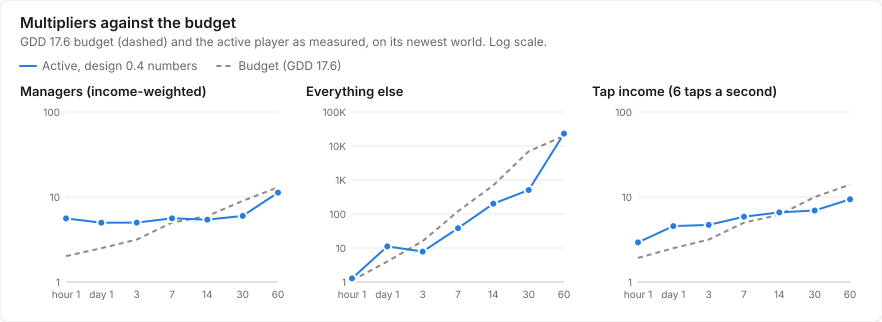

# Balance report: Sprout Tower economy on design 0.4

Written by `pnpm sim` from the simulator's runs (2026-11-28). Do not edit it by hand: change `apps/sim/src/report.ts` or the runs, then run `pnpm sim report`.

Inputs: the GDD and CONTENT of design 0.4 (one fixed manager per floor, the Auto-Gardener rule), as tables in `packages/content/tables`. Three play styles from GDD 17.6 (active, mixed, idle), 60 days each, all six planned worlds, the active and mixed players again for 90 days, plus the four-world launch build. Proposed changes go in `apps/sim/proposals/` as overlays.

**How to run.** From the repository root: `pnpm install`, then `pnpm sim` (every run and this report, about 4 minutes on 4 processors). One player as a printed timeline: `pnpm sim run --profile idle --days 14`. Fit the gate prices again after a design change: `pnpm sim calibrate --out <id> --only <gates>` (writes an overlay to `apps/sim/proposals/`; compare it with `pnpm sim --proposal <id>`).

## The verdict in plain words

**Pacing targets (GDD 17.6).** With design 0.4's numbers 25 of 27 checks are on target. The targets are the GDD 17.6 table with the Game Designer's rulings of 2026-11-26 (first Replant inside day 1 for everyone, active first Replant 30 to 55 minutes, new idle targets, Festival counts as ranges, and after the final run Festivals by day 30 widened to 9 to 12 for active and mixed and idle World 5 to by day 27). A point target counts as met from a third early to half late. 

- Active, design 0.4 numbers: Top floor of Thymeford 20 min against 32 min (1.1 times early).
- Mixed, design 0.4 numbers: World 2 day 2.3 against day 1.4 (1.1 times late).
- Idle, design 0.4 numbers: every gate on target.

**Dead zones.** A dead zone here is more than 30 minutes of open game in which the player buys nothing (time spent saving for a world ticket does not count, and the Auto-Gardener's own purchases do not end a stretch), or two Festivals more than 10 days apart after day 14 (the Game Designer's limit). Design 0.4 numbers: the active player has 33:39 of open game with nothing to buy (day 49.6). Stretches that end with a Replant by the six-hour rule (active player, design 0.4 numbers) would not happen to a player who Replants as soon as nothing is left to buy. These are the 60-day runs, which end before a late Festival gap can close. The 90-day runs break the 10-day limit late on: the active player 11.0 days from day 56.6 and 12.6 days from day 67.6; the mixed player 15.5 days from day 71.7. The Festival rhythm against the designer's shape (gaps of 1 to 3 days to day 10, 3 to 6 to day 30, 5 to 9 after, no jump above about twice the gap before) is under "Dead zones".

- Active, design 0.4 numbers: longest open-game stretch with nothing to buy 33:39 (day 49.6), not counting 36:20 spent saving for a world ticket (day 2.6); 0 of the first 30 days with no progress event; longest gap between Festivals 2.0 days before day 14, 7.0 days after day 14.
- Mixed, design 0.4 numbers: longest open-game stretch with nothing to buy 11:55 (day 17.4); 0 of the first 30 days with no progress event; longest gap between Festivals 1.5 days before day 14, 7.3 days after day 14.
- Idle, design 0.4 numbers: longest open-game stretch with nothing to buy 3:55 (day 53.7); 2 of the first 30 days with no progress event; longest gap between Festivals none before day 14, 6.2 days after day 14.

**Runaway growth.** None. No play style ever grows faster than in its first week, as it should with exponents below 1 (GDD 17.6 note 1). Growth rises again after a slow stretch in one run (Idle, design 0.4 numbers: 2.2 orders of magnitude a week in weeks 3 and 4 against 1.7 in week 2, then 1.1 in weeks 5 to 8.) That is a catch-up as new worlds open, never faster than the run's own week 1. The burst the first audit found (every timed ability held and fired together at 12 taps a second) put the tower at ×675 its steady income under the 0.1 stacking rule, and at most ×39.0 under the 0.2 rule (one Boost capped at 15, Spurt the only multiplier on it). The exploit is gone.

- Active, design 0.4 numbers: all-time Compost grows 8.8 orders of magnitude a week in week 1, 2.8 orders of magnitude a week in week 2, 1.6 orders of magnitude a week in weeks 3 and 4, 0.8 orders of magnitude a week in weeks 5 to 8.
- Mixed, design 0.4 numbers: all-time Compost grows 7.8 orders of magnitude a week in week 1, 3.6 orders of magnitude a week in week 2, 1.7 orders of magnitude a week in weeks 3 and 4, 0.6 orders of magnitude a week in weeks 5 to 8.
- Idle, design 0.4 numbers: all-time Compost grows 5.8 orders of magnitude a week in week 1, 1.7 orders of magnitude a week in week 2, 2.2 orders of magnitude a week in weeks 3 and 4, 1.1 orders of magnitude a week in weeks 5 to 8.

**Longevity.** Days to weeks, yes: the gates are spread over the first three to five weeks for every play style and new things still arrive in week 8. The risk is the other way round: in weeks 5 to 8 all-time Compost grows 0.8 (active), 0.6 (mixed) and 1.1 (idle) orders of magnitude a week, and each Festival needs about 0.6 (four times the Compost, because Ribbons grow with its square root), so after day 30 Festivals come 3.4 to 7.0 days apart (see "Festival rhythm").

- Active, design 0.4 numbers, launch build (4 worlds): level 93 on day 60, 17 Festivals, 5 of them after day 30; progress events in weeks 5 to 8: 49, 45, 48, 43.
- Idle, design 0.4 numbers, six worlds: level 73 on day 60, 14 Festivals, World 6 day 37.7.

## Design 0.4 in the tables

The tables in `packages/content/tables` are design 0.4 (PR #7). The four overlays this simulator proposed for it are now the GDD's own numbers: fewer one-off XP gifts (`XP_DAILY` 1000, `XP_ACHIEVEMENT` 100, 200, 400, 750, 1500), the four Green Thumb tap skills at half strength, the fitted gates (`FIRST_REPLANT_MIN` 440, `RIBBON_C0` 900,000, tickets 3e23, 4.5e23, 1e25, 3e30, 3e35 for Worlds 2 to 6, the World 6 deed at 250 Ribbons), the eight late research projects (48 in all) and one Mastery list per world. The Auto-Gardener rule of CONTENT 8 is in the core, with a switch on every floor that starts on. Story step 35 asks for a Mastery star in two worlds. CHANGES.md part B lists every change and why. No number was refit for this run (CHANGES.md B.6, rule 5).

## Pacing targets: first 10 minutes, first hour, day 1, week 1, month

The GDD gives a minute-by-minute table for a new player's first hour (section 16) and milestones for day 1, week 1 and month 1 (section 17). The simulated new player is the active profile with the beginner model described under "How the simulated players decide".

| Active player | Target | Design 0.4 numbers |
| --- | --- | --- |
| Level at 10 minutes | about 3 to 4 | 4 |
| Floors open at 10 minutes | 7 | 7 |
| Level at 1 hour | 10 to 11 (ruling; GDD 8) | 11 |
| Top floor (floor 10) | 32 min | 20 min |
| First Replant | 30 to 55 min (ruling; GDD 50 to 60) | 38 min |
| Replants by day 1 | 6 to 10 | 11 |
| Level at day 1 | about 23 (ruling; GDD 18) | 22 |
| Level at day 7 | about 40 | 39 |
| Research projects by day 7 | 12 to 15 | 19 |
| Festivals by day 7 | 3 to 4 | 2 |
| Level at day 30 | about 70 | 72 |
| Level at day 60 | cap 112 about month 3 | 95 |

"Ruling": a target the Game Designer moved on 2026-11-26 when accepting the level overlay and the first-Replant rule. The skill tree is now expected at about minute 16.

### The reveal order (GDD section 16, 31 rows)

Measured in game time. Rows 1 to 19 have a target in minutes of the first session, rows 20 to 31 a target day for the active player.

| # | Feature | Target | Active | Mixed | Idle |
| --- | --- | --- | --- | --- | --- |
| 1 | `tap_to_harvest` | 0.1 min | 0.0 min | 0.0 min | 0.0 min |
| 2 | `floor_levels` | 0.2 min | 0.0 min | 0.0 min | 0.0 min |
| 3 | `milestones` | 0.6 min | 0.7 min | 0.8 min | 0.7 min |
| 4 | `more_floors` | 0.7 min | 0.4 min | 0.4 min | 0.4 min |
| 5 | `managers` | 1.5 min | 2.1 min | 2.1 min | 2.7 min |
| 6 | `tap_bonus` | 1.7 min | 2.1 min | 2.1 min | 2.7 min |
| 7 | `quests` | 2.3 min | 3.0 min | 3.2 min | 4.1 min |
| 8 | `plants` | 3.5 min | 4.0 min | 4.4 min | 6.1 min |
| 9 | `bumpers` | 4.0 min | 3.5 min | 3.3 min | 4.6 min |
| 10 | `visitors` | 5.5 min | 5.3 min | 5.7 min | 8.5 min |
| 11 | `abilities` | 11 min | 8.9 min | 9.4 min | 13 min |
| 12 | `spurt` | 13 min | 11 min | 12 min | 5.5 h |
| 13 | `basket` | 15 min | 15 min | 15 min | 15 min |
| 14 | `achievements` | 21 min | 14 min | 18 min | 5.6 h |
| 15 | `skills` | 26 min | 16 min | 18 min | 10.9 h |
| 16 | `offline` | - | 3.2 h | 2.4 h | 5.5 h |
| 17 | `replant` | 50 min | 38 min | 4.4 h | 16.2 h |
| 18 | `research` | 55 min | 38 min | 6.5 h | 16.2 h |
| 19 | `heirlooms` | 90 min | 3.3 h | 14.5 h | day 4.2 |
| 20 | `world2` | day 1.0 | 11.7 h | day 2.3 | day 7.2 |
| 21 | `bees` | day 1.5 | 13.8 h | day 1.2 | day 4.5 |
| 22 | `events` | day 1.5 | 3.2 h | 6.5 h | day 3.5 |
| 23 | `bench` | day 2.0 | day 1.5 | day 2.7 | day 7.5 |
| 24 | `world3` | day 3.0 | day 3.1 | day 5.4 | day 12.5 |
| 25 | `mutation` | day 6.0 | day 10.1 | day 12.0 | day 17.2 |
| 26 | `festival` | day 4.5 | day 4.5 | day 6.6 | day 15.2 |
| 27 | `auto_buy` | day 5.0 | day 4.5 | day 7.1 | day 15.2 |
| 28 | `world4` | day 10.0 | day 7.6 | day 8.7 | day 19.7 |
| 29 | `head_copies` | day 11.0 | day 10.1 | day 12.4 | day 22.2 |
| 30 | `world5` | day 17.0 | day 12.6 | day 14.4 | day 26.2 |
| 31 | `world6` | day 24.0 | day 21.7 | day 22.5 | day 37.7 |

## When each gate arrives

Every unlock, Replant, Festival and world arrival of each run is in `data/timeline-<run>.csv` (one row per event: game time, day, play time, kind, id, world, count).

**Design 0.4 numbers**

| Gate | Active (target) | Mixed (target) | Idle (target) |
| --- | --- | --- | --- |
| Top floor of Thymeford | 20 min (32 min) | 26 min (30 min) | 10.9 h (11.0 h) |
| First Replant | 38 min (30 to 55 min) | 6.5 h (inside day 1) | 16.2 h (inside day 1) |
| World 2 | 11.7 h (12.0 h) | day 2.3 (day 1.4) | day 7.2 (by day 8.0) |
| World 3 | day 3.1 (day 2.6) | day 5.4 (day 4.1) | day 12.5 (by day 13.0) |
| First Harvest Festival | day 4.5 (day 4.1) | day 6.6 (day 5.4) | day 15.2 (by day 16.0) |
| World 4 | day 7.6 (day 6.7) | day 8.7 (day 10.1) | day 19.7 (by day 20.0) |
| World 5 | day 12.6 (day 12.2) | day 14.4 (day 18.1) | day 26.2 (by day 27.0) |
| World 6 | day 21.7 (day 19.5) | day 22.5 (day 30.5) | day 37.7 (day 30 or later) |

## Dead zones

A progress event is a new floor, world, unlock, research project, heirloom, Mastery star, bench job, Replant or Festival. An empty cell is a day on which none of these happened.

| Run | Longest open-game stretch with nothing to buy | The same, counting time spent saving for a world ticket | Longest play time between two reward beats | Days with no progress event (day numbers from 1) | Replants by the six-hour rule |
| --- | --- | --- | --- | --- | --- |
| Active | 33:39 (day 49.6) | 36:20 (day 2.6) | 59:58 (day 33.4) | none | 190 |
| Mixed | 11:55 (day 17.4) | 11:55 (day 17.4) | 12:04 (day 6.6) | none | 186 |
| Idle | 3:55 (day 53.7) | 3:55 (day 53.7) | 4:02 (day 31.7) | 2: 2, 3 | 115 |

### Festival gaps

| Run | Days between Festivals, in order |
| --- | --- |
| Active | 1.7, 1.3, 1.7, 1.3, 1.7, 2.0, 2.2, 2.0, 2.3, 3.4, 5.0, 5.0, 4.4, 4.6, 6.5, 7.0, 3.4 (open) |
| Mixed | 1.1, 1.4, 1.0, 1.5, 1.5, 1.0, 1.5, 1.9, 2.6, 2.5, 4.5, 7.3, 6.8, 6.3, 6.7, 5.9 (open) |
| Idle | 1.4, 2.0, 2.0, 2.0, 2.0, 2.0, 2.6, 2.4, 3.6, 3.4, 3.6, 6.0, 6.2, 5.5 (open) |
| Active, 90 days | 1.7, 1.3, 1.7, 1.3, 1.7, 2.0, 2.2, 2.0, 2.3, 3.4, 5.0, 5.0, 4.4, 4.6, 6.5, 7.0, 11.0, 12.6, 9.9 (open) |
| Mixed, 90 days | 1.1, 1.4, 1.0, 1.5, 1.5, 1.0, 1.5, 1.9, 2.6, 2.5, 4.5, 7.3, 6.8, 6.3, 6.7, 9.3, 8.3, 15.5, 2.8 (open) |

### Festival rhythm

The Game Designer's shape (2026-11-26): first Festival about day 4 for the active player, then gaps of 1 to 3 days up to day 10, 3 to 6 days up to day 30 and 5 to 9 days after, never more than 10, and no gap more than about twice the one before. Listed: every gap that breaks it (a fifth of slack on the ranges).

| Run | Gaps that break the rhythm |
| --- | --- |
| Active | 1.7 days from day 10.5 (wanted 3 to 6); 2.0 days from day 12.1 (wanted 3 to 6); 2.2 days from day 14.1 (wanted 3 to 6); 2.0 days from day 16.4 (wanted 3 to 6); 2.3 days from day 18.4 (wanted 3 to 6) |
| Mixed | 1.5 days from day 10.1 (wanted 3 to 6); 1.5 days from day 11.6 (wanted 3 to 6); 1.0 days from day 13.1 (wanted 3 to 6); 1.5 days from day 14.1 (wanted 3 to 6); 1.9 days from day 15.6 (wanted 3 to 6); 7.3 days from day 27.1 (wanted 3 to 6) |
| Idle | 1.4 days from day 15.2 (wanted 3 to 6); 2.0 days from day 16.7 (wanted 3 to 6); 2.0 days from day 18.7 (wanted 3 to 6); 2.0 days from day 20.7 (wanted 3 to 6); 2.0 days from day 22.7 (wanted 3 to 6); 2.0 days from day 24.7 (wanted 3 to 6); 3.6 days from day 31.7 (wanted 5 to 9); 3.4 days from day 35.2 (wanted 5 to 9); 3.6 days from day 38.7 (wanted 5 to 9) |
| Active, 90 days | 1.7 days from day 10.5 (wanted 3 to 6); 2.0 days from day 12.1 (wanted 3 to 6); 2.2 days from day 14.1 (wanted 3 to 6); 2.0 days from day 16.4 (wanted 3 to 6); 2.3 days from day 18.4 (wanted 3 to 6); 11.0 days from day 56.6, above the 10-day limit; 12.6 days from day 67.6, above the 10-day limit |
| Mixed, 90 days | 1.5 days from day 10.1 (wanted 3 to 6); 1.5 days from day 11.6 (wanted 3 to 6); 1.0 days from day 13.1 (wanted 3 to 6); 1.5 days from day 14.1 (wanted 3 to 6); 1.9 days from day 15.6 (wanted 3 to 6); 7.3 days from day 27.1 (wanted 3 to 6); 15.5 days from day 71.7, above the 10-day limit |

## Runaway growth

Orders of magnitude of all-time Compost gained per week. Falling numbers mean growth slows down, which is what an idle game needs to last.

| Run | Week 1 | Week 2 | Weeks 3 and 4 | Weeks 5 to 8 |
| --- | --- | --- | --- | --- |
| Active | 8.8 | 2.8 | 1.6 | 0.8 |
| Mixed | 7.8 | 3.6 | 1.7 | 0.6 |
| Idle | 5.8 | 1.7 | 2.2 | 1.1 |

### Burst stacking and the tap limit

| Run | Highest tower income over steady income | World 5 | World 6 | Festivals in 10 days | Tap income over steady, day 7, at 6 taps/s | at 12 taps/s |
| --- | --- | --- | --- | --- | --- | --- |
| Every timed ability held and fired together, 12 taps a second, 0.1 stacking rule | ×675 | day 8.6 | not reached | 6 | 4.7 | 9.3 |
| The same player under the 0.2 rule | ×39.0 | not reached | not reached | 5 | 5.2 | 10.4 |
| Active player, 6 taps a second | ×45.0 | day 12.6 | day 21.7 | 4 | 5.9 | 11.7 |
| Active player at the tap limit, 12 taps a second | ×45.0 | day 11.2 | day 17.5 | 4 | 4.7 | 9.3 |

Reviewer note 1 asks for both tap rates with every ability in. On day 60 of the active run, taps pay 9.4 times steady income at 6 taps a second and 18.8 times at 12, before Boost and Growth Spurt. A fully stacked moment multiplies that by at most 60 (Boost cap 15 times a Spurt of 4) for the 20 seconds a Spurt lasts, as GDD 13.5 rule 3 intends. That 20-second peak is not the same measure as the reviewer's 450 to 650, which is average active income over a session; the session averages are in the Boost table under the Game Designer's questions.

## Longevity

| Run | Day 30 | Day 60 | Day 90 | Progress events, days 30 to 60 |
| --- | --- | --- | --- | --- |
| Active, six worlds | level 72, 12 F, 251 R, 35 research, 18 heirlooms | level 95, 17 F, 408 R, 46 research, 18 heirlooms | - | 234 |
| Mixed, six worlds | level 68, 12 F, 228 R, 34 research, 17 heirlooms | level 88, 16 F, 346 R, 46 research, 18 heirlooms | - | 183 |
| Idle, six worlds | level 51, 8 F, 118 R, 29 research, 14 heirlooms | level 73, 14 F, 247 R, 44 research, 15 heirlooms | - | 207 |
| Active, six worlds, 90 days | level 72, 12 F, 251 R, 35 research, 18 heirlooms | level 95, 17 F, 408 R, 46 research, 18 heirlooms | level 111, 19 F, 478 R, 48 research, 18 heirlooms | 234 |
| Mixed, six worlds, 90 days | level 68, 12 F, 228 R, 34 research, 17 heirlooms | level 88, 16 F, 346 R, 46 research, 18 heirlooms | level 100, 19 F, 437 R, 48 research, 18 heirlooms | 183 |
| Active, launch build (4 worlds) | level 71, 12 F, 247 R, 34 research, 16 heirlooms | level 93, 17 F, 389 R, 45 research, 18 heirlooms | - | 211 |
| Idle, launch build (4 worlds) | level 52, 8 F, 122 R, 30 research, 13 heirlooms | level 70, 14 F, 246 R, 44 research, 15 heirlooms | - | 177 |

F: Harvest Festivals held. R: Replants. The launch build stops at World 4, so its late game is Festivals, research, heirlooms and card levels only.

### The Ribbon Shop (GDD 18)

The fixed items are every Ribbon Shop item but the endless Blue Ribbon Polish: 13 items, 3,600 Ribbons in all. All of them are bought on day 24.1 for the active player, day 27.1 for the mixed player, day 38.7 for the idle player. The simulated player buys Golden Hour levels first, then the item with the best payback. Day each item reached its last level:

| Item (Ribbons per level) | Active, 90 days | Mixed, 90 days | Idle, 60 days |
| --- | --- | --- | --- |
| `golden_hour` (3, 10, 40, 150, 600) | 16.4 | 15.6 | 29.2 |
| `auto_gardener` (4) | 4.5 | 7.1 | 15.2 |
| `deed_mitten` (8) | 7.5 | 7.7 | 18.7 |
| `festival_fireworks` (10, 50, 250) | 18.4 | 20.1 | 31.7 |
| `second_desk` (15) | 10.5 | 10.1 | 22.7 |
| `master_composter` (5, 20, 80, 320, 1280) | 24.1 | 27.1 | 38.7 |
| `heirloom_shelf_3` (25) | 14.1 | 13.1 | 24.7 |
| `third_planter` (30) | 14.1 | 14.1 | 26.7 |
| `deluxe_basket` (40) | 14.1 | 14.1 | 26.7 |
| `deed_moon` (60) | 10.5 | 14.1 | 22.7 |
| `auto_replant` (100) | 18.4 | 17.5 | 31.7 |
| `heirloom_shelf_4` (250) | 20.7 | 20.1 | 31.7 |
| `deed_nebula` (250) | 14.1 | 17.5 | 26.7 |
| **All fixed items** | day 24.1 | day 27.1 | day 38.7 |
| Last one bought | `master_composter` | `master_composter` | `master_composter` |

## What each system is worth

The designer's rough pacing script (GDD 17.6) ran on a budget: what managers, taps and "everything else" (skills, plants, card levels, research, heirlooms, achievements, codex, Mastery) multiply income by on each day. **The Game Designer retired this budget as a target on 2026-11-26**: the targets are the gate table and the Festival rhythm. It stays here as a reading aid. The simulator measures the same three numbers on the active player's newest world: the income-weighted manager multiplier, the permanent multiplier on the best floor without Rich Soil and Golden Hour (those are modelled by the script itself), and tap income at 6 taps a second as a multiple of steady income.

| When | Budget: managers / everything else / taps | Active, design 0.4 |
| --- | --- | --- |
| hour 1 | ×2.0 / ×1.1 / ×1.9 | ×5.6 / ×1.3 / ×2.9 |
| day 1 | ×2.5 / ×4.0 / ×2.5 | ×5.0 / ×11.1 / ×4.6 |
| day 3 | ×3.1 / ×16.0 / ×3.1 | ×5.0 / ×7.8 / ×4.7 |
| day 7 | ×5.0 / ×120 / ×5.0 | ×5.6 / ×38.3 / ×5.9 |
| day 14 | ×6.0 / ×700 / ×6.2 | ×5.4 / ×201 / ×6.6 |
| day 30 | ×9.0 / ×7,000 / ×10.0 | ×6.0 / ×507 / ×6.9 |
| day 60 | ×13.0 / ×20,000 / ×14.0 | ×11.3 / ×23,218 / ×9.4 |

### Each system switched off (active player, first 3 days)

Switching off one content system moves World 2 by 12 to 32 percent of play time. The largest is growth spurts (32 percent). No single system carries the early game: most of it comes from what every run has, the fixed managers of the top floors and tapping.

Game time moves in steps of whole sessions (World 2 either arrives in a session or at the start of the next one), so the first column, minutes of play, is the fair comparison.

| Run | World 2, minutes of play | World 2 | World 3 | First Festival | Replants by day 3 | Level on day 3 |
| --- | --- | --- | --- | --- | --- | --- |
| Everything on | 180 min | 11.7 h | day 3.1 | day 4.5 | 17 | 28 |
| Without: Skill tree | 223 min | 16.7 h | not reached | not reached | 17 | 28 |
| Without: Card levels | 221 min | 16.7 h | not reached | not reached | 18 | 26 |
| Without: Plants | 216 min | 16.6 h | not reached | not reached | 17 | 25 |
| Without: Heirlooms | 201 min | 14.2 h | not reached | not reached | 17 | 28 |
| Without: Manager and heirloom abilities | 205 min | 14.2 h | not reached | not reached | 17 | 27 |
| Without: Garden Visitors | 221 min | 16.7 h | not reached | not reached | 17 | 24 |
| Without: Research | 230 min | 16.8 h | not reached | not reached | 16 | 26 |
| Without: Compost Shop items other than Rich Soil | 211 min | 16.5 h | not reached | not reached | 13 | 25 |
| Without: Growth Spurts | 237 min | 16.9 h | not reached | not reached | 16 | 25 |

## The Game Designer's questions for design 0.3, measured on 0.4

### Manager profit on the top floors, days 0 to 2 (CHANGES A.7, item 2)

With one fixed manager per floor the rarest managers sit on the floors that earn most. Measured on the active player's newest world: the median hired manager, the mean of the three highest hired floors, and the income-weighted mean (what managers multiply that world's income by). The Game Designer kept the 0.3 manager numbers in 0.4 and retired the budget column as a target; the gate prices absorb the managers' early strength.

| When | Budget | Active, design 0.4: median / top 3 / weighted |
| --- | --- | --- |
| 10 min | ×2.0 | ×3.0 / ×3.2 / ×3.3 |
| 60 min | ×2.0 | ×4.3 / ×5.6 / ×5.3 |
| 6.0 h | ×2.1 | ×4.3 / ×6.0 / ×5.3 |
| day 1.0 | ×2.5 | ×3.0 / ×4.5 / ×5.0 |
| day 2.0 | ×2.8 | ×3.6 / ×4.5 / ×5.0 |

### Average Boost in each world (CHANGES A.7, item 4)

Time-weighted over every session spent in that world, days 0 to 60. Boost is the sum of timed bonuses on the world on screen (cap 15); the tap column is the Boost the taps see.

| World | Active | Mixed |
| --- | --- | --- |
| Thymeford | ×1.4 (taps ×1.6, Spurt 25%) | ×1.7 (taps ×1.8, Spurt 11%) |
| World 2 | ×1.6 (taps ×1.8, Spurt 40%) | ×2.1 (taps ×2.2, Spurt 21%) |
| World 3 | ×1.6 (taps ×2.1, Spurt 46%) | ×1.7 (taps ×2.0, Spurt 18%) |
| Mount Mitten (World 4) | ×1.7 (taps ×2.1, Spurt 56%) | ×1.8 (taps ×1.9, Spurt 26%) |
| World 5 | ×1.9 (taps ×2.3, Spurt 61%) | ×2.4 (taps ×2.6, Spurt 23%) |
| World 6 | ×1.8 (taps ×2.3, Spurt 65%) | ×2.4 (taps ×2.7, Spurt 34%) |

The script assumes Growth Spurts cover 29 percent of an active session. The measured share is in brackets.

### Where the manager copies go (CHANGES A.7, item 3)

Chest manager slots pick among the managers already met, so early copies pile onto Thymeford. Mean card level of the met managers in each world:

| Run | Thymeford | World 2 | World 3 | Mount Mitten (World 4) | World 5 | World 6 |
| --- | --- | --- | --- | --- | --- | --- |
| Active, design 0.4, day 3 | 4.2 | 2.1 | - | - | - | - |
| Active, design 0.4, day 7 | 4.9 | 3.6 | 3.0 | - | - | - |
| Active, design 0.4, day 14 | 5.4 | 4.3 | 4.3 | 3.0 | 1.4 | - |
| Active, design 0.4, day 30 | 6.1 | 5.6 | 5.3 | 4.6 | 4.1 | 2.7 |
| Active, design 0.4, day 60 | 6.9 | 6.1 | 6.0 | 6.0 | 5.3 | 4.9 |

### Event track and the top chests (reviewer note 4, CHANGES A.7, item 5)

The simulated players play the Garden Fair every weekend, and its chests are in every card and heirloom number of this report.

| Run | Weekends with the track finished | Golden Chests a week (all sources) | Crystal Chests a week | Starlight Chests a week |
| --- | --- | --- | --- | --- |
| Active | 8 of 9 | 5.6 | 2.2 | 0.47 |
| Mixed | 5 of 9 | 4.9 | 2.0 | 0.47 |
| Idle | 0 of 9 | 3.3 | 0.7 | 0.35 |

### Mastery stars (reviewer note 5, GDD 14.5)

Each world has its own ten levels (multiples of 25, GDD 14.5). This simulator picked them for design 0.4 from the crossing data of 90-day runs, so the active player's stars land as near as possible to the designer's days after arrival, with one star on the day of arrival and star 5 (the first Head copy) not before day 8. The picker finds the list with the least squared distance from the windows. The best level of a world rises in steps, once per Festival cycle, so some stars cannot land inside their window and land at the nearest step instead. The same list moves star days by about a day from one run to the next (the Festival days move), so the lists came from the mean of four 90-day active runs, and star 5 was picked at day 9 or later on that mean to keep the first Head copy after day 8.

| World | Design 0.4 (GDD 14.5) |
| --- | --- |
| Thymeford | 25, 325, 350, 400, 475, 525, 625, 675, 725, 800 |
| World 2 | 150, 225, 250, 275, 350, 400, 500, 550, 600, 675 |
| World 3 | 25, 150, 225, 275, 350, 400, 450, 525, 575, 625 |
| Mount Mitten (World 4) | 175, 200, 250, 300, 350, 375, 425, 475, 525, 575 |
| World 5 | 125, 150, 200, 250, 300, 325, 350, 375, 425, 475 |
| World 6 | 100, 150, 175, 200, 225, 250, 300, 325, 375, 400 |

Days after first arriving in the world when each star landed (Thymeford: stars start once World 2 is reached). A dash: not reached in the run.

| Run | Star 1 | Star 2 | Star 3 | Star 4 | Star 5 | Star 6 | Star 7 | Star 8 | Star 9 | Star 10 | In window |
| --- | --- | --- | --- | --- | --- | --- | --- | --- | --- | --- | --- |
| Target | under 1 | 1 to 2 | 3 to 4 | 5 to 6 | 8 to 10 | 12 to 14 | 18 to 22 | 28 to 34 | 40 to 46 | 55 to 65 |  |
| Thymeford, active, 90 days | 0.5 | 4.6 | 4.7 | 5.7 | 10.1 | 13.1 | 22.5 | 32.0 | 40.6 | 60.1 | 6 of 10 |
| Thymeford, mixed, 90 days | 2.3 | 7.2 | 7.2 | 7.6 | 12.4 | 13.7 | 21.7 | 32.7 | 45.4 | 68.2 | 4 of 10 |
| World 2, active, 90 days | 0.8 | 4.2 | 4.9 | 6.1 | 10.6 | 13.0 | 22.6 | 32.2 | 41.1 | 64.8 | 5 of 10 |
| World 2, mixed, 90 days | 1.0 | 5.0 | 5.2 | 6.2 | 10.2 | 11.8 | 20.0 | 35.3 | 47.2 | 74.2 | 2 of 10 |
| World 3, active, 90 days | 0.0 | 2.0 | 3.3 | 5.9 | 10.3 | 14.1 | 19.0 | 33.6 | 43.6 | 58.6 | 8 of 10 |
| World 3, mixed, 90 days | 0.0 | 2.0 | 3.9 | 4.7 | 8.6 | 11.7 | 16.6 | 33.6 | 46.2 | 63.2 | 6 of 10 |
| Mount Mitten (World 4), active, 90 days | 1.0 | 2.0 | 3.8 | 7.6 | 12.0 | 14.5 | 23.6 | 32.8 | 41.5 | 62.1 | 6 of 10 |
| Mount Mitten (World 4), mixed, 90 days | 2.3 | 2.6 | 4.4 | 6.7 | 11.0 | 12.9 | 22.9 | 36.8 | 50.4 | 68.0 | 1 of 10 |
| World 5, active, 90 days | 0.8 | 2.0 | 4.7 | 7.6 | 14.1 | 19.7 | 24.6 | 28.7 | 40.6 | 59.0 | 5 of 10 |
| World 5, mixed, 90 days | 0.2 | 0.8 | 4.2 | 6.7 | 11.7 | 19.1 | 25.7 | 31.7 | 46.0 | 67.6 | 3 of 10 |
| World 6, active, 90 days | 0.4 | 1.7 | 4.9 | 6.9 | 10.9 | 14.4 | 19.5 | 26.0 | 40.6 | 48.4 | 4 of 10 |
| World 6, mixed, 90 days | 1.2 | 1.9 | 6.6 | 8.6 | 15.2 | 17.5 | 26.8 | 30.8 | 55.0 | 62.9 | 3 of 10 |

**For checking the lists.** Days after each world's first arrival when its lowest floor first reached each level (best ever; floors restart at every Festival), from the 90-day runs. Measured at the end of each session, so a value is accurate to a session. A dash: not reached.

| Run | 100 | 150 | 200 | 250 | 300 | 350 | 400 | 450 | 500 | 550 | 600 | 650 | 700 | 750 |
| --- | --- | --- | --- | --- | --- | --- | --- | --- | --- | --- | --- | --- | --- | --- |
| Active, Thymeford | 0.0 | 0.2 | 0.2 | 0.3 | 0.3 | 4.7 | 5.7 | 9.2 | 11.5 | 15.2 | 19.5 | 26.5 | 36.2 | 46.2 |
| Active, World 2 | 0.1 | 0.8 | 0.8 | 4.9 | 6.9 | 10.7 | 13.0 | 17.7 | 22.7 | 32.2 | 41.1 | 55.7 | 71.1 | - |
| Active, World 3 | 0.0 | 2.0 | 2.5 | 4.0 | 7.0 | 10.4 | 14.1 | 19.0 | 28.4 | 38.0 | 48.6 | 69.4 | - | - |
| Active, Mount Mitten (World 4) | 0.0 | 0.6 | 2.0 | 3.8 | 7.6 | 12.0 | 17.8 | 28.6 | 35.6 | 52.9 | 68.0 | - | - | - |
| Active, World 5 | 0.1 | 2.0 | 4.7 | 7.6 | 14.1 | 24.6 | 33.0 | 48.9 | 66.6 | - | - | - | - | - |
| Active, World 6 | 0.4 | 1.7 | 6.9 | 14.4 | 19.6 | 33.8 | 48.4 | - | - | - | - | - | - | - |
| Mixed, Thymeford | 0.1 | 0.6 | 0.6 | 1.5 | 1.5 | 7.2 | 7.6 | 10.1 | 12.7 | 15.1 | 19.1 | 25.1 | 39.1 | 51.2 |
| Mixed, World 2 | 0.1 | 1.0 | 1.0 | 5.2 | 7.3 | 10.2 | 11.8 | 16.2 | 20.0 | 35.3 | 47.2 | 64.8 | 84.4 | - |
| Mixed, World 3 | 0.0 | 2.0 | 3.1 | 4.2 | 6.1 | 8.7 | 11.7 | 16.7 | 26.0 | 40.9 | 53.7 | 77.3 | - | - |
| Mixed, Mount Mitten (World 4) | 0.4 | 1.0 | 2.6 | 4.4 | 6.7 | 11.0 | 15.7 | 30.6 | 41.4 | 58.7 | - | - | - | - |
| Mixed, World 5 | 0.2 | 0.8 | 4.2 | 6.7 | 11.7 | 25.7 | 36.7 | 55.1 | - | - | - | - | - | - |
| Mixed, World 6 | 1.2 | 1.9 | 8.6 | 17.6 | 26.8 | 44.7 | 62.9 | - | - | - | - | - | - | - |

**Do the players keep levelling older worlds?** Yes, all six. Every Festival locks Worlds 2 to 6 again, the player climbs through them to the next ticket, and their best levels keep rising to the end of the run. Thymeford climbs too, because of the Auto-Gardener (CONTENT 8): while floor 1's switch is on, floor 1's manager in every unlocked world works with no fee and stays hired through every Replant and Festival, and a floor that is not open yet opens itself when that costs at most `AUTO_BUY_SHARE` (0.10) of the coins in hand. Thymeford's lowest floor reaches level 858 by day 90 for the active player and 838 for the mixed player (in the trial runs before the rule, it stopped at about 565 in week 2). A side effect: with its floors managed and opening on their own, Thymeford earns all the time, and after day 30 it gives 53% of the active player's Compost (Replants weighed by the Compost they paid). Older worlds feed the Festival rhythm about as much as the newest one, which is why design 0.4's gates and `RIBBON_C0` were refit for the rule (CHANGES.md part B).

### Where the XP comes from

| Run | Level | XP | quests | achievements | milestones | replants | story | chests | visitors | mastery |
| --- | --- | --- | --- | --- | --- | --- | --- | --- | --- | --- |
| Active, design 0.4, 60 min | 11 | 19,450 | 4,000 | 2,300 | 3,200 | 5,400 | 3,550 | 860 | 140 | 0 |
| Active, design 0.4, day 1.0 | 22 | 71,240 | 6,000 | 6,200 | 11,300 | 34,650 | 8,900 | 2,440 | 750 | 1,000 |
| Active, design 0.4, day 7.0 | 39 | 208,295 | 63,000 | 12,100 | 24,000 | 65,250 | 18,400 | 7,160 | 7,385 | 11,000 |

## Design 0.5 checks

### Head crowning (CHANGES C.4)

Design 0.5 (GDD 14.5, EXPANSION 2.2, 2.3 and 3.1 rule 6): at the Harvest Festival after a world's 10th Mastery star, its Head is crowned Godly. That gives the Head one Tier Up step (manager profit ×1.5, perk ×1.25) and the Crown crest, so its perk reaches one step further. Every Head's perk is a world perk, so a crowned Head's perk works in every world. The overlay `c4-head-crowning` switches it on (`HEAD_CROWN_TIERUPS` 1; it is 0 in the 0.4 tables). The check the designer asked for: the crowning must not move the Festival rhythm of GDD 17.5.

| Run | Heads crowned | Festivals the same up to the first crowning | Gaps from the first crowning (days), design 0.4 | The same with the crowning |
| --- | --- | --- | --- | --- |
| Active, 90 days | Worlds 1, 2, 3 on day 67.6; Worlds 4, 5, 6 on day 72.4 | yes | 12.6, 9.9 (open) | 4.8, 8.2, 9.4 (open) |
| Mixed, 90 days | Worlds 1, 3 on day 71.7; Worlds 2, 4, 5, 6 on day 81.4 | yes | 15.5, 2.8 (open) | 9.7, 8.3, 0.3 (open) |

Active player: the first crowning is on day 67.6. After it, the closed gaps between Festivals are 12.6 days without the crowning and 4.8 and 8.2 with it. Mixed player: the first crowning is on day 71.7. After it, the closed gaps between Festivals are 15.5 days without the crowning and 9.7 and 8.3 with it. Weeks 2 to 8 of GDD 17.5 are untouched: the first crowning comes on day 67.6, and every Festival before it is the same. After it, the crowning makes Festivals come faster. Without it, design 0.4's 90-day players have a gap above the 10-day limit after the late research is done. With it, every closed gap after the crowning is between 4 and 10 days, so the crowning brings the late gaps back towards GDD 17.5's "every five to ten days". The gap that ends at the first crowning is the same with and without it, because a Head is crowned at the Festival that closes that gap: 11.0 days from day 56.6 for the active player, 8.3 days from day 63.4 for the mixed player. For the active player that gap is above the 10-day limit, and the crowning cannot shorten it.

## Check against the designer's pacing script

The script in GDD 17.6 plays a perfect player on floors, levels, milestones, hires, taps, Replant, Compost and Rich Soil, with everything else as a budget. With every other system switched off, the simulator's perfect player is the closest match.

| Player | Top floor | First Replant | World 2 |
| --- | --- | --- | --- |
| Script (GDD 17.6), active | 17 min | 36 min | day 0.5 |
| Simulator, perfect player, every other system off | 15 min (15 min of play) | 40 min (40 min of play) | - |
| Simulator, perfect player, everything on | 5.9 min (6 min of play) | 13 min (13 min of play) | 8.5 h (120 min of play) |
| Simulator, new player (active), everything on | 20 min (20 min of play) | 38 min (38 min of play) | 11.7 h (180 min of play) |

On design 0.2 the bare perfect player landed on the script (16:30 to the top floor, 26:25 to the first Replant, in earlier runs). Since design 0.3 the top floor comes a little sooner, because the fixed managers of the top floors start at ×3 to ×5 instead of ×2. Since design 0.4 the first Replant waits for at least 440 Compost (`FIRST_REPLANT_MIN`), so it comes a little later than the script's.

## Reviewer's five notes (re-check of PR #3)

1. **Ceiling sentence in GDD 6.7.** Measured above under "Burst stacking and the tap limit", at both tap rates, with every ability in.
2. **Combo for a mouse-only player.** Not a number the simulator can settle. The simulated player taps without pauses while tapping, and its purchases do not interrupt the Combo (assumption below). A playtest should decide.
3. **Autopilot taps and counted taps.** The simulator follows the ruling: Autopilot taps fill neither Spurt, Combo, Hearth Heat, tap quests nor the `taps` achievement.
4. **Event track every weekend.** Played every weekend; its chests are in all card and heirloom rates (table above). Since design 0.4 the stall's taps use only tap skills and heirloom passives, never cards (GDD 15.3; a note from the audit of PR #6).
5. **Mastery spacing.** Measured above, with the level crossings the designer asked for to set the ten levels.

## Open items

- **Late research (design 0.4, CONTENT 6).** Festival gaps above 10 days after day 14 in the 60-day runs: the active player none, the mixed player none, the idle player none. In the 90-day runs: the active player 11.0 days from day 56.6 and 12.6 days from day 67.6, the mixed player 15.5 days from day 71.7. The 60-day runs end before those gaps close, so the pacing checks do not count them; they are for the Game Designer (GDD 17.6, target 4). The shortest gap after day 30 is 4.4 (active), 6.3 (mixed), 3.4 (idle) days. When the eight late projects finish, active player (90-day run): living soil 1 day 26.1, living soil 2 day 31.4, living soil 3 day 37.1, living soil 4 day 42.1, crop rotation 4 day 46.1, living soil 5 day 48.1, living soil 6 day 54.5, training day 4 day 60.2. Mixed player: living soil 1 day 27.7, living soil 2 day 33.1, living soil 3 day 38.5, living soil 4 day 43.5, crop rotation 4 day 48.1, living soil 5 day 50.1, living soil 6 day 56.7, training day 4 day 63.1. How their costs, Living Soil I's place after Soil Science III and Living Soil's ×1.3 were chosen is in CHANGES.md part B (earlier trial runs of 2026-11-26).
- **The Auto-Gardener (CONTENT 8).** Every floor has a switch, and switches start on. The simulated player turns all of them off while a world ticket is close, so the coins can pile up, and on again once it is bought; it never turns single floors off. No world goes dead after a reset: Thymeford keeps climbing and gives 53% of the active player's Compost after day 30.
- **Accepted by the Game Designer (2026-11-26).** The active player's top floor of Thymeford at 20 min (window from 21 minutes; floor prices were not part of the refit), the mixed player's World 2 on day 2.3 (window to day 2.1; it does not follow the ticket, the mixed player's short sessions set it), the step in the Festival rhythm near day 13, and buying Golden Hour first as the player model. A real player can buy the cheaper Ribbon items first, so the Ribbon Shop could show Golden Hour first or mark it as the best buy (a note for the UI).
- **Numbers are frozen until a playtest (CHANGES.md B.6).** `RIBBON_C0` and the World 4 to 6 tickets were set by hand after the fit (for the late research and the Auto-Gardener), so a later `pnpm sim calibrate` that includes the Festival or World 4 to 6 steps moves them back; refit with `--only` for the gates that move. Design 0.5 (the long game) is fitted next, one system at a time, as an overlay in `apps/sim/proposals/` (EXPANSION.md 15.2).

## Tests

`pnpm test` runs 68 tests (Vitest and fast-check) in about 10 seconds:

- **Big numbers.** Save text round-trips bit for bit at any size; multiply then divide keeps 15 significant digits; integers are exact to 15 digits and within one part in 1e15 past that; comparisons agree with logarithms; a 10,000-level cost curve and 1e(2e12) stay finite; NaN, infinity and junk text are refused.
- **One formatter.** A golden table (1,234, 1.23M, 12.3M, 123M, 1.00Dc, 1.00Ce, 1.00e306, long names, scientific, engineering, durations, multipliers), and properties over a million random sizes: always three significant digits once abbreviated, holdings round down and prices round up, never more than one step in the third digit.
- **Formulas.** Bulk buy equals buying one level at a time; max affordable buys the most the cash covers and no more; Compost and its inverse; Compost and Ribbons never fall as lifetime rises; Compost-record XP; shop prices.
- **Chests.** One fixed manager per floor with the Head on top; manager cards only from managers already met and never a Head; the Starlight Head copy only for a Head with five stars; card counts and guarantees; Legendary pity draws a Legendary, and with no Legendary in the pool leaves the roll as it was; same seed, same chest.
- **Content.** Tables validate; floor tables equal what the template generates; the tables hold design 0.4's numbers (gates, tickets, the late research at 808,900 Insight and 1,354 hours, the Ribbon Shop's fixed items at 3,600 Ribbons); every proposal overlay applies and validates; an overlay can add rows and give a world its own Mastery levels; a typo, a duplicate row or falling Mastery levels are errors.
- **Under play.** A save reads back to the same state and carries on identically; ten one-second ticks equal one ten-second tick; offline pay is proportional to time away up to the cap and stops at the cap; a two-day active soak stays finite and inside the Boost cap. The Auto-Gardener (CONTENT 8): every switch starts on; floor 1 stays hired through a Replant with no fee and the world opens floors on its own; with a world's switches off, a Replanted world with no hired manager stands still; a floor whose switch is off is not levelled while the others are; a save from before the switches reads as every switch on; a switch for a world or floor that does not exist is refused. The fair stall uses tap skills and heirlooms, never cards. The Head crowning (design 0.5, off in 0.4) gives a crowned Head ×1.5 manager profit and a perk ×1.25 that reaches every world, and does nothing while `HEAD_CROWN_TIERUPS` is 0.

One thing the tests found: the big-number library turns a NaN or infinite part into 0 without a word, so the core's NaN guard (`assertFinite`) could never fire for a broken formula. `Num.fromParts` now refuses non-finite parts. Division by zero still gives 0 in the library, so code that divides must check its divisor; a test pins that behaviour down so a library change cannot slip by.

## Assumptions the simulator makes

- **New player.** For the first two minutes 0.3 purchases a second and 30 percent of taps landed, then 0.35 and 35 percent to minute 10, 0.4 and 35 percent to the end of the first hour, then 2 a second and every tap. Fitted to the GDD's first-hour table on the bare game (floor 10 at 29.5 minutes, first Replant at 51 minutes).
- **Abilities.** A manager's ability can be pressed only while its world is on screen and the manager is hired. Leaving a world ends what an ability gave the taps (Combo lock, Liftoff).
- **Tea Party** adds 120 seconds of the world's steady income to the bubbles. **Wake-Up Call** makes the next missed sunrise pay as caught.
- **Auto-Gardener.** The player turns every floor's switch off while a world ticket is close and on again after (never single floors). **Head Start** money is paid on first entry to a new world. Purchases do not interrupt tapping. Autopilot taps are not counted taps.
- **Garden Fair** every weekend, played in the sessions of that weekend.
- **Replant** when pending Compost is at least the era's Compost, or when the run is six hours old and a fifth of the era's Compost is pending (the designer's script; counted as "Replants by the six-hour rule"). **Festival** when pending Ribbons are at least the Ribbons claimed, as in the designer's script.

## How the simulated players decide

- **Schedule (GDD 17.6).** Active: six sessions of 30 minutes a day, the first one 60 minutes. Mixed: eight of 6 minutes, the first 30. Idle: three of 4 minutes, the first 15. Sessions are spread over 16 waking hours; the game is closed in between and offline earnings are paid by the core's own offline code. Game time 0 is 08:00 on a Monday.
- **Buying.** Greedy: the purchase with the lowest wait plus payback time, across floor levels, new floors, hires, Compost Shop, Ribbon Shop, research and the bench. While a world ticket is close the player saves for it.
- **Tapping.** 6 taps a second while a session is open (12 for the tap-limit runs), on the world on screen. Timed abilities are pressed when ready; the burst runs hold them and fire them together.
- **Rules.** The simulator calls the game's own economy code in `packages/core` and reads the tables in `packages/content/tables`, so a number changed in a table changes the simulation. It does not reimplement any formula.
